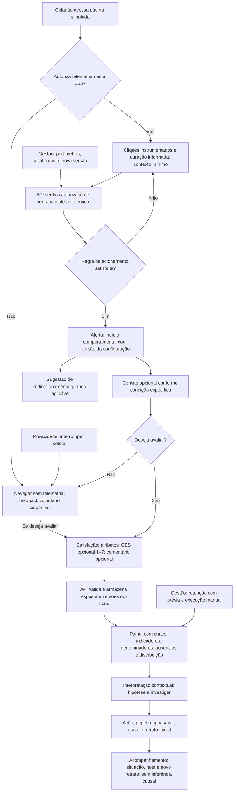

# Fluxo do protótipo atual

Este fluxo descreve a aplicação Python, não as sessões históricas Figma/Useberry. Duração é informada à API, com envio simulado na demonstração; não há cronômetro automático. Indicadores não comprovam dificuldade ou impacto. O painel e os controles têm alcance local.

Requisitos e critérios estão nos Apêndices H–K de [tcc.md](tcc.md). A versão `.tex` deste fluxograma é histórica e não acompanha automaticamente o Markdown; será reconciliada na transposição aprovada ao LaTeX.
