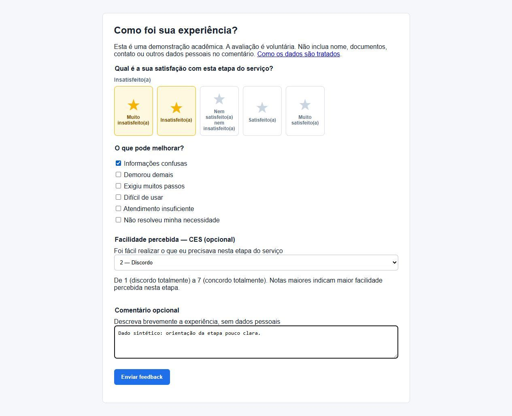
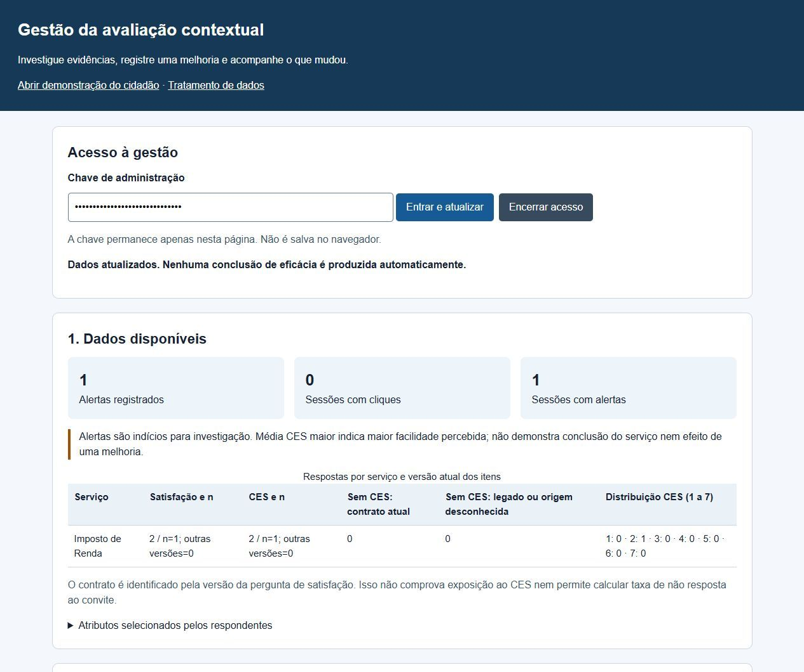

# Avaliação Contextual de Serviços Públicos Digitais

## concepção e desenvolvimento de um sistema baseado em indicadores de navegação e qualidade percebida

**Autores:** Julio Cesar Gomes de Souza Crispim e Fernando Gabriel dos Santos Carrijo.

**Instituição:** Universidade de Brasília — Faculdade de Ciências e Tecnologias em Engenharia — Engenharia de Software.

**Orientador:** Wander Cleber Maria Pereira da Silva.

**Local e ano:** Brasília, DF, 2026.

Monografia submetida ao curso de graduação em Engenharia de Software da Universidade de Brasília como requisito parcial para obtenção do título de Bacharel em Engenharia de Software.

# Ficha catalográfica

[Ficha catalográfica oficial fornecida pelos autores](../latex/pretextuais/ficha-catalografica.pdf).

# Folha de aprovação

Julio Cesar Gomes de Souza Crispim

Fernando Gabriel dos Santos Carrijo

**Avaliação Contextual de Serviços Públicos Digitais: concepção e desenvolvimento de um sistema baseado em indicadores de navegação e qualidade percebida**

Monografia submetida ao curso de graduação em Engenharia de Software da Universidade de Brasília, como requisito parcial para obtenção do Título de Bacharel em Engenharia de Software.

Trabalho submetido à avaliação. Data de aprovação: ____________________.

- Wander Cleber Maria Pereira da Silva — Orientador.
- ____________________ — Convidado 1.
- ____________________ — Convidado 2.

Brasília, DF, 2026.

# Resumo

Este trabalho apresenta a concepção e o desenvolvimento inicial de um sistema de avaliação contextual de serviços públicos digitais. O problema investigado é a dificuldade de relacionar avaliações declaradas pelo cidadão ao contexto de navegação em que são solicitadas. O percurso combinou revisão bibliográfica e normativa, Lean Inception e prototipação incremental, organizados pelas atividades da Design Science Research. Foi implementado um protótipo local em Python, com API, páginas simuladas, regras operacionais sobre cliques e duração informada, formulário de feedback e painel administrativo. A telemetria fornece indícios comportamentais, sem medir qualidade percebida. A versão funcional atual registra satisfação por estrelas, atributos declarados e facilidade percebida por um item CES opcional de 1 a 7. Os itens atuais de satisfação e CES foram definidos após o estudo de interface e ainda não foram avaliados com participantes. Separadamente da implementação funcional, oito participantes avaliaram fluxos de interface no Figma, com registro automático de cliques e tempos pelo Useberry e questionário pós-sessão. Quatro participantes realizaram cada fluxo, com alocação auxiliada por inteligência artificial (IA), descrita como sorteio sem registro auditável, e com popup de redirecionamento presente em ambos. Os resultados descrevem conclusão de tarefa, facilidade percebida e relatos pós-sessão. Não comprovam maior participação, maior especificidade dos comentários do formulário, funcionamento dos gatilhos da API ou superioridade do fluxo contextual. A contribuição investigativa está na formulação de uma hipótese comparativa e na distinção entre evidências comportamentais e declaradas; a contribuição tecnológica está na implementação que permite relacioná-las. Foram especificados requisitos, rastreabilidade, critérios de qualidade e protocolos prospectivos para cidadãos, gestores e especialistas. A continuidade exige executar esses protocolos e calibrar as regras antes de uso real.

**Palavras-chave**: serviços públicos digitais; feedback contextual; avaliação de serviços; experiência do usuário; Design Science Research.

# Abstract

This work presents the design and initial development of a contextual evaluation system for digital public services. The research problem concerns linking citizens' declared evaluations to the navigation context in which feedback is requested. The work combined bibliographic and regulatory review, Lean Inception, and incremental prototyping, organized around the activities of Design Science Research. A local Python prototype was implemented with an API, simulated pages, operational rules based on clicks and reported duration, a feedback form, and an administrative dashboard. Telemetry provides behavioral indications and does not measure perceived quality. The current functional version records star-based satisfaction, declared attributes, and perceived ease through an optional seven-point CES item. The current satisfaction and CES items were specified after the interface study and have not yet been evaluated with participants. Separately from the functional implementation, eight participants evaluated interface flows in Figma, with automatic click and time records collected through Useberry and a post-session questionnaire. Four participants performed each flow, with artificial-intelligence-assisted allocation described as a draw without an auditable record, and with a redirect popup present in both flows. The results describe task completion, perceived ease, and post-session reports. They do not establish greater participation, more specific feedback-form comments, correct API-trigger behavior, or superiority of contextual feedback. The investigative contribution is the comparative hypothesis and the distinction between behavioral and declared evidence; the technological contribution is the implementation that can connect them. Requirements, traceability, quality criteria, and prospective protocols for citizens, managers, and specialists were specified. Further work requires executing these protocols and calibrating the rules before deployment.

**Keywords**: digital public services; contextual feedback; service evaluation; user experience; Design Science Research.

# Lista de ilustrações

- Figura 1 — Página de portal público usada no protótipo
- Figura 2 — Formulário de feedback contextual do protótipo
- Figura 3 — Dados e registro de ação de melhoria no painel

# Lista de quadros

- Quadro 1 — Marcos legais nacionais sobre avaliação de serviços públicos digitais
- Quadro 2 — Posicionamento da proposta em relação a soluções existentes
- Quadro 3 — Rastreabilidade entre construtos, indicadores e dados
- Quadro 4 — Endpoints principais do protótipo
- Quadro 5 — Formas de coleta situada e relação com o protótipo
- Quadro 6 — Análise qualitativa de sensibilidade dos limiares
- Quadro 7 — Regras operacionais de acionamento por possível dificuldade no protótipo
- Quadro 8 — Atributos do feedback e relação com dimensões de qualidade
- Quadro 9 — Decisões de design, benefícios, riscos e mitigações
- Quadro 10 — Critérios da avaliação preliminar do protótipo
- Quadro 11 — Avaliação heurística interna/preliminar do protótipo
- Quadro 12 — Alternativas de design consideradas no MVP
- Quadro 13 — Requisitos funcionais
- Quadro 14 — Requisitos não funcionais
- Quadro 15 — Necessidades, requisitos, componentes e evidências
- Quadro 16 — Casos automatizados identificáveis
- Quadro 17 — Características selecionadas e evidências
- Quadro 18 — Plano de verificação e validação
- Quadro 19 — Critérios de acessibilidade e verificações previstas

# Lista de tabelas

- Tabela 1 — Simulação sintética de sensibilidade dos limiares de clique
- Tabela 2 — Resultados exploratórios por fluxo de avaliação

# Lista de apêndices

- Apêndice A — Síntese da Lean Inception
- Apêndice B — Fluxo Conceitual do sistema de avaliação contextual
- Apêndice C — Endpoints e Indicadores do Protótipo
- Apêndice D — Roteiro de Demonstração Técnica
- Apêndice E — Descrição do TCLE Utilizado
- Apêndice F — Questionário Pós-Sessão
- Apêndice G — Registros Anonimizados da Avaliação com Participantes
- Apêndice H — Especificação e Rastreabilidade do Software
- Apêndice I — Qualidade do Produto e Plano de Verificação e Validação
- Apêndice J — Privacidade e Acessibilidade por Requisitos
- Apêndice K — Protocolos das Três Perspectivas de Avaliação
- Apêndice L — Proveniência e guarda dos registros de concepção

# Abreviaturas e siglas

| Sigla | Significado |
| --- | --- |
| API | Application Programming Interface |
| BRASP | Modelo Brasileiro de Avaliação de Serviços Públicos |
| CEP | Comitê de Ética em Pesquisa |
| CES | Customer Effort Score |
| CSAT | Customer Satisfaction Score |
| CSS | Cascading Style Sheets |
| DSR | Design Science Research |
| E-RecS-QUAL | Electronic Recovery Service Quality |
| E-S-QUAL | Electronic Service Quality |
| ESM | Experience Sampling Method |
| FCTE | Faculdade de Ciências e Tecnologias em Engenharia |
| HTML | HyperText Markup Language |
| HTTP | Hypertext Transfer Protocol |
| IA | Inteligência artificial |
| IEC | International Electrotechnical Commission |
| IPC NSW | Information and Privacy Commission New South Wales |
| IRPF | Imposto sobre a Renda da Pessoa Física |
| ISO | International Organization for Standardization |
| JSON | JavaScript Object Notation |
| LGPD | Lei Geral de Proteção de Dados Pessoais |
| MVP | Minimum Viable Product |
| PPA | Plano Plurianual |
| RF | Requisito funcional |
| RN | Regra de negócio |
| RNF | Requisito não funcional |
| SERVQUAL | Service Quality |
| SQuaRE | Systems and software Quality Requirements and Evaluation |
| TCC | Trabalho de Conclusão de Curso |
| TCLE | Termo de Consentimento Livre e Esclarecido |
| TIC | Tecnologias de Informação e Comunicação |
| TLS | Transport Layer Security |
| UnB | Universidade de Brasília |
| UX | User Experience |
| W3C | World Wide Web Consortium |
| WCAG | Web Content Accessibility Guidelines |

# Sumário

- [1 Introdução](#secao-1-introducao)
  - [1.1 Contextualização](#secao-1-1-contextualizacao)
  - [1.2 Problema de Pesquisa](#secao-1-2-problema-de-pesquisa)
  - [1.3 Objetivo Geral](#secao-1-3-objetivo-geral)
  - [1.4 Objetivos Específicos](#secao-1-4-objetivos-especificos)
  - [1.5 Justificativa](#secao-1-5-justificativa)
  - [1.6 Escopo Inicial](#secao-1-6-escopo-inicial)
- [2 Referencial Teórico](#secao-2-referencial-teorico)
  - [2.1 Serviços e Serviços Públicos](#secao-2-1-servicos-e-servicos-publicos)
    - [2.1.1 Serviço digital, interação e resultado pretendido](#secao-2-1-1-servico-digital-interacao-e-resultado-pretendido)
  - [2.2 Avaliação de Serviços](#secao-2-2-avaliacao-de-servicos)
  - [2.3 Satisfação e Qualidade Percebida](#secao-2-3-satisfacao-e-qualidade-percebida)
  - [2.4 Qualidade de Serviços Eletrônicos e Governo Eletrônico: E-S-QUAL, E-RecS-QUAL e e-GovQual](#secao-2-4-qualidade-de-servicos-eletronicos-e-governo-eletronico-e-s-qual-e-recs-qual-e-e-govqual)
  - [2.5 Avaliação de Serviços Públicos no Brasil](#secao-2-5-avaliacao-de-servicos-publicos-no-brasil)
  - [2.6 BRASP, API de Avaliação e Modelo Unificado](#secao-2-6-brasp-api-de-avaliacao-e-modelo-unificado)
  - [2.7 Usabilidade, Inclusão Digital e Métricas de Experiência](#secao-2-7-usabilidade-inclusao-digital-e-metricas-de-experiencia)
  - [2.8 Experiência do Usuário e Avaliações Inspiradas em Plataformas Digitais](#secao-2-8-experiencia-do-usuario-e-avaliacoes-inspiradas-em-plataformas-digitais)
    - [2.8.1 Posicionamento em relação a soluções existentes](#secao-2-8-1-posicionamento-em-relacao-a-solucoes-existentes)
  - [2.9 Métricas de Navegação e Sinais de Dificuldade](#secao-2-9-metricas-de-navegacao-e-sinais-de-dificuldade)
  - [2.10 Feedback Contextual e Acionamento por Sinais de Uso](#secao-2-10-feedback-contextual-e-acionamento-por-sinais-de-uso)
  - [2.11 Síntese do Referencial](#secao-2-11-sintese-do-referencial)
- [3 Metodologia](#secao-3-metodologia)
  - [3.1 Estratégia de Pesquisa e Fontes](#secao-3-1-estrategia-de-pesquisa-e-fontes)
  - [3.2 Identificação do Problema e Motivação](#secao-3-2-identificacao-do-problema-e-motivacao)
  - [3.3 Objetivos e Requisitos da Solução](#secao-3-3-objetivos-e-requisitos-da-solucao)
    - [3.3.1 Concepção e Delimitação com Lean Inception](#secao-3-3-1-concepcao-e-delimitacao-com-lean-inception)
    - [3.3.2 Atividades de Concepção](#secao-3-3-2-atividades-de-concepcao)
  - [3.4 Design e Desenvolvimento](#secao-3-4-design-e-desenvolvimento)
  - [3.5 Demonstração](#secao-3-5-demonstracao)
  - [3.6 Avaliação](#secao-3-6-avaliacao)
    - [3.6.1 Hipóteses e Critérios da Avaliação Exploratória](#secao-3-6-1-hipoteses-e-criterios-da-avaliacao-exploratoria)
    - [3.6.2 Procedimentos do Estudo Histórico](#secao-3-6-2-procedimentos-do-estudo-historico)
    - [3.6.3 Tratamento e Significado dos Dados](#secao-3-6-3-tratamento-e-significado-dos-dados)
  - [3.7 Comunicação](#secao-3-7-comunicacao)
- [4 Desenvolvimento da Solução](#secao-4-desenvolvimento-da-solucao)
  - [4.1 Visão Geral do Produto](#secao-4-1-visao-geral-do-produto)
  - [4.2 Objetivos do Produto](#secao-4-2-objetivos-do-produto)
  - [4.3 Personas](#secao-4-3-personas)
  - [4.4 Jornadas](#secao-4-4-jornadas)
  - [4.5 Funcionalidades Priorizadas](#secao-4-5-funcionalidades-priorizadas)
  - [4.6 Sequenciamento e Canvas MVP](#secao-4-6-sequenciamento-e-canvas-mvp)
  - [4.7 Arquitetura do Protótipo](#secao-4-7-arquitetura-do-prototipo)
  - [4.8 API e Endpoints](#secao-4-8-api-e-endpoints)
  - [4.9 Regras de Detecção de Possível Dificuldade](#secao-4-9-regras-de-deteccao-de-possivel-dificuldade)
    - [4.9.1 Simulação Sintética dos Limiares](#secao-4-9-1-simulacao-sintetica-dos-limiares)
  - [4.10 Fluxos Implementados](#secao-4-10-fluxos-implementados)
  - [4.11 Painel Administrativo e Indicadores](#secao-4-11-painel-administrativo-e-indicadores)
  - [4.12 Resultado do Desenvolvimento](#secao-4-12-resultado-do-desenvolvimento)
  - [4.13 Avaliação Preliminar do Artefato](#secao-4-13-avaliacao-preliminar-do-artefato)
  - [4.14 Avaliação Exploratória com Participantes](#secao-4-14-avaliacao-exploratoria-com-participantes)
  - [4.15 Síntese Crítica do Desenvolvimento](#secao-4-15-sintese-critica-do-desenvolvimento)
  - [4.16 Alternativas de Design Consideradas](#secao-4-16-alternativas-de-design-consideradas)
  - [4.17 Gestão de Configurações](#secao-4-17-gestao-de-configuracoes)
  - [4.18 Controles de Privacidade e Inclusão](#secao-4-18-controles-de-privacidade-e-inclusao)
  - [4.19 Verificação Técnica da Implementação Atual](#secao-4-19-verificacao-tecnica-da-implementacao-atual)
- [5 Considerações Finais](#secao-5-consideracoes-finais)
  - [5.1 Resultados em Relação aos Objetivos](#secao-5-1-resultados-em-relacao-aos-objetivos)
  - [5.2 Limitações](#secao-5-2-limitacoes)
  - [5.3 Trabalhos Futuros](#secao-5-3-trabalhos-futuros)
  - [5.4 Conclusão](#secao-5-4-conclusao)
- [Referências](#secao-referencias)
- [Apêndice A — Síntese da Lean Inception](#secao-apendice-a-sintese-da-lean-inception)
  - [A.1 Agenda](#secao-a-1-agenda)
  - [A.2 Escopo Delimitado](#secao-a-2-escopo-delimitado)
  - [A.3 MVP](#secao-a-3-mvp)
  - [A.4 Inventário dos registros visuais históricos](#secao-a-4-inventario-dos-registros-visuais-historicos)
- [Apêndice B — Fluxo Conceitual do sistema de avaliação contextual](#secao-apendice-b-fluxo-conceitual-do-sistema-de-avaliacao-contextual)
  - [B.1 Fluxo de navegação](#secao-b-1-fluxo-de-navegacao)
  - [B.2 Detecção e redirecionamento](#secao-b-2-deteccao-e-redirecionamento)
  - [B.3 Feedback e painel](#secao-b-3-feedback-e-painel)
- [Apêndice C — Endpoints e Indicadores do Protótipo](#secao-apendice-c-endpoints-e-indicadores-do-prototipo)
  - [C.1 Endpoints](#secao-c-1-endpoints)
  - [C.2 Indicadores](#secao-c-2-indicadores)
- [Apêndice D — Roteiro de Demonstração Técnica](#secao-apendice-d-roteiro-de-demonstracao-tecnica)
- [Apêndice E — Descrição do TCLE Utilizado](#secao-apendice-e-descricao-do-tcle-utilizado)
  - [E.1 Descrição do TCLE](#secao-e-1-descricao-do-tcle)
- [Apêndice F — Questionário Pós-Sessão](#secao-apendice-f-questionario-pos-sessao)
  - [F.1 Perguntas](#secao-f-1-perguntas)
- [Apêndice G — Registros Anonimizados da Avaliação com Participantes](#secao-apendice-g-registros-anonimizados-da-avaliacao-com-participantes)
  - [G.1 P01 — Fluxo A](#secao-g-1-p01-fluxo-a)
  - [G.2 P02 — Fluxo B](#secao-g-2-p02-fluxo-b)
  - [G.3 P03 — Fluxo A](#secao-g-3-p03-fluxo-a)
  - [G.4 P04 — Fluxo B](#secao-g-4-p04-fluxo-b)
  - [G.5 P05 — Fluxo A](#secao-g-5-p05-fluxo-a)
  - [G.6 P06 — Fluxo B](#secao-g-6-p06-fluxo-b)
  - [G.7 P07 — Fluxo A](#secao-g-7-p07-fluxo-a)
  - [G.8 P08 — Fluxo B](#secao-g-8-p08-fluxo-b)
- [Apêndice H — Especificação e Rastreabilidade do Software](#secao-apendice-h-especificacao-e-rastreabilidade-do-software)
  - [H.1 Requisitos funcionais e critérios de aceitação](#secao-h-1-requisitos-funcionais-e-criterios-de-aceitacao)
  - [H.2 Requisitos não funcionais](#secao-h-2-requisitos-nao-funcionais)
  - [H.3 Regras de negócio](#secao-h-3-regras-de-negocio)
  - [H.4 Histórias de uso](#secao-h-4-historias-de-uso)
  - [H.5 Matriz de rastreabilidade do software](#secao-h-5-matriz-de-rastreabilidade-do-software)
  - [H.6 Catálogo dos testes e evidências](#secao-h-6-catalogo-dos-testes-e-evidencias)
- [Apêndice I — Qualidade do Produto e Plano de Verificação e Validação](#secao-apendice-i-qualidade-do-produto-e-plano-de-verificacao-e-validacao)
  - [I.1 Seleção de características de qualidade](#secao-i-1-selecao-de-caracteristicas-de-qualidade)
  - [I.2 Plano de verificação e validação](#secao-i-2-plano-de-verificacao-e-validacao)
- [Apêndice J — Privacidade e Acessibilidade por Requisitos](#secao-apendice-j-privacidade-e-acessibilidade-por-requisitos)
  - [J.1 Privacidade desde a concepção](#secao-j-1-privacidade-desde-a-concepcao)
  - [J.2 Requisitos e plano de acessibilidade](#secao-j-2-requisitos-e-plano-de-acessibilidade)
- [Apêndice K — Protocolos das Três Perspectivas de Avaliação](#secao-apendice-k-protocolos-das-tres-perspectivas-de-avaliacao)
  - [K.1 Cidadãos: uso, compreensão e comparação](#secao-k-1-cidadaos-uso-compreensao-e-comparacao)
    - [K.1.1 Calibração dos sinais comportamentais — TV10](#secao-k-1-1-calibracao-dos-sinais-comportamentais-tv10)
  - [K.2 Gestores: interpretação, decisão e acompanhamento](#secao-k-2-gestores-interpretacao-decisao-e-acompanhamento)
  - [K.3 Especialistas: inspeção independente](#secao-k-3-especialistas-inspecao-independente)
- [Apêndice L — Proveniência e guarda dos registros de concepção](#secao-apendice-l-proveniencia-e-guarda-dos-registros-de-concepcao)

# 1 Introdução

## 1.1 Contextualização

Nas últimas décadas, a relação entre Estado e cidadão passou por uma mudança estrutural: atividades que antes dependiam de balcões presenciais, deslocamentos e atendimento físico foram progressivamente incorporadas a portais, aplicações e fluxos digitais. A plataforma GOV.BR simboliza esse movimento ao concentrar a oferta digital de serviços federais e ao reforçar a ideia de que governo digital não é apenas troca de canal, mas reorganização da forma como o cidadão encontra, solicita, acompanha e avalia serviços públicos.

Os serviços públicos compõem uma das formas mais diretas dessa relação. Solicitar um documento, consultar uma situação cadastral, acompanhar um benefício, registrar uma demanda ou acessar uma política pública são situações em que a experiência do usuário influencia a qualidade percebida da administração pública. A digitalização ampliou o alcance e a velocidade desses atendimentos, mas também deslocou parte das dificuldades para a própria navegação: localizar o serviço correto, entender a linguagem institucional, preencher etapas intermediárias e perceber se a solicitação realmente avançou.

A escala dessa transição aparece de forma clara em experiências recentes de participação digital. O Plano Plurianual (PPA) Participativo 2024-2027, por exemplo, mobilizou mais de 1,5 milhão de participantes e superou 4 milhões de acessos na plataforma Brasil Participativo, demonstrando a capacidade de mobilização do ambiente digital. Ao mesmo tempo, a experiência registrou barreiras como problemas de conectividade, dificuldade de uso, fluxos de cadastro complexos e necessidade de melhor retorno ao cidadão sobre sua contribuição ([Brasil. Ministério da Gestão e da Inovação em Serviços Públicos, 2024](#ref-brasilMgi2024ppaParticipativo)). Esse contraste reforça a importância de avaliar não apenas se o serviço existe em formato digital, mas como ele é percebido e utilizado durante a jornada.

No Brasil, a avaliação dos serviços públicos possui base legal e gerencial. A Lei no 13.460/2017 trata da participação, proteção e defesa dos usuários de serviços públicos e prevê que os resultados de avaliação subsidiem a reorientação e o ajuste da prestação estatal ([Brasil, 2017b](#ref-brasil2017lei13460)). O Decreto no 9.094/2017 institui a Carta de Serviços ao Usuário e reforça a simplificação do atendimento ([Brasil, 2017a](#ref-brasil2017decreto9094)). A Lei no 14.129/2021 associa governo digital, eficiência pública, desburocratização e participação do cidadão ([Brasil, 2021](#ref-brasil2021lei14129)). Como referência histórica, o Decreto no 11.260/2022 tratou da elaboração da Estratégia Nacional de Governo Digital e da prorrogação da estratégia anterior; foi revogado em 2024 e não é apresentado como norma vigente ([Brasil, 2022](#ref-brasil2022decreto11260)).

A avaliação da experiência digital, porém, não depende apenas de perguntar ao usuário se ele ficou satisfeito ao final do atendimento. Em serviços digitais, excesso de cliques, permanência por tempo acima do esperado, retorno repetido a páginas anteriores e abandono antes da conclusão constituem evidências comportamentais de possível dificuldade. Esses sinais não medem qualidade percebida e não autorizam, isoladamente, concluir que a experiência foi ruim. Quando coletados com finalidade clara e com cuidado em relação à privacidade, eles ajudam a localizar pontos da jornada que devem ser investigados e confrontados com a percepção declarada pelo usuário ([DeLone; McLean, 2003](#ref-deloneMclean2003); [Government Digital Service, 2021a](#ref-govuk2021completionRate); [Brasil, 2018](#ref-brasil2018lgpd)).

A proposta é relacionar evidências comportamentais e declaradas sem tratá-las como equivalentes. A implementação Python registra cliques em elementos instrumentados, página, serviço e informações do evento; recebe também uma duração informada à API, demonstrada por envio simulado de 120 segundos, sem cronômetro automático no cliente. Regras operacionais podem gerar uma sugestão de redirecionamento ou disponibilizar um convite. Estrelas, atributos, CES e comentários permitem examinar julgamentos declarados sobre satisfação, aspectos do serviço, facilidade percebida e contexto qualitativo, respectivamente. Esses indicadores têm interpretações distintas e não formam um escore único de qualidade. O estudo com participantes ocorreu separadamente, em interfaces no Figma, com cliques e tempos registrados automaticamente pelo Useberry.

A proposta adota uma interface curta de avaliação e mantém uma implementação local de registro de eventos e feedback. A visualização administrativa disponível apresenta alertas, contagens por serviço e médias de respostas. O painel apresenta frequência de atributos, sessões distintas alertadas e ações com acompanhamento. Taxa de resposta por fluxo ainda depende de instrumentação A/B e de exposição. A Lean Inception orientou a delimitação do produto e do MVP, cujas funcionalidades foram implementadas parcialmente ([Caroli, 2018](#ref-caroli2018leanInception); [Fowler; Caroli, 2022](#ref-fowler2022leanInception)).

## 1.2 Problema de Pesquisa

A questão investigada é como relacionar a avaliação declarada pelo cidadão ao contexto de navegação em que ela é solicitada. Quando a coleta fica restrita ao final da jornada, pode deixar de registrar detalhes de uma etapa anterior ou de um fluxo interrompido. Essa possibilidade motiva o estudo do momento do convite, sem pressupor que a coleta contextual produza resultados superiores. Indicadores só se tornam úteis à gestão quando seu contexto e suas limitações são considerados ([Government Digital Service, 2021b](#ref-govuk2021usingData); [DeLone; McLean, 2003](#ref-deloneMclean2003)).

Modelos oficiais e instrumentos consolidados de avaliação de serviços públicos contribuem para a mensuração da satisfação e da qualidade percebida. Ainda assim, permanecem desafios relacionados à baixa adesão, ao esforço exigido do usuário e à transformação das respostas em informação acionável para o gestor. Avaliações longas podem reduzir a participação; avaliações curtas podem gerar indicadores pouco explicativos; dados de navegação sem interpretação podem produzir apenas registros técnicos sem valor gerencial. A literatura científica mostra que taxas de resposta variam entre modos de coleta e populações, e que a formulação e o contexto das perguntas influenciam os relatos dos respondentes ([Shih; Fan, 2008](#ref-shihFan2008responseRates); [Lozar Manfreda et al., 2008](#ref-manfreda2008webSurveys); [Schwarz, 1999](#ref-schwarz1999selfReports)). Esses estudos justificam examinar adesão e desenho da coleta, mas não demonstram superioridade do feedback contextual em serviços públicos digitais. O uso dos registros para melhoria também exige interpretação dos dados de desempenho e atenção à relação entre qualidade do sistema, satisfação e benefícios ([Government Digital Service, 2021b](#ref-govuk2021usingData); [DeLone; McLean, 2003](#ref-deloneMclean2003)).

Este trabalho parte da seguinte questão de pesquisa: como propor e prototipar um avaliador de serviços públicos digitais que identifique sinais de possível dificuldade na navegação, colete feedback contextual de baixo esforço e organize informações úteis para a melhoria dos serviços avaliados?

A comparação entre convite contextual e formulário final foi organizada nas hipóteses H1 e H2, formuladas na seção 3.6.1. Elas tratam, respectivamente, de participação e especificidade dos comentários do formulário. Os resultados disponíveis são observações exploratórias de interface e não testam essas hipóteses.

## 1.3 Objetivo Geral

Propor e desenvolver um protótipo inicial de avaliador de serviços públicos digitais capaz de registrar sinais de possível dificuldade na navegação, coletar feedback contextual estruturado, comparar esse fluxo com uma avaliação estática e apresentar indicadores administrativos que apoiem a melhoria contínua dos serviços.

## 1.4 Objetivos Específicos

Para alcançar o objetivo geral, foram definidos os seguintes objetivos específicos:

- levantar fundamentos legais, técnicos e teóricos sobre avaliação de serviços públicos, qualidade percebida, usabilidade, governo digital e Lean Inception;

- definir, por meio de Lean Inception, o fluxo de detecção de possível dificuldade, sugestão de redirecionamento e coleta de feedback;

- construir um protótipo funcional com API, páginas simuladas de serviço público, feedback contextual, formulário estático comparativo e visualização administrativa;

- estruturar os dados e indicadores necessários para apoiar a análise de cliques, tempo de navegação, taxa de resposta, satisfação por estrelas, esforço percebido pelo CES e pontos recorrentes de melhoria.

A estrutura dos objetivos combina a fundamentação legal e técnica da avaliação de serviços públicos com práticas de definição de MVP e prototipação de software ([Brasil, 2017b](#ref-brasil2017lei13460); [Brasil, 2021](#ref-brasil2021lei14129); [Caroli, 2018](#ref-caroli2018leanInception); [Sommerville, 2011](#ref-Sommerville2011)).

## 1.5 Justificativa

Mecanismos digitais de avaliação podem fortalecer a participação do usuário na melhoria dos serviços públicos. Os materiais da Enap destacam que a avaliação centrada no cidadão desloca o foco das ferramentas tecnológicas para as necessidades, demandas e satisfação dos usuários ([Lima; Pereira, 2020a](#ref-limaPereira2020modulo1)). Também indicam que avaliações devem alimentar ciclos de melhoria, permitindo identificar problemas recorrentes, atributos críticos e prioridades de intervenção ([Lima; Pereira, 2020d](#ref-limaPereira2020modulo4)).

A proposta é relevante porque muitos usuários já conhecem avaliações simples por estrelas, motivos e comentários. Uma solução pública pode aproveitar essa familiaridade para reduzir o esforço de resposta, desde que use os dados para finalidades compatíveis com o interesse público. Além disso, a combinação entre eventos de navegação e feedback declarado permite que o gestor observe tanto o que o usuário informou quanto o que ocorreu durante a jornada digital.

Do ponto de vista investigativo, o trabalho formula hipóteses sobre o momento da coleta e distingue indícios comportamentais de percepção declarada. A organização conceitual é explicitada no Quadro [3](#tab:construtos-indicadores-dados), com dados, origem e limites de interpretação; sua validade ainda depende de avaliação empírica. Do ponto de vista tecnológico, a contribuição é a implementação de API, telas, regras explícitas e painel que permitem associar contexto de navegação e relato do cidadão. As configurações possuem versões e histórico local, o que permite inspecionar alterações, sem equivaler a auditoria independente ([DeLone; McLean, 2003](#ref-deloneMclean2003); [Hevner et al., 2004](#ref-hevner2004designscience); [Sommerville, 2011](#ref-Sommerville2011)).

## 1.6 Escopo Inicial

O escopo inicial concentra-se na proposta e prototipação de uma solução. O trabalho não pretende implantar um sistema em ambiente governamental real, nem substituir instrumentos oficiais de avaliação já existentes. A solução é complementar e exploratória: simula páginas de serviço público, registra eventos de navegação, aplica regras configuráveis de acionamento por sinais de possível dificuldade, abre uma coleta simples de feedback, inclui um formulário reutilizável e apresenta dados administrativos agregados. A comparação entre formulário final e convite contextual pertence ao desenho de interface no Figma; a aplicação Python ainda não distingue os grupos nem registra a exposição. Essa delimitação segue a lógica de prototipação como forma de reduzir incertezas antes de uma solução definitiva e mantém cuidado com minimização de dados pessoais ([Sommerville, 2011](#ref-Sommerville2011); [Brasil, 2018](#ref-brasil2018lgpd)).

A avaliação desta etapa reúne procedimentos distintos: inspeção funcional e heurística interna/preliminar relatada pelos autores, e sessões exploratórias de interface com oito participantes no Figma, instrumentadas pelo Useberry. Essas sessões não constituem teste de integração ou execução da API Python. Os resultados são descritivos, sem generalização estatística ou validação em contexto real de prestação de serviço público. Integração com portais governamentais, calibração e estudo comparativo permanecem etapas futuras.

# 2 Referencial Teórico

Avaliar um serviço público digital exige olhar para mais do que a tela final de confirmação. A experiência do cidadão começa quando ele tenta entender onde está o serviço, continua nos caminhos que percorre e termina apenas quando a demanda é resolvida ou abandonada. Por isso, este capítulo reúne os fundamentos que sustentam a proposta do avaliador: conceitos de serviço público, satisfação, qualidade percebida, usabilidade, modelos brasileiros de avaliação e sinais de possível dificuldade observáveis durante a navegação.

O capítulo também parte de uma tradição anterior à digitalização dos serviços: os modelos clássicos de qualidade em serviços. Essa base é importante porque mostra que a percepção do usuário sempre dependeu da comparação entre o que ele esperava receber e o que efetivamente experimentou. No ambiente público digital, essa comparação passa a envolver, além do resultado do serviço, a clareza da informação, a confiança no canal, a facilidade de navegação, o esforço exigido e a capacidade do órgão de responder ao problema identificado ([Grönroos, 1984](#ref-gronroos1984service); [Parasuraman; Zeithaml; Berry, 1988](#ref-parasuraman1988servqual); [DeLone; McLean, 2003](#ref-deloneMclean2003)).

## 2.1 Serviços e Serviços Públicos

Serviços diferenciam-se de produtos porque são mais intangíveis, ocorrem como séries de atividades, envolvem algum grau de interação com o usuário e, em muitos casos, são produzidos e consumidos simultaneamente. Essa característica torna a avaliação de serviços mais dependente da experiência vivida pelo usuário, e não apenas de propriedades observáveis de um bem material ([Grönroos, 1984](#ref-gronroos1984service); [Lima; Pereira, 2020a](#ref-limaPereira2020modulo1)).

No setor público, o serviço é parte do relacionamento entre cidadão e Estado. Ele pode envolver uma entrega individualizada, como a emissão de um documento, ou uma entrega de interesse coletivo, como segurança, educação, saúde e infraestrutura. Por isso, a avaliação de serviços públicos possui uma dimensão adicional: além de medir satisfação ou qualidade, ela se conecta ao exercício da cidadania, à prestação de contas e ao aperfeiçoamento da administração pública ([Brasil, 2017b](#ref-brasil2017lei13460); [Brasil, 2021](#ref-brasil2021lei14129); [Lima; Pereira, 2020a](#ref-limaPereira2020modulo1)).

Com a digitalização, muitos serviços passaram a ser acessados por portais, aplicativos e sistemas integrados. Essa mudança amplia o alcance da prestação pública, mas também cria novas exigências de usabilidade, clareza, confiabilidade e disponibilidade. A usabilidade pode ser entendida como resultado de uso associado à efetividade, eficiência e satisfação em um contexto definido ([International Organization for Standardization, 2018](#ref-iso9241112018)). O usuário não avalia apenas o resultado final do serviço; ele também avalia o caminho percorrido, a linguagem utilizada, o esforço exigido, a facilidade de navegação e a capacidade do canal digital de resolver sua demanda.

### 2.1.1 Serviço digital, interação e resultado pretendido

Neste trabalho, serviço público digital é o arranjo de informações, procedimentos, pessoas, regras e recursos tecnológicos pelo qual o cidadão busca um resultado de interesse público. O portal é um canal desse arranjo. Encontrar uma página ou concluir uma interação não significa necessariamente obter o documento, benefício ou solução pretendida. A orientação institucional de resolver o problema completo do usuário ajuda a delimitar essa diferença ([Government Digital Service, 2026](#ref-govuk2026wholeProblem)).

A avaliação distingue quatro objetos: **qualidade do software**, relativa às propriedades da aplicação e da API; **qualidade da interação**, relativa às condições e resultados do uso da interface; **qualidade percebida do serviço**, relativa ao julgamento declarado sobre aspectos da prestação; e **efetividade do serviço**, relativa ao alcance do resultado pretendido. A primeira é tratada pelo modelo de qualidade de produto ISO/IEC 25010:2023; a usabilidade em contexto considera efetividade, eficiência e satisfação conforme ISO 9241-11; os atributos de serviço e a conclusão real exigem evidências próprias ([International Organization for Standardization e International Electrotechnical Commission, 2023](#ref-iso250102023); [International Organization for Standardization, 2018](#ref-iso9241112018)).

Por exemplo, uma API pode aceitar e armazenar corretamente uma avaliação sem que o cidadão tenha conseguido declarar o imposto. Uma interface pode ser fácil de navegar, mas conduzir à consulta quando a necessidade era declarar. Uma nota favorável não prova que a obrigação foi cumprida. A conclusão de tarefa registrada no Figma é efetividade da tarefa simulada, não entrega de um serviço público real. O avaliador apoia investigação sobre a jornada; não executa nem certifica essa entrega.

## 2.2 Avaliação de Serviços

A avaliação de serviços pode ser entendida como uma investigação qualitativa ou quantitativa sobre a qualidade do serviço e a satisfação do usuário, considerando a relação entre expectativa e experiência concreta ([Lima; Pereira, 2020a](#ref-limaPereira2020modulo1)). Em outras palavras, avaliar um serviço significa observar se a entrega realizada corresponde ao que o usuário precisava, esperava ou considerava adequado. Modelos clássicos de qualidade de serviço indicam que a percepção do usuário é formada por lacunas entre o serviço esperado e o serviço recebido. O modelo de qualidade percebida de [Grönroos (1984)](#ref-gronroos1984service) e o modelo SERVQUAL de [Parasuraman, Zeithaml e Berry (1988)](#ref-parasuraman1988servqual) consolidaram a ideia de que qualidade em serviços depende de fatores como confiabilidade, responsividade, segurança, empatia e aspectos tangíveis. Embora esses modelos tenham origem no setor privado, eles influenciaram diversas iniciativas posteriores de avaliação de serviços públicos e serviços digitais.

No SERVQUAL, essas dimensões aparecem como tangibilidade, confiabilidade, responsividade, garantia e empatia. A contribuição central do modelo é tratar a qualidade percebida como diferença entre expectativa prévia e percepção após a experiência. Para serviços públicos, entretanto, essa leitura exige adaptação: o cidadão geralmente não escolhe entre prestadores concorrentes e muitas vezes depende daquele serviço para exercer um direito, cumprir uma obrigação ou acessar um benefício. Assim, a expectativa não é formada apenas por comparação de mercado, mas também por experiências anteriores com o Estado, comunicação institucional, relatos de outros usuários e, mais recentemente, pela comparação com serviços digitais privados que oferecem interfaces mais rápidas e responsivas ([Parasuraman; Zeithaml; Berry, 1988](#ref-parasuraman1988servqual); [Lima; Pereira, 2020b](#ref-limaPereira2020modulo2)).

Nos serviços digitais, a avaliação passou a incorporar fatores ligados ao uso de sistemas de informação, como qualidade do sistema, qualidade da informação, qualidade do serviço, intenção de uso, satisfação do usuário e benefícios percebidos. Os materiais da Enap destacam que, à medida que cidadãos passaram a interagir com sistemas governamentais digitais, tornou-se necessário adotar modelos capazes de avaliar não apenas páginas ou portais, mas a experiência do usuário ao longo da prestação do serviço ([Lima; Pereira, 2020b](#ref-limaPereira2020modulo2); [DeLone; McLean, 2003](#ref-deloneMclean2003); [Pedrosa et al., 2019](#ref-pedrosa2019qualidadeGovbr)).

## 2.3 Satisfação e Qualidade Percebida

Satisfação e qualidade percebida são conceitos próximos, mas não idênticos. A satisfação costuma expressar um julgamento global do usuário após consumir o serviço, enquanto a qualidade percebida pode ser decomposta em atributos mais específicos da experiência, como rapidez, clareza das informações, atendimento, esforço, confiabilidade e facilidade de uso. Para [Oliver (2014)](#ref-oliver2014satisfaction), a satisfação está relacionada ao julgamento do usuário sobre o grau em que uma experiência atendeu ou não suas expectativas.

No contexto público, a distinção entre satisfação e qualidade percebida é importante porque uma nota geral, sozinha, nem sempre indica o que deve ser melhorado. Um usuário pode avaliar mal um serviço por demora, linguagem confusa, instabilidade do sistema, falta de atendimento ou excesso de etapas. Portanto, um avaliador de serviços públicos precisa combinar uma avaliação simples, como nota ou estrelas, com mecanismos que ajudem a qualificar o motivo da avaliação.

Essa lógica aparece na evolução dos instrumentos brasileiros de avaliação. O BRASP considera a qualidade percebida como um elemento central para compreender a experiência do usuário e apoiar o aprimoramento dos serviços ([Silva et al., 2019](#ref-silva2019brasp)). A proposta de modelo unificado busca integrar qualidade técnica, qualidade percebida, efetividade e satisfação, reduzindo o custo de resposta para o cidadão e tornando os resultados mais úteis para a gestão ([Silva; Menezes, 2022](#ref-silva2022modeloUnificado)).

## 2.4 Qualidade de Serviços Eletrônicos e Governo Eletrônico: E-S-QUAL, E-RecS-QUAL e e-GovQual

A passagem dos modelos gerais para os serviços eletrônicos exige considerar a prestação mediada por sistemas. [Parasuraman, Zeithaml e Malhotra (2005)](#ref-parasuraman2005esqual) desenvolveram E-S-QUAL para sites de compras, com 22 itens e quatro dimensões: eficiência, cumprimento da prestação, disponibilidade do sistema e privacidade. E-RecS-QUAL trata situações não rotineiras e recuperação do serviço, com 11 itens em responsividade, compensação e contato. São escalas distintas; uma avaliação de recuperação pressupõe que tenha ocorrido uma situação pertinente.

A aplicação ao presente artefato é uma decisão de análise, não a aplicação integral dessas escalas. Eficiência motiva examinar caminhos e facilidade declarada; disponibilidade motiva testes técnicos; cumprimento motiva separar navegação de resultado; privacidade motiva requisitos de coleta. Na recuperação, responsividade e contato orientam investigar suporte e retorno ao cidadão. Compensação depende da natureza do serviço e de seu enquadramento institucional; não é inferida dos cliques ou de um comentário.

Os seis atributos do formulário não reproduzem os itens de E-S-QUAL/E-RecS-QUAL nem geram seus escores. O CES é outro indicador, e não uma dimensão substituta dessas escalas. Para serviços públicos, a interpretação precisa considerar direitos, obrigações, continuidade entre canais e ausência de escolha de prestador. Essa delimitação conduz aos modelos brasileiros apresentados nas seções seguintes, preservando a progressão qualidade de serviços → serviços eletrônicos → serviços públicos digitais → BRASP e modelos nacionais.

No domínio governamental, [Papadomichelaki e Mentzas (2012)](#ref-papadomichelaki2012egovqual) desenvolveram e-GovQual para sites públicos nos quais o cidadão procura informação ou serviço. A escala final reúne 21 itens em confiabilidade, eficiência, suporte ao cidadão e confiança. Esse modelo oferece o elo entre qualidade eletrônica e prestação pública digital, sem reduzir a avaliação à transação comercial.

Neste trabalho, e-GovQual orienta examinar a consistência da prestação, a facilidade de acesso à informação, os caminhos de suporte e a confiança na coleta. São relações conceituais de projeto: o formulário não reproduz seus 21 itens, e os seis atributos não geram um escore e-GovQual. A validação relatada por Papadomichelaki e Mentzas não se transfere ao CES adaptado nem a este protótipo. O modelo internacional antecede, nesta progressão, os instrumentos brasileiros e o BRASP discutidos a seguir.

## 2.5 Avaliação de Serviços Públicos no Brasil

A avaliação de serviços públicos no Brasil possui base normativa e base técnica. Do ponto de vista normativo, a Lei no 13.460/2017 estabelece direitos dos usuários e prevê que os resultados de avaliação subsidiem a reorientação dos serviços ([Brasil, 2017b](#ref-brasil2017lei13460)). O Decreto no 9.094/2017 institui a Carta de Serviços ao Usuário e reforça o uso de ferramenta de pesquisa de satisfação no governo federal ([Brasil, 2017a](#ref-brasil2017decreto9094)). A Lei no 14.129/2021 relaciona o governo digital à eficiência pública, à desburocratização e à participação do cidadão ([Brasil, 2021](#ref-brasil2021lei14129)).

A partir desse conjunto normativo, a avaliação deixa de ser apenas uma prática gerencial desejável e passa a compor o próprio modo de prestação dos serviços públicos digitais. A Lei de Acesso à Informação reforça a transparência como base para acompanhamento social; a Lei no 13.460/2017 vincula avaliação à proteção do usuário; a Lei do Governo Digital incorpora canais digitais de participação; e normas infralegais detalham instrumentos de simplificação, monitoramento e avaliação de satisfação. O Quadro [1](#tab:marcos-legais-avaliacao) resume os marcos mais relevantes para este trabalho.

**Quadro 1 — Marcos legais nacionais sobre avaliação de serviços públicos digitais**

| **Instrumento** | **Ano** | **Principais disposições relevantes** |
|:---|:---|:---|
| Lei no 12.527 (LAI) ([Brasil, 2011](#ref-brasil2011lei12527)) | 2011 | Transparência ativa e passiva; base para acesso a informações públicas e dados sobre desempenho de serviços. |
| Lei no 13.460 ([Brasil, 2017b](#ref-brasil2017lei13460)) | 2017 | Direitos do usuário, participação na avaliação dos serviços e uso dos resultados para reorientação da prestação pública. |
| Decreto no 9.094 ([Brasil, 2017a](#ref-brasil2017decreto9094)) | 2017 | Simplificação do atendimento, Carta de Serviços ao Usuário e racionalização de exigências feitas ao cidadão. |
| Lei no 14.129 ([Brasil, 2021](#ref-brasil2021lei14129)) | 2021 | Governo digital, eficiência pública, desburocratização, canais digitais de participação e melhoria da prestação estatal. |
| Decreto no 11.260 ([Brasil, 2022](#ref-brasil2022decreto11260)) | 2022 | Referência histórica sobre elaboração da estratégia e prorrogação da anterior; revogado em 2024, sem caráter de norma vigente neste trabalho. |
| Portaria SGD/ME no 548 ([Brasil. Secretaria de Governo Digital, 2022](#ref-brasil2022portaria548)) | 2022 | Avaliação de satisfação dos usuários e padrões de qualidade para serviços públicos digitais. |

Fonte: elaborada pelos autores com base na legislação federal brasileira.

Do ponto de vista técnico, relatórios produzidos no âmbito da Universidade de Brasília, da Secretaria de Governo Digital e de instituições parceiras apresentam modelos voltados à mensuração da qualidade de serviços públicos digitais. A proposta Qualidade Gov.br organiza a avaliação em dimensões ligadas à consistência digital e à experiência do usuário, reconhecendo que a qualidade de um serviço digital depende tanto dos requisitos técnicos quanto da jornada do cidadão ([Pedrosa et al., 2019](#ref-pedrosa2019qualidadeGovbr)). O BRASP amplia essa discussão ao considerar serviços presenciais, digitizados e parcialmente digitizados ([Silva et al., 2019](#ref-silva2019brasp)).

O avanço desses modelos demonstra que a avaliação pública precisa equilibrar rigor metodológico e simplicidade operacional. Instrumentos longos e complexos podem gerar dados ricos, mas tendem a aumentar o esforço do respondente. Por outro lado, instrumentos muito curtos podem ampliar a adesão, mas produzir dados insuficientes para orientar melhorias. Esse equilíbrio é especialmente relevante para a proposta deste TCC, que busca um avaliador simples para o cidadão e útil para a gestão.

## 2.6 BRASP, API de Avaliação e Modelo Unificado

O Modelo Brasileiro de Avaliação de Serviços Públicos (BRASP) foi desenvolvido para construir e validar instrumentos de avaliação da qualidade adaptados à realidade brasileira. O modelo considera três modalidades de prestação: serviços digitizados, serviços parcialmente digitizados e serviços presenciais ([Silva et al., 2019](#ref-silva2019brasp)). Essa diferenciação é relevante porque a experiência do usuário muda de acordo com o canal. Um serviço presencial pode depender mais de atendimento, espera e estrutura física; um serviço digital pode depender mais de facilidade de uso, clareza, disponibilidade e segurança; e um serviço híbrido pode combinar problemas de ambos os contextos.

Nos materiais da Enap, o modelo brasileiro de avaliação é apresentado como instrumento para identificar fatores relacionados à satisfação do usuário, localizar pontos críticos e gerar comparações capazes de acompanhar a evolução dos serviços. Essa leitura é coerente com o BRASP e com a proposta de modelo unificado, que organizam satisfação, qualidade percebida, qualidade técnica e efetividade como dimensões complementares de análise ([Lima; Pereira, 2020c](#ref-limaPereira2020modulo3); [Silva et al., 2019](#ref-silva2019brasp); [Silva; Menezes, 2022](#ref-silva2022modeloUnificado)). A pesquisa de satisfação aparece ancorada em uma pergunta geral sobre a experiência com o serviço, enquanto a qualidade percebida é investigada por atributos que ajudam a explicar essa experiência.

A API de avaliação do governo brasileiro segue uma lógica semelhante. Segundo o relatório sobre os atributos da API, a satisfação é medida por uma estratégia simples inspirada no CSAT, com resposta por opções associadas a estrelas, e a qualidade percebida é explorada por atributos como clareza das informações, custo ou esforço para obtenção do serviço, disponibilidade, eficácia, facilidade de uso, qualidade dos canais de comunicação e tempo para obtenção do serviço ([Silva, 2024](#ref-silva2024atributosApi)). Essa abordagem se aproxima da proposta deste trabalho, pois combina avaliação rápida com categorização do motivo da nota.

A proposta de modelo unificado reforça essa direção ao articular quatro eixos: qualidade técnica, qualidade percebida, satisfação do usuário e efetividade ([Silva; Menezes, 2022](#ref-silva2022modeloUnificado)). Para um avaliador de serviços públicos, esses eixos podem orientar tanto a coleta quanto a visualização de dados. A satisfação indica o julgamento geral do cidadão; a qualidade percebida explica a experiência por atributos; a qualidade técnica pode apoiar análises de disponibilidade, integração e consistência; e a efetividade aproxima a avaliação da pergunta central: o serviço resolveu a necessidade do usuário?

## 2.7 Usabilidade, Inclusão Digital e Métricas de Experiência

A usabilidade em serviços públicos digitais possui impacto mais amplo do que em produtos privados. Quando uma interface privada é difícil, o usuário pode trocar de fornecedor; quando um serviço público digital é difícil, o cidadão pode perder prazo, deixar de acessar um benefício, não concluir uma obrigação ou depender de atendimento presencial. Por isso, os princípios de usabilidade precisam ser interpretados como parte do acesso efetivo ao serviço. As heurísticas de [Nielsen (1994)](#ref-nielsen1994heuristic), como visibilidade do status do sistema, correspondência entre linguagem da interface e linguagem do usuário, prevenção de erros e ajuda contextual, são diretamente relacionadas aos problemas que o avaliador busca observar durante a navegação.

A representatividade também é um ponto relevante. Serviços públicos atendem usuários com diferentes níveis de letramento digital, conectividade, idade, familiaridade com formulários e capacidade de compreender linguagem institucional. Os dados do PPA Participativo 2024-2027 indicam que participação digital em larga escala pode conviver com barreiras de uso e de retorno ao cidadão ([Brasil. Ministério da Gestão e da Inovação em Serviços Públicos, 2024](#ref-brasilMgi2024ppaParticipativo)). Da mesma forma, pesquisas sobre acesso às tecnologias de informação no Brasil mostram que o uso de serviços digitais ainda depende de condições desiguais de acesso, dispositivos e habilidades ([Comitê Gestor da Internet no Brasil, 2025](#ref-cetic2025ticDomicilios2024)). Para este TCC, isso reforça a necessidade de uma coleta de feedback simples, opcional e de baixo esforço.

O CSAT e o CES abordam julgamentos diferentes. A satisfação expressa a avaliação do cidadão sobre a experiência com a etapa do serviço; o CES aborda a facilidade ou o esforço percebido nessa interação. A proposta usa estrelas como operacionalização local de satisfação, atributos para detalhar aspectos do serviço e um item CES para facilidade percebida. Nenhum deles é obtido diretamente da telemetria. A discussão profissional de [Dixon, Freeman e Toman (2010)](#ref-dixon2010effort) motiva atenção ao esforço, mas sua origem em atendimento comercial não demonstra validade em serviços públicos.

A literatura profissional de [Dixon, Toman e DeLisi (2013)](#ref-dixon2013effortless) desenvolve a abordagem de experiência com menor esforço no atendimento comercial. Para a formulação por concordância, a apresentação de [Dixon (2016, slide 72)](#ref-dixon2016ces) mostra o CES 2.0 com afirmação sobre facilidade para lidar com uma questão. Esse material primário distingue a formulação posterior da referência de 2010, que não é utilizada para atribuir origem à redação ou à escala adotadas aqui. A conferência visual desse slide identifica seis opções visíveis, não sete; ele fundamenta a formulação por concordância, não o número de categorias adotado neste projeto. A frase em português, o recorte por etapa e as sete categorias são decisões de adaptação deste projeto, ainda sem validação com cidadãos.

O CES adotado usa a afirmação “Foi fácil realizar o que eu precisava nesta etapa do serviço”, com sete categorias: 1 — discordo totalmente; 2 — discordo; 3 — discordo parcialmente; 4 — nem concordo nem discordo; 5 — concordo parcialmente; 6 — concordo; 7 — concordo totalmente. A resposta é opcional. Notas maiores significam maior facilidade declarada e, nessa orientação, menor esforço percebido. Não se inverte o resultado nem se combina essa escala com medidas de outra orientação. Trata-se de adaptação ao contexto deste protótipo, não de uma tradução validada. A documentação de [SurveyMonkey (2026)](#ref-surveymonkey2026ces) é utilizada como apoio comercial complementar à descrição operacional, sem importar alegações comerciais de desempenho ou pontos de corte.

A média CES descritiva é a soma das respostas válidas dividida pelo número de respostas válidas, com apresentação conjunta da distribuição nas sete categorias e do denominador. Ausência de resposta fica nula, nunca zero; na ausência de respostas, a média fica indisponível. A média resume uma escala ordinal por convenção descritiva do protótipo e não comprova intervalos equivalentes entre categorias. Não se adotam faixas universais de “bom” ou “ruim” nem um escore geral resultante da soma de estrelas, atributos, CES e telemetria.

O item se refere à etapa vivenciada até o convite, inclusive quando a tarefa não foi concluída. A expressão “realizar o que eu precisava” pode, porém, ser interpretada como tarefa já concluída; o piloto de compreensão deverá verificar esse risco antes de manter a redação em convite intermediário. Portanto, facilidade declarada não comprova entrega do resultado pretendido pelo cidadão. O momento da coleta pode influenciar recordação e interpretação. Resultados sobre avaliação retrospectiva motivam investigar esse efeito, sem demonstrar a vantagem do acionamento neste cenário ([Kahneman et al., 1993](#ref-kahneman1993peakEnd)). O esforço para preencher o próprio formulário é outra variável e requer medida específica.

## 2.8 Experiência do Usuário e Avaliações Inspiradas em Plataformas Digitais

Plataformas digitais privadas popularizaram formas de avaliação de baixo esforço: nota de uma a cinco estrelas, comentários curtos, seleção de motivos e visualização agregada das avaliações. A referência a aplicações como plataformas de entrega deve ser entendida como inspiração de interação, e não como modelo de governança. Em uma plataforma privada, a avaliação frequentemente orienta reputação, consumo e concorrência. Em serviços públicos, ela deve orientar direitos, transparência, participação social e melhoria da entrega estatal.

Mesmo com essa diferença, a familiaridade do usuário com mecanismos simples de avaliação pode ser aproveitada. Um avaliador de serviços públicos pode reduzir barreiras de participação se oferecer uma interface direta, com poucos passos e linguagem compreensível. A nota geral permite captar a percepção imediata; os atributos permitem interpretar os motivos; e comentários opcionais podem revelar problemas não previstos pelo formulário. Essa escolha está alinhada ao design centrado no usuário, que orienta o desenvolvimento de sistemas interativos a partir das necessidades, capacidades e limitações das pessoas que irão utilizá-los ([International Organization for Standardization, 2019](#ref-iso92412102019)).

Para que a avaliação seja útil ao gestor, o sistema também precisa organizar os dados coletados. Isso envolve agrupar avaliações por serviço, período, órgão, canal e atributo; identificar itens recorrentes; apresentar médias e distribuições; e permitir comparação temporal. A literatura de melhoria de serviços reforça que as avaliações devem alimentar ciclos de melhoria contínua, funcionando como linha de base para decisões e como indicador para acompanhar a evolução do serviço ([Lima; Pereira, 2020d](#ref-limaPereira2020modulo4); [Government Digital Service, 2021b](#ref-govuk2021usingData); [Brasil, 2026](#ref-govbrFerramentaAvaliacao)).

### 2.8.1 Posicionamento em relação a soluções existentes

Embora o protótipo dialogue com ferramentas existentes de avaliação e análise de experiência, sua contribuição não está em substituí-las nem em afirmar superioridade. A contribuição está em combinar, em um MVP com regras explícitas e voltado a serviços públicos, sinais simples de possível dificuldade durante a navegação, coleta contextual por formulário curto e organização administrativa dos dados por serviço e atributo.

A ferramenta oficial de avaliação do gov.br constitui uma referência institucional para medir satisfação em serviços públicos digitais. Ferramentas comerciais como Hotjar e Microsoft Clarity oferecem funcionalidades de analytics comportamental, mapas de calor, gravações de sessão e feedback. Suas páginas de documentação são utilizadas neste trabalho somente para caracterização tecnológica das funcionalidades declaradas, e não como evidência científica de eficácia ou adequação ao setor público ([Brasil, 2026](#ref-govbrFerramentaAvaliacao); [Hotjar, 2026](#ref-hotjar2026); [Microsoft, 2026](#ref-microsoftClarity2026)). O Government Digital Service, por sua vez, é uma fonte institucional e metodológica sobre uso de dados de desempenho na melhoria de serviços digitais ([Government Digital Service, 2021b](#ref-govuk2021usingData)).

O Quadro [2](#tab:posicionamento-solucoes) sintetiza esse posicionamento.

**Quadro 2 — Posicionamento da proposta em relação a soluções existentes**

| **Solução** | **Foco principal** | **Contribuição** | **Limite em relação a este TCC** |
|:---|:---|:---|:---|
| Ferramenta de avaliação do gov.br | Avaliação institucional de satisfação | Padronização oficial no governo digital brasileiro | Não enfatiza, no escopo analisado, gatilhos baseados em cliques e tempo durante a jornada. |
| Hotjar | Analytics comportamental, mapas de calor, gravações e feedback | Observação de comportamento em sites | Documentação comercial; requer adaptação à governança pública e à minimização de dados. |
| Microsoft Clarity | Análise de sessões, mapas de calor e navegação | Observabilidade detalhada de páginas web | Documentação comercial; não constitui modelo de avaliação de serviço público. |
| GDS UK | Medição e melhoria de serviços digitais | Referência metodológica institucional para uso de dados | Contexto institucional distinto e sem equivalência direta ao protótipo. |
| Artefato deste TCC | Implementação local Python e interfaces de avaliação no Figma | Implementação parcial de eventos, feedback e painel; observações exploratórias de interface | Inspeção interna da implementação e avaliação de interface Figma/Useberry são procedimentos distintos. O estudo com participantes não verifica a API nem valida o serviço em contexto real. |

Fonte: elaborada pelos autores (2026).

A comparação é documental e de posicionamento: baseia-se nas funcionalidades declaradas pelas fontes institucionais e comerciais, sem teste independente ou auditoria técnica das soluções. Assim, delimita a lacuna explorada pelo trabalho sem transformar documentação de ferramentas em evidência científica.

## 2.9 Métricas de Navegação e Sinais de Dificuldade

Além do feedback declarado pelo usuário, serviços digitais podem ser avaliados por sinais observados durante a jornada. A taxa de conclusão, por exemplo, mede a proporção de transações iniciadas que chegam ao ponto definido como conclusão do serviço; sua leitura depende de identificar início, etapas intermediárias, abandono e término do fluxo ([Government Digital Service, 2021a](#ref-govuk2021completionRate)). Métricas de tempo, cliques, páginas visitadas e retorno a etapas anteriores também podem indicar dificuldade quando comparadas a faixas esperadas.

O uso dessas métricas aproxima a avaliação de serviços públicos da avaliação de sistemas de informação. O modelo de sucesso de sistemas de informação de [DeLone e McLean (2003)](#ref-deloneMclean2003) relaciona qualidade do sistema, qualidade da informação, qualidade do serviço, uso, satisfação do usuário e benefícios líquidos. Para a solução proposta, cliques, tempo e sequência de navegação são evidências comportamentais de possível esforço ou dificuldade. Eles não medem qualidade percebida. Estrelas, atributos e comentários constituem evidências declaradas sobre a experiência. O CES é autorrelato de facilidade percebida, e não uma transformação da quantidade de cliques ou do tempo. A contribuição analítica está em relacionar essas fontes sem fundi-las: a telemetria localiza o contexto e o feedback permite interpretar a percepção.

O registro de eventos de navegação exige cuidado metodológico e jurídico. A coleta deve ser limitada ao necessário para a finalidade de melhoria do serviço, com uso de identificador técnico e minimização dos campos registrados, sem presumir anonimização. A Lei Geral de Proteção de Dados Pessoais estabelece princípios para o tratamento de dados, inclusive em meios digitais, com objetivo de proteger liberdade, privacidade e desenvolvimento da personalidade da pessoa natural ([Brasil, 2018](#ref-brasil2018lgpd)). Por isso, a proposta deste TCC considera o registro de cliques e tempo como mecanismo de análise agregada, não como instrumento de vigilância individual.

## 2.10 Feedback Contextual e Acionamento por Sinais de Uso

O feedback contextual busca aproximar a coleta declarada do ponto da jornada em que uma experiência ocorre. Essa proposta dialoga com o Experience Sampling Method (ESM), desenvolvido para coletar autorrelatos durante a vida cotidiana ([Larson; Csikszentmihalyi, 1983](#ref-larson1983experienceSampling); [Hektner; Schmidt; Csikszentmihalyi, 2007](#ref-hektner2007experienceSampling)). No presente trabalho, essa relação é conceitual: o convite acionado por um evento de navegação não representa, por si só, a aplicação integral de um protocolo de ESM.

A proximidade temporal pode reduzir a dependência de recordações retrospectivas e permitir investigar relatos mais situados. Estudos sobre avaliação retrospectiva mostram que o desfecho pode influenciar o julgamento de uma experiência ([Kahneman et al., 1993](#ref-kahneman1993peakEnd)); esse resultado não comprova que perguntar durante uma dificuldade de navegação produza respostas melhores. A formulação, as opções de resposta e o contexto da pergunta também influenciam o autorrelato ([Schwarz, 1999](#ref-schwarz1999selfReports)).

A eventual vantagem de obter um comentário mais específico precisa ser confrontada com o custo da interrupção. O estudo de [Mark, Gudith e Klocke (2008)](#ref-mark2008interruptedWork) identificou maior estresse associado a interrupções em tarefas de trabalho. Esse achado oferece um motivo para investigar a intrusão do convite, sem estabelecer seu efeito no cenário deste TCC. Por isso, a pergunta contextual deve ser curta e opcional, e sua adequação precisa ser avaliada pelos usuários.

No protótipo deste TCC, os gatilhos comportamentais foram reduzidos a regras simples e explícitas: excesso de cliques, tempo acima da faixa esperada e persistência do sinal após a sugestão de redirecionamento. Esses sinais não substituem a percepção do usuário, mas indicam quando faz sentido solicitar uma avaliação de baixo esforço. A escolha por regras explícitas preserva a rastreabilidade do MVP e evita que a solução dependa de modelos estatísticos complexos antes de haver dados reais suficientes para calibração.

Esse tipo de coleta também precisa respeitar a carga cognitiva do cidadão. Questionários longos ou tecnicamente ambíguos aumentam esforço, erro e abandono. A Teoria da Carga Cognitiva indica que a memória de trabalho humana possui capacidade limitada; portanto, interfaces de feedback devem usar linguagem direta, poucas perguntas, opções de resposta claras e campos textuais opcionais ([Sweller, 1988](#ref-sweller1988cognitiveLoad)). O formulário atual reúne satisfação por estrelas, atributos, CES opcional e comentário opcional. Essa decisão de projeto não demonstra esforço reduzido ou utilidade dos dados, propriedades que dependem de avaliação específica.

## 2.11 Síntese do Referencial

O referencial teórico indica que a proposta de um avaliador de serviços públicos deve considerar quatro princípios. O primeiro é a centralidade do cidadão: a avaliação precisa capturar a experiência real do usuário, e não apenas métricas internas da administração. O segundo é a decomposição da avaliação em atributos: uma nota geral é útil, mas precisa ser acompanhada de critérios que expliquem o motivo da satisfação ou insatisfação. O terceiro é a orientação para melhoria: os dados coletados devem ser estruturados para apoiar decisões de gestão e acompanhar a evolução dos serviços. O quarto é a contextualidade como hipótese de desenho: investigar se aproximar a pergunta de um sinal de possível dificuldade altera a participação e o conteúdo das respostas, sem presumir que essa aproximação produza evidências melhores.

Com base nesses princípios, este TCC propõe um avaliador inspirado em interfaces simples de plataformas digitais, mas fundamentado em modelos de avaliação de serviços públicos, usabilidade, design centrado no usuário e sucesso de sistemas de informação. A solução deve permitir que o usuário avalie um serviço de forma rápida e compreensível, enquanto eventos de navegação e resultados agregados oferecem ao gestor indícios sobre quais aspectos do serviço precisam de priorização e aperfeiçoamento.

# 3 Metodologia

Este capítulo organiza o percurso pela DSR, distinguindo atividades executadas, documentação formalizada posteriormente e avaliações ainda planejadas. O artefato técnico atual e as interfaces históricas do Figma são componentes relacionados, com bases de evidência separadas.

## 3.1 Estratégia de Pesquisa e Fontes

A pesquisa é aplicada e exploratória: propõe uma solução computacional para relacionar contexto de navegação e avaliação declarada em serviços públicos digitais. O artefato possui dois componentes: uma implementação funcional local em Python, com API, páginas, formulário e painel; e um protótipo de interface no Figma, com os fluxos A e B usados no estudo com participantes. A implementação recebeu inspeção interna funcional e heurística. As interfaces no Figma receberam avaliação exploratória de usabilidade, instrumentada pelo Useberry. Nenhum desses procedimentos constitui validação em contexto real de prestação de serviço público.

A estratégia de pesquisa adotada é Design Science Research (DSR), com o artefato como meio de investigar o problema. A organização segue identificação do problema, objetivos da solução, design e desenvolvimento, demonstração, avaliação e comunicação ([Hevner et al., 2004](#ref-hevner2004designscience); [Peffers et al., 2007](#ref-peffers2007dsrm)). A Lean Inception é uma técnica da etapa de concepção do MVP, e a prototipação incremental é uma prática de desenvolvimento. Não são apresentadas como metodologias científicas paralelas.

A formalização de requisitos, rastreabilidade e plano de avaliação ocorreu após a construção inicial e o estudo exploratório de 28 de junho de 2026. A DSR organiza a consolidação e a continuidade iterativa; não se afirma que todos os seus produtos foram definidos prospectivamente antes daquela coleta. Demonstração técnica, testes automatizados locais, inspeção heurística interna e observação de interfaces têm alcances diferentes. A avaliação externa e a validação em serviço público real permanecem não executadas.

As fontes foram diferenciadas por natureza e finalidade. Artigos e livros acadêmicos fundamentam conceitos e questões de pesquisa; normas oferecem definições e critérios; legislação caracteriza o enquadramento normativo; relatórios técnicos e materiais institucionais descrevem modelos e práticas de governo digital. Os módulos da Enap são material didático institucional. Caroli, Fowler e Caroli, Cooper e Kalbach são usados como literatura profissional de concepção e projeto; Dixon, Freeman e Toman contextualizam o esforço em serviços como literatura profissional, sem validar o instrumento adaptado para serviços públicos. Hotjar, Microsoft Clarity, Useberry e SurveyMonkey são documentação comercial, limitada à descrição de funcionalidades declaradas e instrumentos utilizados. A classificação das fontes é apresentada a seguir; a presença de uma fonte não comprova a eficácia do mecanismo proposto.

- **Legislação:** [Brasil, 2011](#ref-brasil2011lei12527); [Brasil, 2017a](#ref-brasil2017decreto9094); [Brasil, 2017b](#ref-brasil2017lei13460); [Brasil, 2018](#ref-brasil2018lgpd); [Brasil, 2021](#ref-brasil2021lei14129); [Brasil, 2022](#ref-brasil2022decreto11260); [Brasil. Secretaria de Governo Digital, 2022](#ref-brasil2022portaria548).

- **Documentação ou pesquisa institucional:** [Brasil, 2026](#ref-govbrFerramentaAvaliacao); [Brasil. Ministério da Gestão e da Inovação em Serviços Públicos, 2024](#ref-brasilMgi2024ppaParticipativo); [Comitê Gestor da Internet no Brasil, 2025](#ref-cetic2025ticDomicilios2024); [Government Digital Service, 2021a](#ref-govuk2021completionRate); [Government Digital Service, 2021b](#ref-govuk2021usingData); [Government Digital Service, 2026](#ref-govuk2026wholeProblem); [Information and Privacy Commission NSW, 2020](#ref-ipc2020privacy); [Cavoukian, 2011](#ref-cavoukian2011pbd).

- **Literatura profissional:** [Caroli, 2018](#ref-caroli2018leanInception); [Cooper, 1999](#ref-cooper1999inmates); [Fowler; Caroli, 2022](#ref-fowler2022leanInception); [Kalbach, 2016](#ref-kalbach2016mapping); [Dixon; Freeman; Toman, 2010](#ref-dixon2010effort); [Dixon; Toman; DeLisi, 2013](#ref-dixon2013effortless); [Dixon, 2016](#ref-dixon2016ces).

- **Literatura acadêmica/científica:** [DeLone; McLean, 2003](#ref-deloneMclean2003); [Grönroos, 1984](#ref-gronroos1984service); [Hektner; Schmidt; Csikszentmihalyi, 2007](#ref-hektner2007experienceSampling); [Hevner et al., 2004](#ref-hevner2004designscience); [Kahneman et al., 1993](#ref-kahneman1993peakEnd); [Larson; Csikszentmihalyi, 1983](#ref-larson1983experienceSampling); [Lozar Manfreda et al., 2008](#ref-manfreda2008webSurveys); [Mark; Gudith; Klocke, 2008](#ref-mark2008interruptedWork); [Nielsen, 1994](#ref-nielsen1994heuristic); [Oliver, 2014](#ref-oliver2014satisfaction); [Parasuraman; Zeithaml; Berry, 1988](#ref-parasuraman1988servqual); [Schwarz, 1999](#ref-schwarz1999selfReports); [Shih; Fan, 2008](#ref-shihFan2008responseRates); [Sommerville, 2011](#ref-Sommerville2011); [Sweller, 1988](#ref-sweller1988cognitiveLoad); [Parasuraman; Zeithaml; Malhotra, 2005](#ref-parasuraman2005esqual); [Peffers et al., 2007](#ref-peffers2007dsrm); [Papadomichelaki; Mentzas, 2012](#ref-papadomichelaki2012egovqual).

- **Documentação comercial:** [Hotjar, 2026](#ref-hotjar2026); [Microsoft, 2026](#ref-microsoftClarity2026); [Useberry, c2026](#ref-useberryFigma); [SurveyMonkey, 2026](#ref-surveymonkey2026ces).

- **Normas técnicas:** [International Organization for Standardization, 2018](#ref-iso9241112018); [International Organization for Standardization, 2019](#ref-iso92412102019); [International Organization for Standardization e International Electrotechnical Commission, 2023](#ref-iso250102023); [World Wide Web Consortium, 2024](#ref-wcag22).

- **Material didático institucional:** [Lima; Pereira, 2020a](#ref-limaPereira2020modulo1); [Lima; Pereira, 2020b](#ref-limaPereira2020modulo2); [Lima; Pereira, 2020c](#ref-limaPereira2020modulo3); [Lima; Pereira, 2020d](#ref-limaPereira2020modulo4).

- **Relatório técnico institucional:** [Pedrosa et al., 2019](#ref-pedrosa2019qualidadeGovbr); [Silva, 2024](#ref-silva2024atributosApi); [Silva et al., 2019](#ref-silva2019brasp); [Silva; Menezes, 2022](#ref-silva2022modeloUnificado).

As fontes acrescentadas nesta consolidação incluem o artigo de E-S-QUAL/E-RecS-QUAL, o método DSRM e o artigo de Fawcett sobre matriz de confusão como literatura científica; ISO/IEC 25010:2023 e WCAG 2.2 como referências normativas de qualidade e acessibilidade; e o material sobre Privacy by Design como orientação institucional de projeto ([Parasuraman; Zeithaml; Malhotra, 2005](#ref-parasuraman2005esqual); [Peffers et al., 2007](#ref-peffers2007dsrm); [Fawcett, 2006](#ref-fawcett2006roc); [International Organization for Standardization e International Electrotechnical Commission, 2023](#ref-iso250102023); [World Wide Web Consortium, 2024](#ref-wcag22); [Information and Privacy Commission NSW, 2020](#ref-ipc2020privacy)). O guia de serviço completo do GDS é documentação institucional. Essa classificação não transfere validade de um contexto de aplicação para outro.

## 3.2 Identificação do Problema e Motivação

O problema é a dificuldade de relacionar julgamentos declarados ao contexto de navegação em que são solicitados. Derivam-se cinco necessidades de projeto: **N01**, avaliar a etapa com linguagem e esforço de resposta compatíveis com o cidadão; **N02**, registrar contexto sem equipará-lo à percepção; **N03**, transformar evidências em hipóteses de melhoria acompanháveis; **N04**, gerir regras e dados de forma controlada; e **N05**, verificar o software e planejar avaliação independente. São necessidades de projeto derivadas do problema e da discussão de concepção, não resultados de nova elicitação com gestores externos.

## 3.3 Objetivos e Requisitos da Solução

Os objetivos da seção 1.4 são desdobrados em requisitos funcionais, não funcionais, regras de negócio, histórias de usuário e critérios de aceitação no Apêndice H. A matriz de Engenharia de Software liga N01–N05 a esses requisitos, componentes e evidências. Ela difere da rastreabilidade conceitual entre construtos e dados: a primeira organiza construção e verificação; a segunda delimita o significado das medidas.

### 3.3.1 Concepção e Delimitação com Lean Inception

A Lean Inception foi utilizada como técnica de concepção para alinhar visão de produto, escopo e MVP. A abordagem de [Caroli (2018)](#ref-caroli2018leanInception) auxilia equipes a definir o produto certo antes de ampliar o desenvolvimento; [Fowler e Caroli (2022)](#ref-fowler2022leanInception) também a descrevem como uma inception focada em compreender funcionalidades, clientes e Canvas MVP. Neste trabalho, a técnica organizou a definição do sistema de avaliação contextual e ajudou a transformar a ideia inicial em um conjunto priorizado de funcionalidades.

O tema inicial foi organizado pelo orientador em dois recortes. Este trabalho, desenvolvido por Julio Cesar Gomes de Souza Crispim e Fernando Gabriel dos Santos Carrijo, aborda avaliação contextual de serviços públicos digitais, indicadores de navegação, CSAT, CES e modelos de qualidade percebida. O outro recorte é desenvolvido por Wesley Pedrosa dos Santos.

As atividades de concepção parcialmente compartilhadas abrangeram o alinhamento do problema, a visão do produto, a dinâmica É / Não É / Faz / Não Faz e o levantamento e a priorização iniciais das funcionalidades e do MVP. Wesley participou apenas de parte dessas atividades, não de toda a Lean Inception nem da discussão das quatro perspectivas apresentada a seguir.

Os registros visuais históricos tiveram elaboração visual de Fernando Gabriel dos Santos Carrijo; seu conteúdo resultou dessas atividades parcialmente compartilhadas, com contribuições de Julio e Fernando e participação parcial de Wesley. Os originais permanecem no acervo digital de concepção, separado deste manuscrito, cuja proveniência está descrita no Apêndice L.

As quatro perspectivas foram associadas às contribuições dos participantes, sem lhes atribuir vínculo institucional ou condição de especialista independente:

- **Felipe:** atendimento público; dúvidas e dificuldades dos cidadãos;
- **Lucas:** gestão digital; indicadores para priorizar melhorias;
- **Diassis:** estudante da UnB; viabilidade técnica, escopo, segurança e LGPD;
- **Bruno:** estudante da UnB; experiência, jornada, interface e validação.

Lucas, participante da discussão, e Lucas Almeida, persona fictícia da seção 4.3, são referências distintas. A participação parcial de Wesley nas atividades compartilhadas é registrada como colaboração de concepção; este manuscrito tem como autores Julio e Fernando. Essa colaboração não constitui avaliação independente. A dinâmica foi uma atividade de alinhamento interno e não substitui especificação de requisitos, teste de usabilidade ou avaliação por especialistas.

### 3.3.2 Atividades de Concepção

A agenda da Lean Inception foi organizada para que as funcionalidades surgissem a partir da jornada do usuário, e não apenas de possibilidades técnicas. As etapas executadas foram:

1.  **Kick-off**: alinhamento do problema, da hipótese e dos limites do MVP;

2.  **É / Não É / Faz / Não Faz**: delimitação do produto como solução de feedback contextual, não como ouvidoria, chatbot, ferramenta de identificação individual ou sistema governamental completo;

3.  **Objetivos do Produto**: definição de objetivos como capturar sinais de possível dificuldade, solicitar feedback no momento adequado, preservar privacidade e gerar dados acionáveis;

4.  **Personas**: definição de Carlos Pereira, cidadão usuário de serviço público digital, e Lucas Almeida, gestor público de serviço digital;

5.  **Jornadas**: comparação entre um fluxo com formulário estático ao final e um fluxo com feedback contextual durante a dificuldade;

6.  **Brainstorming de features**: levantamento de funcionalidades relacionadas a coleta de sinais, regras, feedback, painel e integração;

7.  **Revisão técnica, de negócio e UX**: avaliação relativa de esforço, valor para gestão e impacto na experiência do usuário;

8.  **Sequenciador**: organização das funcionalidades em ondas de entrega;

9.  **Canvas MVP**: consolidação da menor versão viável para validação inicial.

A construção de personas foi baseada na tradição de design centrado no usuário. [Cooper (1999)](#ref-cooper1999inmates) apresenta personas como arquétipos usados para orientar decisões de produto. O mapeamento de jornada seguiu a lógica de visualização de experiências discutida por [Kalbach (2016)](#ref-kalbach2016mapping), com identificação de pontos de contato, fricções e oportunidades de intervenção. As personas também consideraram o cenário brasileiro de uso de tecnologias digitais, descrito pela TIC Domicílios 2024 ([Comitê Gestor da Internet no Brasil, 2025](#ref-cetic2025ticDomicilios2024)), e a existência de mecanismos oficiais de avaliação de serviços públicos digitais ([Brasil, 2026](#ref-govbrFerramentaAvaliacao)).

## 3.4 Design e Desenvolvimento

O desenvolvimento adotou prototipação incremental, com a finalidade de explorar decisões de solução e reduzir incertezas ([Sommerville, 2011](#ref-Sommerville2011)). A Lean Inception foi conduzida entre 18 e 27 de junho de 2026; a avaliação das interfaces no Figma ocorreu em 28 de junho de 2026. A existência de uma implementação funcional em Python antes das sessões não significa que ela tenha sido usada pelos participantes. Não se atribuem os resultados do Figma à API.

O sequenciador de concepção organizou cinco ondas:

1. **Onda 1 — Base técnica e desenho comparativo:** identificador de sessão, eventos e planejamento dos formulários contextual e final.
2. **Onda 2 — Regras e feedback:** condições de acionamento, sugestão de redirecionamento e formulário.
3. **Onda 3 — Painel básico:** agregações de eventos e respostas e planejamento de indicadores comparativos.
4. **Onda 4 — Incrementos de gestão:** parâmetros por serviço, filtros e apresentação de comentários.
5. **Onda 5 — Preparação de integração real:** organizações, autenticação, chave de API e cliente instalável.

As ondas 1 a 3 constituíram o MVP planejado, mas foram implementadas apenas em parte. Na aplicação Python existem identificadores técnicos, captura de cliques em elementos instrumentados, envio de duração simulada, regras, formulário reutilizável e agregações básicas. Não foram implementados cronômetro automático de navegação, registro dos grupos A/B, exposição ao convite, ranking por alertas ou taxa de resposta por fluxo. A comparação de interfaces foi realizada no Figma. Parâmetros por serviço, originalmente previstos como incremento da onda 4, agora possuem edição, persistência e histórico versionado; filtros temporais e comentários recentes continuam pendentes. Foram acrescentados controles locais de coleta, acesso e retenção, além de ações de melhoria com acompanhamento. O sequenciador expressa o planejamento, não uma lista de entregas integralmente executadas.

A implementação foi posteriormente atualizada para incorporar CES opcional de 1 a 7. Essa versão é posterior às sessões de 28 de junho de 2026. A atualização do formulário e dos indicadores não acrescenta medidas à coleta histórica nem permite atribuir CES aos participantes já avaliados.

## 3.5 Demonstração

A demonstração técnica usa páginas simuladas, requisições HTTP, SQLite e um painel local. Dados sintéticos permitem observar uma condição operacional, o convite, a persistência de uma resposta, a edição de configurações e o registro de ações de melhoria. Executar esse encadeamento demonstra funções disponíveis no ambiente local, sem provar benefício ao cidadão ou capacidade de integração governamental. Os testes da implementação atual são descritos na seção 4.19.

O estudo histórico utilizou Figma e Useberry. Sua demonstração de interfaces e seus oito registros não são demonstração de endpoints ou da persistência da API. A nova implementação de CES, configuração e gestão não foi retroativamente avaliada naquela amostra.

## 3.6 Avaliação

A avaliação distingue **verificação**, que confronta software e critérios de aceitação, de **validação**, que investiga se a solução atende ao problema e às necessidades dos interessados. Os testes automatizados locais oferecem evidências parciais de verificação; não validam os construtos, a utilidade do painel ou a hipótese comparativa. O Apêndice I seleciona características de qualidade e apresenta o plano de verificação e validação. O Apêndice K separa protocolos de cidadãos, gestores e especialistas.

### 3.6.1 Hipóteses e Critérios da Avaliação Exploratória

A comparação entre feedback contextual e formulário final constitui hipótese para o TCC 2. H1: o convite contextual produz maior taxa de resposta que o formulário apresentado somente ao final. H2: o convite contextual produz comentários mais específicos sobre a etapa vivenciada. Antes da coleta, serão definidas as variáveis dependentes: taxas de resposta e de conclusão, esforço percebido, qualidade/especificidade do comentário, interrupção provocada e adequação do momento da pergunta. A avaliação atual não testou essas hipóteses; denominadores, codificação e critérios de análise serão fixados no protocolo do TCC 2.

As variáveis previstas têm diferentes condições de observação nesta etapa:

- **Realização da avaliação:** considerou-se resposta, no fluxo A, quando o participante realizou a avaliação apresentada ao final da jornada e, no fluxo B, quando aceitou o convite e realizou a avaliação. Abrir o convite, sem realizar a avaliação, não corresponde a esse critério. Essa classificação não comprova envio de dados à API nem digitação de comentário. A exposição ao formulário final não foi discriminada para cada participante do A; as proporções por participante e por exposição devem permanecer distintas.
- **Conclusão da tarefa:** há classificação Sim/Parcial/Não; o resumo considera somente Sim como conclusão completa. Isso explicita o cálculo descritivo e não representa critério prévio de sucesso documentado.
- **Esforço percebido:** não foi medido por instrumento específico no estudo histórico; a nota de facilidade do Apêndice F não corresponde ao CES. A versão posterior do protótipo dispõe do item CES especificado na seção 2.7, ainda sem nova coleta com participantes.
- **Qualidade/especificidade dos comentários do formulário:** não há corpus separado nem rubrica aplicada. Os comentários do Apêndice G são do questionário pós-sessão e não permitem testar H2.
- **Interrupção e abandono associados ao convite:** há relatos pontuais de ignorar o convite; não há medida capaz de atribuir causalidade ao popup ou ao feedback.
- **Adequação do momento:** existem relatos pontuais, mas o conjunto de dados apresentado não inclui a série completa de respostas à pergunta correspondente do questionário.

H1 e H2 são as hipóteses comparativas principais. Conclusão da tarefa, esforço, interrupção e adequação do momento são variáveis secundárias previstas para caracterizar benefícios e custos da intervenção; nesta etapa, sua observação foi incompleta. H2 compara somente comentários de quem respondeu ao formulário. Essa seleção pode diferir entre os grupos e produzir viés; um estudo futuro deverá relatar a ausência de respostas e a composição dos respondentes, sem generalizar os escores para todos os participantes.

Tempo e cliques são medidas auxiliares. A tarefa no Figma foi instrumentada pelo Useberry, enquanto as regras da API constituem outra fonte de evidência, relativa à implementação. O planejamento de instrumentos e critérios comparativos deve preceder nova coleta.

Para a inspeção interna do artefato foram organizados sete critérios, retomados pelos mesmos identificadores no Quadro [10](#tab:criterios-avaliacao-preliminar):

1. **C1 — Registro mínimo de navegação:** existência de sessão técnica e estruturas para registrar eventos, com explicitação dos limites de captura do cliente de demonstração.
2. **C2 — Acionamento contextual:** correspondência entre parâmetros por serviço e ações previstas no código, sem interpretar acionamento como dificuldade confirmada.
3. **C3 — Esforço de resposta:** presença de formulário curto como decisão de projeto; esforço efetivamente percebido deve ser tratado como não medido nesta coleta.
4. **C4 — Apresentação para gestão:** existência de agregações e alertas; utilidade e acionabilidade dependem de avaliação com gestores.
5. **C5 — Inspeção das regras:** configuração por serviço com versão, justificativa e histórico; o encadeamento é verificado localmente, sem auditoria independente ou calibração científica.
6. **C6 — Privacidade:** exame dos campos e das limitações de transparência, retenção e acesso, sem concluir conformidade jurídica.
7. **C7 — Interrupção:** possibilidade de ignorar o convite e limitar o popup; efeito sobre abandono ou irritação depende de mensuração posterior.

A apresentação dos resultados como exploratórios é uma regra de interpretação comum a todos os critérios, sem afirmação de superioridade ou generalização.

### 3.6.2 Procedimentos do Estudo Histórico

O relato distingue três procedimentos: verificação funcional interna da implementação; **avaliação heurística interna/preliminar**, conduzida pelos autores; e teste exploratório de usabilidade no Figma com oito cidadãos, que não corresponde à verificação de API. Para o TCC 2, planeja-se avaliação heurística externa por especialistas, separada do teste de usabilidade com cidadãos. Essa avaliação externa ainda não foi executada.

A avaliação exploratória de interface ocorreu em 28 de junho de 2026, com oito participantes externos ao grupo de desenvolvimento, quatro em cada fluxo. A alocação entre os grupos foi auxiliada por inteligência artificial e descrita como sorteio, sem registro auditável do mecanismo. Não se assume aleatorização verificável. O Figma foi instrumentado pelo Useberry para registro automático de cliques e tempos. O fluxo A previa formulário final e o B convite contextual; o popup de redirecionamento fez parte de ambos. A tarefa consistiu em localizar e iniciar a declaração do Imposto sobre a Renda da Pessoa Física (IRPF) de 2026, com limite de dez minutos. As sessões foram individuais e moderadas, sob coordenação de Julio Cesar Gomes de Souza Crispim e Fernando Gabriel dos Santos Carrijo, com TCLE que mencionava o Useberry e o registro de interações. A gravação se limitou à tela e aos eventos de interação, sem áudio ou vídeo de câmera dos participantes. Os comentários apresentados no Apêndice G provêm do questionário pós-sessão. O convite no fluxo B podia decorrer de tempo, entrada em tela ou clique no Figma. No fluxo A, resposta significa realizar a avaliação no formulário final; no B, aceitar o convite e realizar a avaliação sobre a experiência, não apenas abrir o convite. Os valores temporais, as telas e as interações específicas não estão discriminados neste protocolo. Esse procedimento permite observação formativa de interface, sem estabelecer funcionamento dos gatilhos do backend ou efeitos causais entre fluxos.

### 3.6.3 Tratamento e Significado dos Dados

A implementação organiza dois grupos de dados: eventos de interação, com contexto de sessão, página, serviço, clique e duração informada; e respostas declaradas, com satisfação por estrelas, atributos, CES opcional e comentário opcional. Eventos indicam contexto e possível esforço, sem medir qualidade percebida. Estrelas registram satisfação; atributos descrevem aspectos percebidos; CES registra facilidade percebida em uma etapa. A adequação dessa adaptação ao público-alvo ainda precisa ser avaliada. A base do estudo de interface é distinta: cliques e tempos registrados no Useberry, classificações de tarefa e respostas ao questionário pós-sessão, transcritos no Apêndice G. Não foi apresentado um conjunto separado de respostas do formulário que permita comparar seus comentários, estrelas e atributos.

A implementação oferece sessões distintas com cliques ou alertas, frequências de atributos e agregações separadas por versão de item. A coleta de eventos requer autorização local; o formulário pode ser respondido sem telemetria. O contrato atual rejeita identificador de usuário, URL completa e coordenadas. Registros históricos e cópias não são automaticamente anonimizados. O identificador técnico permite associar eventos e relatos, exigindo controle de acesso e retenção. Os requisitos e limites estão no Apêndice J ([Brasil, 2018](#ref-brasil2018lgpd)).

**Quadro 3 — Rastreabilidade entre construtos, indicadores e dados**

| Construto ou dimensão | Indicador e interpretação | Dado e origem | Situação e limite da evidência |
| --- | --- | --- | --- |
| Satisfação com a etapa | Resposta por estrelas de 1 a 5, de muito insatisfeito(a) a muito satisfeito(a); média acompanhada de n. | `feedbacks.stars` e `stars_item_version` na API atual. | Coleta implementada; não há corpus apresentado do formulário no estudo Figma. O item atual explicita satisfação; notas históricas de avaliação geral permanecem preservadas com versão desconhecida e não entram nessa média. Não há validação psicométrica nem medida de qualidade global. |
| Qualidade percebida do serviço | Seleção de atributos sobre clareza, tempo, passos, uso, atendimento e necessidade atendida. | `feedbacks.traits_json`, categorias opcionais. | Coleta e frequência por atributo implementadas no painel. Ausência de seleção não demonstra ausência de problema; nenhum escore composto foi validado. |
| Esforço percebido na etapa | CES adaptado: concordância de 1 a 7 com a afirmação de facilidade; maior nota indica maior facilidade percebida. | `feedbacks.ces` e `ces_item_version`; resposta opcional, nula quando ausente. | Implementado após as oito sessões. Sem CES empírico nessa amostra e sem validação da redação adaptada. Distribuição, n e média descritiva disponíveis na API; não mede esforço de preenchimento do formulário. |
| Interação observada, como aproximação de esforço comportamental | Contagem de cliques instrumentados e duração; indícios para investigar possível atrito, sem diagnóstico. | API: `click_events` e `page_time_events`; duração demonstrada por envio simulado. Estudo: cliques e tempos automáticos do Useberry. | Bases distintas. Apenas elementos marcados geram cliques na aplicação; não há cronômetro automático no cliente Python. Limiares sem calibração e risco de falsos positivos/negativos. Não mede percepção. |
| Efetividade da tarefa observada | Classificação de conclusão completa, parcial ou não conclusão; proporção de conclusão completa. | Registro Sim/Parcial/Não do Apêndice G, no Figma/Useberry, conforme síntese do estudo. | Há oito casos; “Parcial” não foi contado como completo. Critério prévio de sucesso não está documentado. Conclusão simulada não demonstra entrega efetiva de um serviço público real; API não registra conclusão. |
| Evidência qualitativa da experiência | Comentário sobre situação e motivo; análise temática ou rubrica de especificidade exigiria protocolo. | `feedbacks.comment` opcional na implementação; separadamente, comentários pós-sessão do Apêndice G. | Comentário é evidência qualitativa, não construto latente. Os relatos pós-sessão não são comentários do formulário e não sustentam comparação de especificidade entre os fluxos. |

Fonte: elaboração dos autores com base no modelo de dados, no instrumento atual e nos registros da avaliação exploratória (2026).

A tabela explicita o significado pretendido, o dado observável e sua disponibilidade. Não demonstra validade de construto, equivalência entre fontes ou causalidade. O sistema relaciona as evidências por contexto técnico de sessão e serviço quando disponíveis, sem somá-las em uma pontuação única. O estudo Figma/Useberry continua separado da base da API.

## 3.7 Comunicação

Os registros históricos de concepção e as evidências técnicas já publicadas estão disponíveis no [repositório do projeto](https://github.com/Juliovskys/latex-tcc), no registro permanente `d24af5d8ccfa088c7857983fe4d24b08af5337b0`. O [acervo de concepção](https://github.com/Juliovskys/latex-tcc/tree/d24af5d8ccfa088c7857983fe4d24b08af5337b0/latex/figuras/apendices) e as [evidências da execução automatizada](https://github.com/Juliovskys/latex-tcc/tree/d24af5d8ccfa088c7857983fe4d24b08af5337b0/docs/evidencias) podem ser consultados nessa versão. O registro da execução técnica identifica como commit-base `935050f9ea7ffa443a1742ec956776762d756090`; os hashes nele registrados identificam os arquivos efetivamente testados. Esses localizadores se referem ao acervo e à evidência técnica existente, não a uma nova avaliação empírica.

A comunicação reúne o manuscrito, os artefatos de requisitos/rastreabilidade, os protocolos, o código e seus testes. As capturas da implementação atual identificam a versão e seu caráter demonstrativo. Os registros históricos do estudo permanecem separados da atualização técnica. A publicação de resultados de usuários, gestores ou especialistas exige executar e documentar os respectivos protocolos; o planejamento não é relatado como resultado.

# 4 Desenvolvimento da Solução

Este capítulo apresenta o desenvolvimento do sistema de avaliação contextual a partir dos artefatos da Lean Inception e da implementação do protótipo. O desenvolvimento foi orientado pela hipótese de que o feedback contextual, acionado próximo a um sinal de possível dificuldade, pode ampliar a participação e produzir evidências declaradas mais específicas do que uma avaliação estática exibida apenas ao final da jornada. A avaliação exploratória desta etapa não é suficiente para confirmar essa hipótese.

## 4.1 Visão Geral do Produto

O sistema de avaliação contextual foi definido como uma solução de feedback contextual para serviços públicos digitais. A solução registra eventos de navegação permitidos, identifica sinais de possível dificuldade, solicita feedback por meio de um formulário curto e apresenta indicadores agregados para apoio à decisão do gestor.

A visão do produto reúne cidadãos que precisam realizar uma tarefa e gestores que precisam interpretar sinais de uso. O sistema propõe relacionar o contexto da navegação a declarações curtas de satisfação, atributos e facilidade percebida, para orientar investigação e melhoria do serviço. Os benefícios de participação e utilidade permanecem hipóteses de avaliação.

As sínteses desta seção apresentam a concepção do produto e sua delimitação atual. Os registros visuais históricos tiveram elaboração visual de Fernando Gabriel dos Santos Carrijo e conteúdo resultante das atividades parcialmente compartilhadas descritas na seção 3.3.1. Os originais permanecem no acervo digital de concepção, separado deste manuscrito. O escopo de coleta foi atualizado após o estudo de interface; não se atribui essa atualização à execução histórica da dinâmica. As capacidades implementadas são discriminadas nas seções 3.4 e 4.7 a 4.19; os registros históricos estão inventariados no Apêndice A e sua proveniência está descrita no Apêndice L.

A dinâmica É / Não É / Faz / Não Faz delimitou o escopo inicial. O produto é uma implementação local demonstrativa, com integração a portais reais prevista como evolução. Também é um apoio à melhoria de serviços digitais e à decisão administrativa. Não é um substituto de ouvidoria, não é chatbot, não solicita nome ou CPF na interface e não representa uma implantação governamental completa. A delimitação distingue coleta de indícios, julgamento declarado e resolução efetiva da necessidade; o protótipo não executa a prestação do serviço público.

Na implementação Python, o sistema registra cliques instrumentados, recebe duração informada à API, aplica regras e disponibiliza um formulário com satisfação por estrelas, atributos, CES opcional e comentário opcional. A duração é demonstrada por envio simulado, sem cronômetro automático no cliente. O formulário não solicita identificação civil ou credenciais de login; o contrato atual de eventos rejeita identificador de usuário, URL completa e coordenadas e exige autorização local. Não há garantia de anonimização, resolução automática do problema do serviço ou integração governamental real.

## 4.2 Objetivos do Produto

A dinâmica de objetivos do produto separou o que o MVP precisava provar daquilo que seria apenas evolução futura. Os objetivos levantados foram: capturar sinais de possível dificuldade durante a navegação, solicitar feedback no momento adequado, reduzir o esforço de resposta, gerar dados agregados e acionáveis, coletar dados comparáveis entre fluxo contextual e fluxo estático, preservar privacidade e validar o MVP em protótipo controlado.

Foram priorizados três objetivos essenciais. O primeiro é capturar sinais de possível dificuldade, pois sem eventos de navegação não há como identificar o momento adequado para solicitar feedback. O segundo é solicitar feedback contextual, pois essa é a diferença principal em relação a formulários tradicionais. O terceiro é coletar dados comparáveis, porque a hipótese do MVP depende da comparação entre um fluxo estático e um fluxo contextual.

## 4.3 Personas

As personas representam os usuários e beneficiários da solução. Elas não são os participantes da Lean Inception; são arquétipos usados para orientar decisões de produto.

A primeira persona é Carlos Pereira, cidadão usuário de serviço público digital. Carlos acessa portais públicos para emitir documentos, consultar solicitações ou encontrar orientações. Ele tem pressa, muitas vezes acessa pelo celular e espera concluir a tarefa sem entender a estrutura interna do órgão. Suas dores incluem menus confusos, linguagem institucional, páginas parecidas, excesso de etapas e avaliações exibidas tarde demais. Seus comportamentos observáveis são cliques repetidos, permanência acima do esperado, retorno de página, abandono e baixa disposição para responder pesquisas longas.

A segunda persona é Lucas Almeida, gestor público de serviço digital. Lucas precisa acompanhar a qualidade de serviços digitais e priorizar melhorias. Sua dificuldade está em transformar notas genéricas, reclamações isoladas e dados técnicos em decisões objetivas. Para ele, o produto só gera valor se apontar onde o cidadão está travando e quais atributos do serviço devem ser priorizados.

A equipe técnica e de UX foi reconhecida como persona secundária de evolução. Ela seria importante em um piloto real, especialmente para configurar regras, acompanhar integrações e interpretar dados técnicos, mas não é essencial para validar o MVP em ambiente de protótipo.

## 4.4 Jornadas

A jornada principal descreve Carlos tentando usar um serviço público digital. Ele acessa um portal público, procura um serviço, encontra termos confusos, clica repetidamente, permanece tempo acima do esperado, tem os sinais registrados pelo avaliador, recebe feedback contextual e pode responder ou ignorar a avaliação. Em seguida, os dados são enviados ao painel para que a persona gestora investigue um possível ponto de atrito.

O ponto crítico ocorre entre a dificuldade observada e o abandono da jornada. É nesse intervalo que o feedback contextual se diferencia de uma avaliação estática. A proposta é perguntar quando a experiência ainda está recente, sem exigir um formulário longo e sem pressupor que um sinal comportamental comprove dificuldade.

Foram definidos dois fluxos comparáveis. No fluxo A, o cidadão navega, enfrenta dúvidas e recebe um formulário apenas ao final da jornada. No fluxo B, o cidadão clica ou demora além do esperado, o sistema registra o sinal e solicita feedback contextual. A comparação futura seguirá H1 e H2 da seção 3.6.1. A apresentação de alertas no painel é uma capacidade de implementação distinta do teste dessas hipóteses.

## 4.5 Funcionalidades Priorizadas

O brainstorming de features agrupou as funcionalidades em cinco categorias: coleta de sinais, regras e detecção, feedback, painel e integração. A revisão técnica, de negócio e UX classificou cada funcionalidade por esforço, valor para gestão, impacto na experiência do usuário e confiança.

A organização atual mantém cinco grupos: coleta de eventos instrumentados; regras operacionais por serviço; formulário com satisfação, atributos e CES; agregações administrativas; e integração prevista. Os requisitos, os critérios de aceitação e sua rastreabilidade estão especificados no Apêndice H; o Apêndice I relaciona qualidade e verificação/validação.

As funcionalidades essenciais definidas para o MVP foram implementadas com os seguintes limites:

- sessão com identificador técnico, para agrupar eventos por identificador técnico, sem solicitação direta de nome ou CPF;

- registro de cliques instrumentados e recepção de duração simulada na API; medição automática de tempo e cliques apenas no estudo de interface Figma/Useberry;

- detecção por regra simples, para definir quando o sistema deve atuar;

- feedback contextual, para diferenciar o MVP do formulário estático;

- desenho de formulário final comparativo no Figma; instrumentação A/B na aplicação funcional permanece pendente;

- painel básico, para explorar a apresentação dos dados ao gestor;

- taxa de resposta dos fluxos, para preparar a mensuração futura de H1, com denominadores definidos previamente.

Funcionalidades como inteligência artificial para resumir comentários, integração com portal real, autenticação avançada, separação multi-organização completa e calibração estatística refinada foram deixadas fora do MVP inicial. Essas funcionalidades ampliam o escopo técnico e dependem de dados reais, autorização institucional ou governança de produção.

## 4.6 Sequenciamento e Canvas MVP

O sequenciador definiu as ondas 1 a 3 como escopo do MVP. A implementação foi parcial, conforme a seção 3.4: API e interfaces no Figma materializam partes distintas do desenho. As regras por serviço já estão implementadas, embora tenham sido inicialmente associadas à onda 4; ranking, indicadores A/B, filtros e comentários recentes não estão disponíveis no painel. A preparação para piloto real permanece futura.

O Canvas MVP consolidou o planejamento de uma solução contextual com identificadores técnicos, formulário curto e indicadores administrativos. O resultado alcançado foi uma implementação local parcial e um estudo exploratório das interfaces no Figma. A execução integrada do MVP planejado e seus benefícios comparativos continuam sujeitos a desenvolvimento e avaliação.

## 4.7 Arquitetura do Protótipo

O protótipo foi implementado como uma aplicação local em Python, com servidor HTTP, banco SQLite e páginas HTML geradas pelo próprio backend. A escolha por uma estrutura simples reduz dependências externas e facilita a demonstração do fluxo completo durante o TCC.

A arquitetura possui quatro camadas principais. A primeira é a camada de interface, composta por uma página inicial de portal público de demonstração, páginas de serviço, popup de redirecionamento, formulário de feedback e painel visual. A segunda é o script cliente de demonstração, que inicia sessão e envia cliques dos elementos marcados para rastreamento. Na implementação Python, o envio de duração ocorre por um controle de simulação que informa 120 segundos; não há cronômetro automático de navegação nesse cliente. A existência do endpoint temporal não comprova captura automática de tempo na aplicação Python. A terceira é a API, responsável por receber eventos, aplicar regras e devolver ações. A quarta é a camada de dados, armazenada em SQLite.

A Figura [1](#fig:prototipo-portal) mostra a página de portal público usada no protótipo, incluindo a área lateral que evidencia a comunicação com a API durante a navegação.

**Figura 1 — Página de portal público usada no protótipo.**

Fonte: captura da implementação Python atual, produzida na conferência local do protótipo (2026).

## 4.8 API e Endpoints

A API disponibiliza endpoints para saúde do serviço, listagem de serviços, registro de eventos, envio de feedback e consulta administrativa. O Quadro [4](#tab:endpoints-prototipo) resume os principais endpoints.

**Quadro 4 — Endpoints principais do protótipo**

| **Endpoint** | **Finalidade** |
|:---|:---|
| `GET /health` | Verificar disponibilidade da API. |
| `GET /api/services` | Listar serviços cadastrados e suas regras. |
| `POST /api/events/click` | Registrar contexto mínimo de clique após autorização local. |
| `POST /api/events/page-time` | Receber e armazenar duração informada; demonstração com valor simulado, sem cronômetro automático no cliente. |
| `GET /feedback` | Exibir página simples de feedback para uma sessão. |
| `POST /api/feedback` | Salvar satisfação por estrelas, atributos, CES opcional e comentário. |
| `GET /api/admin/alerts` | Consultar alertas administrativos de possível dificuldade. |
| `GET /api/admin/dashboard` | Consultar indicadores com versões e denominadores; requer chave. |
| `POST /api/session/permission` e `/withdraw` | Autorizar ou interromper telemetria da sessão. |
| `GET/POST /api/admin/configurations` | Consultar/alterar parâmetros e histórico versionado. |
| `GET/POST /api/admin/improvements` | Registrar ações e acompanhamentos. |
| `GET/POST /api/admin/retention` | Consultar prévia e confirmar descarte de registros vencidos. |

Fonte: elaboração dos autores com base nos endpoints da implementação Python (2026).

Nota: todas as rotas com prefixo `/api/admin/` exigem chave administrativa.

## 4.9 Regras de Detecção de Possível Dificuldade

A detecção de possível dificuldade foi implementada com regras explícitas no backend. A API mantém, para cada serviço, um limite de cliques e um tempo médio esperado. Um alerta por clique é criado quando a contagem de cliques da mesma sessão, no mesmo serviço, fica **maior** que o limite configurado. Um alerta por duração informada é criado quando esse valor fica **maior** que o tempo de referência multiplicado pelo fator configurado; o fator inicial é 1,5.

O identificador técnico é mantido no armazenamento da aba. O contrato atual rejeita `user_id`, URL completa e coordenadas; o registro de eventos depende da autorização local. Isso reduz dados novos, mas não torna os registros anônimos nem remove automaticamente campos históricos.

O alerta é um registro administrativo distinto do convite. Um campo legado de armazenamento não é exposto como indicador ao gestor. A transparência ocorre pelo aviso anterior à coleta, pelas opções de recusa/interrupção e pela página de privacidade. Os controles implementados são locais e parciais, conforme o Apêndice J.

Essas regras operacionalizam o conceito de feedback contextual discutido na Seção [2.10](#sec:feedback-contextual): o sistema não pergunta aleatoriamente, mas usa sinais de uso para decidir quando solicitar uma manifestação do usuário. O acionamento não confirma que houve dificuldade nem mede qualidade percebida; ele apenas seleciona um contexto para coleta do feedback declarado.

A lógica aproxima-se da coleta contingente a eventos discutida na literatura de Experience Sampling Method (ESM), com uma adaptação ao contexto de software. A literatura de ESM descreve procedimentos de coleta de autorrelatos no cotidiano ([Larson; Csikszentmihalyi, 1983](#ref-larson1983experienceSampling); [Hektner; Schmidt; Csikszentmihalyi, 2007](#ref-hektner2007experienceSampling)). O Quadro [5](#tab:formas-coleta-situada) organiza formas de acionamento para discutir o desenho do MVP; não representa uma classificação validada por este estudo. Neste protótipo, cliques acima do limite, tempo acima da faixa esperada e persistência após redirecionamento funcionam como sinais comportamentais de possível dificuldade. Eles não são equivalentes a uma confirmação de dificuldade e não expressam qualidade percebida; indicam apenas um momento plausível para solicitar feedback declarado. Por isso, o convite deve ser opcional, curto e não bloqueante.

O Quadro [5](#tab:formas-coleta-situada) explicita essa adaptação metodológica.

**Quadro 5 — Formas de coleta situada e relação com o protótipo**

| **Forma de coleta situada** | **Funcionamento geral** | **Relação com o protótipo** | **Limitação** |
|:---|:---|:---|:---|
| Amostragem temporal | O participante responde em horários ou intervalos definidos. | Não foi adotada, pois a jornada do serviço não depende de horários fixos. | Poderia acionar perguntas fora do momento de dificuldade. |
| Amostragem aleatória | O participante é solicitado em momentos sorteados durante a observação. | Não foi adotada no MVP, pois poderia interromper usuários sem sinal de atrito. | Reduz viés de seleção, mas aumenta o risco de interrupção sem contexto. |
| Amostragem orientada a evento | A coleta ocorre quando um evento previamente definido acontece. | É a lógica mais próxima do MVP: cliques, tempo e persistência funcionam como eventos operacionais. | O evento técnico pode não corresponder a dificuldade real. |
| Acionamento por proxy comportamental | O sistema usa indícios observáveis como substitutos de um evento subjetivo. | Foi adotado para tornar o feedback contextual demonstrável sem inferência complexa. | Exige calibração futura e análise de falsos positivos. |

Fonte: elaborada pelos autores (2026).

Os limiares usados no protótipo foram definidos como parâmetros operacionais de demonstração, e não por calibração estatística com dados de produção. A escolha permite que o MVP exiba três estados do fluxo: navegação sem alerta, alerta administrativo de possível dificuldade e convite de feedback contextual. Em uma implantação real, esses parâmetros deveriam ser calibrados por serviço, página, perfil de tarefa e histórico de uso.

Nos dados iniciais do backend Python, o parâmetro `click_threshold` é 12 para a página inicial e o serviço genérico, e 10 para Imposto de Renda. A condição é estrita: a regra aciona quando a contagem é maior que esse parâmetro, portanto no 13º e no 11º clique, respectivamente. Nos contextos com redirecionamento, o convite de feedback por clique ocorre a partir de `click_threshold + 2`: 14º clique na página inicial e 12º em Imposto de Renda. Esses valores se referem à contagem por sessão e serviço no backend, não ao total de cliques de uma tarefa no Figma. A duração informada é comparada com 1,5 vez o tempo esperado: acima de 90 segundos para os serviços com parâmetro 60 e acima de 67,5 segundos para Imposto de Renda, com parâmetro 45. O cliente Python demonstra essa regra com envio manual de duração simulada. Os tempos totais do Useberry não permitem deduzir se uma regra da API teria sido acionada.

Portanto, o primeiro acionamento no 13º clique corresponde ao parâmetro armazenado 12, não a um parâmetro 13. São valores operacionais de demonstração, sem calibração empírica. O Quadro [6](#tab:sensibilidade-limiares) apresenta uma análise qualitativa dos efeitos esperados de alterar os parâmetros.

**Quadro 6 — Análise qualitativa de sensibilidade dos limiares**

| **Parâmetro** | **Valor menor** | **Efeito provável** | **Valor maior** | **Efeito provável** |
|:---|:---|:---|:---|:---|
| Cliques | 10 cliques | Maior sensibilidade, mais alertas e maior risco de falso positivo. | 15 a 20 cliques | Menos alertas e maior risco de perder dificuldades reais. |
| Tempo | 1,2 vez o tempo esperado | Acionamento mais rápido, com possível interrupção de leitura normal. | 2,0 vezes o tempo esperado | Acionamento mais conservador, com possível atraso na coleta contextual. |
| Persistência após redirecionamento | Acionamento imediato | Maior chance de interromper cedo demais. | Acionamento após nova evidência | Menor interrupção, mas maior demora para coletar o relato. |

Fonte: elaborada pelos autores (2026).

O Quadro [6](#tab:sensibilidade-limiares) é uma análise de projeto elaborada pelos autores, distinta das sessões empíricas com participantes. Ela organiza efeitos esperados e riscos dos parâmetros; não mede taxas reais de acionamento nem calibra limiares para produção.

### 4.9.1 Simulação Sintética dos Limiares

Foi registrada uma análise sintética com 1.000 sessões de cliques e durações log-normais, medianas de 7 cliques e 60 segundos e cenários identificados por 10, 13 e 18 cliques. Os arquivos de execução e resultados intermediários não estão disponíveis. O valor da semente e os parâmetros de dispersão não foram preservados no relato. A Tabela [1](#tab:simulacao-sintetica-limiares) apresenta a síntese numérica dessa etapa, sem possibilidade de reprodução a partir dos materiais disponíveis.

O resultado sintético não valida um limiar de dificuldade e não corresponde à observação dos oito participantes. Sem o script, os dados gerados e todos os parâmetros, sua reprodutibilidade não pode ser afirmada. A confirmação ou substituição desse ensaio depende de execução futura documentada, apresentada como nova análise e sem atribuí-la à coleta anterior.

**Tabela 1 — Simulação sintética de sensibilidade dos limiares de clique**

| **Limiar** | **Tempo**  | **Por clique** | **Por tempo** | **Total acionado** |
|:-----------|:-----------|:---------------|:--------------|:-------------------|
| 10 cliques | > 90 s | 28,3%          | 25,9%         | 42,9% (429/1000)   |
| 13 cliques | > 90 s | 13,7%          | 25,9%         | 32,8% (328/1000)   |
| 18 cliques | > 90 s | 5,1%           | 25,9%         | 27,3% (273/1000)   |

Fonte: registros de síntese da análise sintética do projeto (2026). Os arquivos de execução não estão disponíveis para reprodução.

Na síntese numérica, o cenário denominado 13 cliques tem taxa intermediária de acionamento. Não foi preservada a definição do comparador aplicado à contagem: não se sabe se os rótulos significavam `> 13`, `≥ 13` ou primeiro acionamento associado ao parâmetro 12. Portanto, essa linha não pode ser equiparada ao `click_threshold` da implementação, nem fundamenta a escolha de um limite de dificuldade.

Os valores iniciais de demonstração, antes de alterações administrativas, são os seguintes:

**Quadro 7 — Regras operacionais de acionamento por possível dificuldade no protótipo**

| **Serviço** | **Cliques** | **Tempo** | **Ação principal** |
|:---|:---|:---|:---|
| Página inicial do governo | parâmetro 12; alerta e sugestão no 13º; convite no 14º clique | duração informada maior que 90 segundos | sugere Imposto de Renda; persistência do sinal pode gerar convite |
| Imposto de Renda | parâmetro 10; alerta e sugestão no 11º; convite no 12º clique | duração informada maior que 67,5 segundos | retorna sugestão de redirecionamento e pode gerar convite |
| Serviço público genérico | parâmetro 12; alerta e convite no 13º clique | duração informada maior que 90 segundos | gera convite sem sugestão prioritária |

Fonte: elaboração dos autores com base nos valores iniciais configurados no backend Python (2026).

A página inicial do governo é tratada como contexto capaz de recomendar um serviço prioritário. O serviço de Imposto de Renda foi marcado como importante e de alto tráfego. O serviço genérico representa uma situação comum, na qual a API registra o acionamento da regra e pode gerar um convite sem sugerir redirecionamento. Em todos os casos, o alerta administrativo registra somente que uma regra operacional foi acionada. O gestor visualiza o evento como indício para investigação, e não como diagnóstico automático de dificuldade ou de baixa qualidade percebida.

## 4.10 Fluxos Implementados

O fluxo de clique começa pelo acesso a uma página simulada e pela escolha de autorizar ou recusar a telemetria. Após autorização, o script cliente associa eventos instrumentados a uma sessão técnica de aba e os envia à API. A interrupção bloqueia novos eventos dessa sessão. A API registra o clique, atualiza a contagem por serviço, verifica o limite configurado e decide se deve retornar fluxo normal, popup de redirecionamento ou convite de feedback.

Quando o serviço é prioritário, a API pode retornar uma ação de popup sugerindo redirecionamento para o serviço correto. O cliente controla sua exibição pelo armazenamento de aba (`sessionStorage`), uma vez por sessão, serviço e motivo nesse armazenamento. Limpar esse armazenamento pode permitir nova exibição. Quando o sinal persiste ou quando a duração informada ultrapassa a faixa esperada, a API pode retornar uma ação para disponibilizar o convite de feedback.

O fluxo de feedback coleta satisfação por estrelas, características do problema, CES opcional e comentário opcional. As características previstas incluem clareza, tempo, esforço, usabilidade, atendimento e eficácia. O objetivo é transformar uma nota geral em dados explicativos para o gestor.

A escolha desses atributos buscou decompor a avaliação geral em dimensões acionáveis. Clareza relaciona-se à compreensão da informação; tempo, à demora percebida; esforço, à quantidade de passos e decisões; usabilidade, à interação e navegação; atendimento, ao suporte complementar; e eficácia, à percepção de alcance do resultado pretendido. Essas categorias não constituem um modelo definitivo e devem ser confrontadas com a linguagem de cidadãos e com a taxonomia oficial. O Quadro [8](#tab:atributos-feedback) explicita a relação.

**Quadro 8 — Atributos do feedback e relação com dimensões de qualidade**

| **Atributo no protótipo** | **Relação com atributos oficiais ou literatura** | **Justificativa no MVP** | **Limitação** |
|:---|:---|:---|:---|
| Clareza | Clareza das informações e correspondência entre linguagem do sistema e do usuário. | Identifica problemas de compreensão, instrução ou linguagem institucional. | Não separa linguagem, orientação e organização visual. |
| Tempo | Tempo para obtenção do serviço e percepção de demora. | Associa permanência excessiva ou espera percebida a uma avaliação declarada. | Não distingue lentidão técnica, leitura cuidadosa ou complexidade legítima. |
| Esforço | Atributo categórico sobre passos ou decisões difíceis; complementa o CES. | Registra a seleção de um motivo percebido, sem produzir uma pontuação CES. | Não é intercambiável com o item graduado de facilidade; pode se sobrepor a usabilidade e tempo. |
| Usabilidade | Facilidade de uso, prevenção de erros e navegação. | Captura problemas de interação, fluxo e compreensão operacional da interface. | É uma categoria ampla e exige comentário para diagnóstico mais preciso. |
| Atendimento | Qualidade dos canais de comunicação e suporte. | Mantém espaço para experiências em que o canal digital depende de orientação complementar. | Pode ser pouco aplicável a serviços totalmente automatizados. |
| Eficácia | Efetividade e resolução da necessidade do cidadão. | Indica se o serviço ajudou o usuário a atingir o resultado esperado. | Não comprova a conclusão real da tarefa sem integração com sistemas de produção. |

Fonte: elaborada pelos autores com base nos atributos do protótipo e em [Silva (2024)](#ref-silva2024atributosApi).

O CES opcional emprega sete categorias de concordância sobre a facilidade da etapa. O backend armazena a resposta e a versão do item; o painel apresenta quantidade de respostas, ausências, distribuição e média descritiva. Essa implementação não demonstra validade do instrumento adaptado nem menor esforço do cidadão. Também foram considerados riscos de falso positivo: permanência longa pode representar leitura cuidadosa, tarefa complexa, conexão lenta, tecnologia assistiva ou interrupção externa, e não necessariamente dificuldade. Os alertas, portanto, são indícios comportamentais para investigação; a interpretação da qualidade percebida depende do feedback declarado.

O popup de redirecionamento segue a mesma cautela. Ele pode ajudar quando o usuário parece estar no serviço incorreto, mas também pode interromper a navegação e aumentar o abandono. No MVP, o risco foi mitigado por exibição limitada e pela possibilidade de continuar a tarefa. O Quadro [9](#tab:decisoes-design) registra benefícios, riscos e formas de mitigação das principais decisões.

**Quadro 9 — Decisões de design, benefícios, riscos e mitigações**

| **Decisão de design** | **Benefício esperado** | **Risco** | **Mitigação no MVP** | **Avaliação futura necessária** |
|:---|:---|:---|:---|:---|
| Popup de redirecionamento | Ajudar o usuário a encontrar o serviço correto antes de registrar reclamação. | Interromper a navegação, irritar ou aumentar o abandono. | Exibição limitada, sem bloqueio definitivo da navegação. | Medir abandono, aceitação do redirecionamento e percepção de intrusão. |
| Feedback contextual | Coletar relato próximo ao ponto de dificuldade. | Aumentar carga cognitiva durante uma tarefa já difícil. | Formulário curto, campos opcionais e poucos atributos. | Medir taxa de resposta, abandono e qualidade dos comentários. |
| Atributos predefinidos | Transformar nota geral em categorias acionáveis. | Reduzir problemas complexos a opções simplificadas. | Comentário opcional para complementar a categoria. | Comparar com taxonomia oficial e ajustar nomes. |
| CES opcional de 1 a 7 | Registrar facilidade percebida na etapa em que o convite aparece. | Confundir resposta favorável com esforço objetivo reduzido ou efetividade do serviço. | Informar pergunta, âncoras, orientação, versão, distribuição e denominador; não preencher ausências com zero. | Avaliar compreensão e adequação do item em estudo futuro. |

Fonte: elaborada pelos autores (2026).

A Figura [2](#fig:prototipo-feedback) apresenta a tela de feedback contextual, com satisfação por estrelas, atributos do problema, CES opcional e comentário opcional.

**Figura 2 — Formulário de feedback contextual do protótipo.**

Fonte: captura da versão funcional com CES, produzida na atualização do protótipo (2026). Não corresponde às interfaces Figma utilizadas no estudo exploratório.

## 4.11 Painel Administrativo e Indicadores

O painel administrativo exige chave de acesso e reúne indicadores por serviço, configurações e ações de melhoria. Mostra sessões distintas com cliques e com alertas, além dos totais de eventos. Um identificador presente em serviços diferentes pode constar em mais de uma linha; a soma das linhas não representa usuários únicos. A frequência de atributos conta escolhas nos feedbacks; não representa prevalência na população nem dificuldade confirmada por um alerta.

As médias de satisfação e CES consideram somente a versão vigente de cada pergunta. O painel informa denominadores, ausências e distribuição CES; valores de outras versões são contados separadamente. Média sem resposta válida permanece nula. Ausência de CES é um feedback armazenado sem esse item, não um cidadão exposto que recusou todo o formulário. Não há taxa de resposta por fluxo, pois a exposição A/B ainda não está instrumentada.

A cadeia administrativa é **dado → interpretação → ação → acompanhamento**. O gestor seleciona uma fonte, registra uma hipótese de problema, propõe ação, papel responsável e prazo opcional. A aplicação guarda um retrato inicial dos indicadores e acrescenta situação, nota e novo retrato a cada acompanhamento. A comparação é descritiva: mudanças no conjunto de respondentes e na janela acumulada podem alterar médias sem efeito da ação. O retrato não substitui desenho causal nem avaliação de impacto. Sua utilidade será examinada por gestores segundo o Apêndice K.

Exemplo sintético: respostas baixas de facilidade junto à seleção de clareza podem motivar investigação da orientação da etapa; o gestor registra revisão de linguagem e acompanha novos registros. Alertas isolados não autorizam concluir que existe um problema de linguagem. Quando há poucos dados, registrar insuficiência de evidência é uma decisão adequada.

A Figura [3](#fig:painel-atual) apresenta dados e registro de ação no painel atual, em base sintética de demonstração.

**Figura 3 — Dados e registro de ação de melhoria no painel.**

Fonte: captura da implementação local com dados sintéticos (2026); não representa resultados de cidadãos ou gestores.

## 4.12 Resultado do Desenvolvimento

O desenvolvimento resultou em uma implementação local parcial das ondas 1 a 3. Na aplicação Python há captura de cliques instrumentados, recepção de duração simulada, regras, formulário e agregações básicas. A construção não entrega integralmente o fluxo de avaliação planejado: faltam, entre outros elementos, instrumentação A/B, registro de exposição ao convite e coleta automática de duração no cliente. O estudo com participantes examinou o componente de interface no Figma.

A implementação funcional e a avaliação de interface representam frentes distintas do trabalho. O desenho prevê formulário final no fluxo A e convite contextual no B. As sessões com oito participantes, descritas na seção [4.14](#sec:avaliacao-participantes), ocorreram no Figma/Useberry. Seus resultados não verificam integração com SQLite, funcionamento dos endpoints ou aderência dos convites às regras do código Python.

## 4.13 Avaliação Preliminar do Artefato

A execução automatizada local de 15 de outubro de 2026, documentada na seção 4.19, compreende sete testes específicos de satisfação e CES, com bases temporárias e dados sintéticos, e doze testes de governança, totalizando 19. Os sete casos do formulário verificam as sete categorias, respostas ausentes, rejeição de valores inválidos, agregações por serviço, migração com cópia de segurança, separação de versões dos itens e presença do CES opcional. O código está em `prototype-api/test_feedback_ces.py`, e os casos são identificados em H.6. Um envio sintético também foi conferido no navegador. Esses procedimentos verificam aspectos técnicos do contrato atual; não são novas sessões com cidadãos, validação do instrumento, teste das hipóteses ou execução de um plano completo de verificação e validação.

O quadro heurístico preserva a inspeção interna anterior às últimas alterações; suas recomendações não são um novo julgamento da versão atual. Os recursos posteriormente implementados precisam de reavaliação. A análise interna do artefato distingue inspeção funcional e **avaliação heurística interna/preliminar** dos autores. A organização heurística tomou como referência [Nielsen (1994)](#ref-nielsen1994heuristic), sem equivaler a inspeção externa. O registro daquela inspeção não discrimina avaliadores, data ou severidade e não contém relatório completo de execução. Os testes automatizados posteriores possuem saída e identificação dos arquivos na seção 4.19. Os resultados abaixo devem ser lidos como apreciação interna da implementação e do desenho de interface.

O Quadro [10](#tab:criterios-avaliacao-preliminar) retoma os sete critérios C1–C7 da seção 3.6.1. Ele separa existência de implementação, julgamento interno e propriedades que não foram medidas.

**Quadro 10 — Critérios da avaliação preliminar do protótipo**

| **Critério** | **Situação da evidência** | **Base disponível** | **Limitação** |
|:---|:---|:---|:---|
| C1 — Registro mínimo de navegação | Implementado com limites de captura | Código de sessão, eventos e persistência | Cliques restritos a elementos marcados; duração demonstrada por envio simulado; verificação parcial documentada na seção 4.19. |
| C2 — Acionamento contextual | Regras explícitas no código | Parâmetros por serviço e condições de acionamento | A sessão no Figma não verifica sua execução; sem calibração empírica. |
| C3 — Esforço de resposta | Não medido | Formulário curto como decisão de projeto | O CES atual diz respeito à facilidade de uso da etapa do serviço, não ao tempo ou esforço para preencher o formulário. O estudo histórico não coletou CES nem mediu sistematicamente o esforço de resposta. |
| C4 — Apresentação para gestão | Indicadores e ações implementados; utilidade não avaliada | Sessões distintas, atributos, médias/denominadores e acompanhamento | Sem exposição A/B, taxa de resposta ou avaliação com gestores; mudanças descritivas não demonstram impacto. |
| C5 — Inspeção das regras | Implementado e verificado localmente | Configurações por serviço com versão, justificativa e histórico | Sem calibração empírica ou auditoria independente; histórico local não é inviolável. |
| C6 — Privacidade | Controles locais parcialmente verificados | Aviso, autorização/interrupção, minimização, chave e expurgo manual | O contrato atual rejeita identificação de usuário, URL e coordenadas; registros históricos podem contê-los. Minimização não comprova anonimização ou conformidade integral; guarda e implantação dependem de definição institucional. |
| C7 — Interrupção | Efeito não medido sistematicamente | Controles de recusa/fechamento e relatos pontuais | Sem taxa de intrusão ou efeito causal sobre abandono; popup presente nos dois fluxos. |

Fonte: elaborada pelos autores (2026).

A inspeção permite localizar os componentes que materializam o fluxo proposto. Não comprova benefício ao cidadão, baixo esforço, utilidade gerencial ou superioridade sobre formulários finais. A calibração, a compreensão dos avisos, o risco de falsos positivos e a avaliação externa permanecem limites da proposta.

**Quadro 11 — Avaliação heurística interna/preliminar do protótipo**

| **Heurística observada** | **Evidência no protótipo** | **Avaliação preliminar** | **Ajuste recomendado** |
|:---|:---|:---|:---|
| Visibilidade do status do sistema | O painel lateral e o administrativo indicam eventos, alertas e respostas da API. | Parcialmente atendida | Exibir estados mais claros de carregamento, erro e feedback enviado. |
| Correspondência com a linguagem do usuário | O formulário usa termos simples para informações confusas, demora e excesso de passos. | Parcialmente atendida | Testar os rótulos com cidadãos para evitar termos ambíguos. |
| Controle e liberdade do usuário | O feedback é opcional e o popup não deve bloquear definitivamente a navegação. | Parcialmente atendida | Garantir ação evidente para ignorar, fechar e continuar o fluxo. |
| Prevenção de erros | O popup pode orientar o usuário que parece estar no serviço incorreto. | Parcialmente atendida | Evitar redirecionamento automático e registrar se a sugestão foi aceita ou recusada. |
| Reconhecimento em vez de memorização | Estrelas e atributos predefinidos reduzem a necessidade de relato longo. | Atendida | Manter comentário opcional para problemas não previstos. |
| Eficiência e baixo esforço | O formulário é curto e estruturado. | Parcialmente atendida | Medir tempo de preenchimento e abandono em teste ampliado. |
| Diagnóstico e recuperação | A lista de alertas indica serviço e tipo de sinal; recorrência não é agregada no painel. | Parcialmente atendida | Relacionar alertas a recomendações de melhoria ou prioridade de investigação. |
| Ajuda e orientação | O protótipo demonstra o fluxo, mas não oferece ajuda contextual robusta. | Não atendida plenamente | Incluir microtextos explicativos e orientação sobre a finalidade da coleta. |

Fonte: elaborada pelos autores (2026).

A leitura heurística interna/preliminar indicou que a interface apresenta o estado básico das ações, usa linguagem relativamente direta, mantém o feedback opcional e procura limitar a extensão do formulário por meio de atributos predefinidos. Como limitações, foram registrados a necessidade de estados mais claros de carregamento e erro, microtextos explicativos, maior evidência para ignorar ou fechar o convite e uma ligação mais explícita entre alertas e ações de melhoria. Esses achados são hipóteses de aprimoramento produzidas pelos autores, não parecer independente de especialistas.

## 4.14 Avaliação Exploratória com Participantes

Em 28 de junho de 2026 foi conduzida uma avaliação exploratória de interface com oito participantes externos ao grupo de desenvolvimento. As tarefas foram realizadas no Figma, com registro automático de cliques e tempos pelo Useberry. A documentação do fornecedor caracteriza a integração para testes de protótipos; não constitui evidência independente dos dados desta coleta ([Useberry, c2026](#ref-useberryFigma)). Quatro participantes realizaram o fluxo A, com formulário final, e quatro o B, com convite contextual. A alocação foi auxiliada por inteligência artificial e descrita como sorteio, sem registro auditável de seu mecanismo. O popup de redirecionamento fez parte de ambos os fluxos; não há registro individual de sua exibição ou aceitação. A tarefa consistia em localizar e iniciar a declaração do IRPF 2026, com limite de dez minutos. As sessões foram individuais e moderadas, sob coordenação de Julio Cesar Gomes de Souza Crispim e Fernando Gabriel dos Santos Carrijo, com TCLE que mencionava o Useberry e o registro de interações. A gravação se limitou à tela e aos eventos de interação, sem áudio ou vídeo de câmera dos participantes.

No fluxo A, a avaliação era apresentada ao final da jornada. No fluxo B, o convite podia ser acionado por tempo decorrido, entrada em uma tela ou interação de clique no Figma. Esses acionamentos pertencem ao protótipo de interface, sem execução das regras da API Python. A descrição do protocolo não discrimina os intervalos de tempo, as telas e os cliques configurados, nem identifica o gatilho específico de cada exposição registrada. Assim, os tipos de acionamento estão definidos, mas não se reconstrói a configuração exata de cada caso apenas com os dados apresentados.

No fluxo A, a classificação “respondeu ao feedback” corresponde à realização da avaliação no formulário final. No B, corresponde ao aceite do convite seguido da realização da avaliação na interface. O aceite isolado do convite no B não foi suficiente. Essas classificações não comprovam digitação de comentário ou envio a um backend. Os comentários literais apresentados no Apêndice G foram obtidos no questionário pós-sessão. As figuras da implementação mostram telas Python; não reproduzem as telas A e B efetivamente avaliadas no Figma.

Os participantes foram recrutados voluntariamente entre estudantes da FCTE e cidadãos em geral, incluindo profissionais das áreas administrativa, educação, empreendedorismo e finanças, além de pessoa aposentada. Em P05, houve um pedido de confirmação sobre a segurança do protótipo e a orientação verbal do moderador para agir como em casa. Essa intervenção deve ser considerada como possível influência sobre a experiência. Quando necessário, foi feita uma demonstração inicial em tela neutra para reduzir a interferência da ferramenta de prototipação, registrada em P07. O tamanho da amostra foi definido para observação qualitativa formativa, e não para inferência estatística ou estimação de efeito entre os fluxos.

Os resultados são apresentados de forma descritiva. Com quatro participantes por grupo e seleção não probabilística, os dados não sustentam conclusões comparativas robustas nem generalização dos achados. Os números constituem indícios iniciais para orientar iterações e planejar um estudo posterior, não evidência de superioridade do feedback contextual.

**Tabela 2 — Resultados exploratórios por fluxo de avaliação**

| **Métrica** | **Fluxo A – formulário final** | **Fluxo B – feedback contextual** |
|:---|:---|:---|
| Participantes | 4 | 4 |
| Taxa de conclusão | 2/4 (50%) | 3/4 (75%) |
| Tempo médio observado, incluindo encerramentos no limite | 8min32s | 7min31s |
| Cliques médios | 20,25 | 19,00 |
| Convite contextual apareceu | N.A. | 3/4 |
| Realizou a avaliação / participantes | 2/4 (50%) | 2/4 (50%) |
| Resposta quando o convite apareceu | N.A. | 2/3 (67%) |
| Nota média de facilidade | 2,50/5 | 3,75/5 |
| Encontrou o que procurava | 2/4 (50%) | 3/4 (75%) |

Fonte: elaborada pelos autores com base na avaliação exploratória preliminar (2026).

O fluxo B apresentou maior proporção descritiva de conclusão completa e maior nota de facilidade, além de menor tempo médio observado. A exposição ao formulário final não está registrada por participante no fluxo A; por isso, 2/4 em cada grupo é a proporção de participantes que realizaram a avaliação segundo o critério de cada fluxo, não uma comparação condicionada à exposição. Entre os três participantes com convite registrado no B, dois responderam. As médias temporais incluem P06 e P07, encerrados no limite de dez minutos; não são médias de tempo de conclusão apenas entre tarefas completas. O caso Parcial de P03 foi contabilizado como não conclusão completa no resumo, sem que isso indique um critério prévio de sucesso documentado. A seleção, a alocação sem mecanismo auditável, o popup e as diferenças de familiaridade limitam qualquer interpretação comparativa ou causal.

Os comentários do Apêndice G são respostas ao questionário pós-sessão, inclusive de participantes que não realizaram a avaliação na interface. Não representam um corpus de comentários coletados pelo mecanismo contextual. Sem esse corpus e uma rubrica aplicada, não há base para concluir maior qualidade ou especificidade dos comentários do fluxo B. Os relatos permitem discutir impressões sobre a interface e o convite. A confusão entre consultar e declarar foi mencionada sobretudo por participantes do fluxo A, o que também impede atribuir a identificação desse problema ao mecanismo contextual. Os TCLEs foram arquivados separadamente; sua descrição consta no Apêndice E e o questionário no Apêndice F.

Quatro temas descritivos merecem registro: ambiguidade entre consultar e declarar, nos relatos de P01, P03 e P05; percepção de oportunidade do convite em P02 e P08; decisão de ignorá-lo em P06; e baixa familiaridade de P07 com GOV.BR e Figma. São observações pós-sessão e do moderador, não medidas de eficácia do feedback. Os convites no Figma podiam decorrer de tempo, tela ou clique; as medidas agregadas da Tabela [2](#tab:resultados-preliminares-fluxos) não identificam a configuração ou a sequência específica de eventos de cada caso. Os limiares da API não explicam os casos P04 e P06, pois pertencem a outro componente do artefato.

## 4.15 Síntese Crítica do Desenvolvimento

A contribuição investigativa desta etapa é formular hipóteses e organizar a distinção entre contexto comportamental e percepção declarada. A contribuição tecnológica é a implementação que permite associar essas fontes. O Quadro [3](#tab:construtos-indicadores-dados) documenta a rastreabilidade conceitual; sua validação e a execução dos instrumentos comparativos propostos no Apêndice K permanecem pendentes. Não se apresenta um modelo de mensuração validado. O estudo no Figma oferece observações formativas de interface e não verifica a execução do backend nem confirma H1 ou H2.

Permanecem como riscos centrais os falsos positivos dos gatilhos, a interrupção inoportuna, a simplificação de problemas complexos em atributos predefinidos e a ausência de avaliação externa por especialistas e gestores. Por isso, o sistema deve ser lido como artefato investigativo e protótipo tecnológico, não como produto pronto ou instrumento cientificamente calibrado.

## 4.16 Alternativas de Design Consideradas

Durante a definição do MVP, alternativas de design foram consideradas, mas não priorizadas na primeira versão. O Quadro [12](#tab:alternativas-design) torna explícitas essas decisões de escopo.

**Quadro 12 — Alternativas de design consideradas no MVP**

| **Decisão adotada no MVP** | **Alternativa considerada** | **Motivo para não adotar no MVP** | **Consequência da escolha atual** |
|:---|:---|:---|:---|
| Regras simples de clique e tempo | Modelo estatístico ou aprendizado de máquina para detectar dificuldade. | Exigiria base histórica, volume de dados e validação inexistentes nesta etapa. | Facilita a inspeção das regras; a precisão dos acionamentos permanece desconhecida sem calibração empírica. |
| Acionamento por limite de cliques e tempo | Análise de sequência de páginas, retorno a etapas ou padrões de navegação. | Aumentaria a complexidade de instrumentação e análise. | Facilita a demonstração, mas perde sinais mais ricos de desorientação. |
| Popup de redirecionamento | Banner discreto, mensagem inline ou recomendação no painel lateral. | O popup torna a intervenção mais visível na demonstração. | Aumenta o risco de interrupção e precisa de teste de aceitação. |
| Atributos predefinidos | Campo aberto obrigatório ou taxonomia oficial completa. | Campo obrigatório poderia aumentar o esforço; taxonomia extensa poderia reduzir a resposta. | Busca reduzir o esforço de resposta, ainda não medido, e pode simplificar problemas complexos. |
| CES opcional de concordância em sete pontos | Pergunta direta de esforço com escala invertida ou instrumento mais longo. | A facilidade da etapa é aderente ao problema de navegação e permite explicitar uma única orientação de resposta. | A tradução e o recorte contextual requerem avaliação de compreensão; não demonstram validade no setor público. |
| Sessão com identificador técnico | Login, CPF ou integração com conta gov.br. | A identificação aumentaria o risco de privacidade e a dependência institucional. | Evita solicitação de identificação civil, mas não comprova anonimização. |
| Painel administrativo básico | Ferramenta completa de analytics ou exportação avançada. | Escopo incompatível com o MVP e com a ausência de implantação real. | Entrega visão inicial, mas não substitui sistema de gestão de melhoria. |

Fonte: elaborada pelos autores (2026).

Essas alternativas indicam caminhos de evolução do artefato. A análise de sequência de páginas e retorno a etapas anteriores pode melhorar a detecção sem depender apenas de cliques ou tempo. Uma intervenção menos intrusiva também pode reduzir abandono. Tais escolhas exigem avaliação externa e estudos com usuários para determinar se aumentam a utilidade do feedback contextual ou apenas acrescentam complexidade.

## 4.17 Gestão de Configurações

O painel permite editar limite de cliques, duração de referência e multiplicador por serviço, exigindo justificativa e versão esperada. A alteração válida atualiza o serviço e acrescenta histórico na mesma transação; uma edição sobre versão obsoleta recebe conflito HTTP 409 e exige nova consulta. A inicialização preserva valores já existentes. Cada alerta conserva a versão de sua ocorrência, sem reclassificação retroativa. Os testes verificam esses comportamentos em base temporária. O histórico fica no mesmo SQLite e não é mecanismo inviolável de auditoria.

## 4.18 Controles de Privacidade e Inclusão

A coleta de eventos começa após escolha explícita na sessão da aba e pode ser interrompida. Feedback voluntário permanece disponível sem telemetria. Novas entradas rejeitam identificador de usuário, URL completa e coordenadas; avisos explicam finalidade e limites. Consultas e alterações administrativas exigem chave. A manutenção oferece prévia e expurgo confirmado de registros vencidos, sem agenda automática e sem alcançar cópias ou arquivos externos. Esses controles materializam parte dos requisitos do Apêndice J; não comprovam conformidade jurídica integral.

Foram acrescentados rótulos associados, agrupamento das escalas, mensagens de estado, foco visível e controle inicial de foco dos modais. Tais alterações são recursos de implementação, não resultado de avaliação completa de acessibilidade. Os critérios e o plano abrangem páginas públicas e painel, incluindo teclado, leitor de tela, ampliação, contraste e pessoas com diferentes necessidades.

## 4.19 Verificação Técnica da Implementação Atual

A suíte local contém 19 testes automatizados com dados sintéticos e bases temporárias: sete de satisfação/CES e doze de configuração, regras, acesso, privacidade, ações e retenção. Os testes foram executados em Windows, com Python 3.12.14 e SQLite 3.53.1, e passaram na execução automatizada local assistida por agente em 15 de outubro de 2026. A saída está em [docs/evidencias/verificacao-medio-prazo.txt](evidencias/verificacao-medio-prazo.txt); ambiente, comando, commit-base e hashes SHA-256 dos arquivos estão em [docs/evidencias/verificacao-medio-prazo.json](evidencias/verificacao-medio-prazo.json). Os metadados identificam o commit de referência e se havia alterações locais; os hashes registram os bytes dos arquivos efetivamente testados. Verificam contratos e cenários selecionados, incluindo preservação após reinicialização, conflito de versão, rejeição de entradas, controle de coleta, médias estratificadas, histórico de ações e prévia/descarte. O procedimento reproduzível está em `prototype-api/README.md` e os casos em `test_feedback_ces.py` e `test_governance.py`.

Essa evidência não abrange carga, recuperação completa de falhas, auditoria de segurança, avaliação acessível abrangente ou novos participantes. A inspeção no navegador usa dados sintéticos e serve para conferir operação e apresentação local. O Apêndice I registra o plano de verificação e validação restante; o Apêndice K separa as três perspectivas humanas.

# 5 Considerações Finais

Este trabalho teve como objetivo conceber e desenvolver um protótipo inicial de avaliação contextual de serviços públicos digitais, capaz de registrar sinais de possível dificuldade na navegação, solicitar feedback por formulário curto e apresentar indicadores agregados para apoiar a melhoria dos serviços avaliados. A proposta partiu de um problema prático: avaliações exibidas apenas ao final da jornada nem sempre capturam o contexto em que o usuário se perde, demora ou abandona a busca por um serviço.

A fundamentação distingue satisfação, qualidade percebida, efetividade e usabilidade. O desenho relaciona contexto comportamental e julgamento declarado, mas cada componente tem limites: a API recebe duração simulada, o estudo Figma/Useberry registra automaticamente tempo e cliques, e o questionário pós-sessão reúne impressões da interface. Estrelas e atributos não são substituídos por telemetria. O CES integra a versão funcional posterior ao estudo de interface e não dispõe de resultados empíricos nesta amostra.

A Lean Inception contribuiu para transformar a ideia inicial em um MVP mais delimitado. As dinâmicas de escopo, objetivos, personas, jornadas, brainstorming, revisão técnica, sequenciamento e Canvas MVP permitiram separar o que deveria entrar na primeira versão do que deveria permanecer como evolução. Com isso, o trabalho evitou ampliar o escopo para ouvidoria, chatbot, identificação individual, autenticação avançada ou integração real com portais governamentais.

O protótipo funcional implementa registro de eventos, regras de acionamento, convite de feedback e agregações administrativas em ambiente local. Essa implementação constitui a contribuição tecnológica. A contribuição investigativa é a formulação de hipóteses sobre o momento da coleta e a distinção entre evidências comportamentais e declaradas. A avaliação no Figma examina o desenho da interface; não demonstra integração funcional nem valida um modelo de mensuração.

## 5.1 Resultados em Relação aos Objetivos

O primeiro objetivo específico foi levantar fundamentos legais, técnicos e teóricos sobre avaliação de serviços públicos, qualidade percebida, usabilidade, governo digital e Lean Inception. O referencial articula modelos de serviços, qualidade eletrônica e instrumentos brasileiros, distinguindo os objetos avaliados. A metodologia organiza o percurso pelas atividades da DSR e situa a Lean Inception na concepção; a formalização posterior não transforma atividades planejadas em executadas.

O segundo objetivo específico foi definir, por meio de Lean Inception, o fluxo de detecção de possível dificuldade, sugestão de redirecionamento e coleta de feedback. Esse resultado aparece na definição do MVP, nas personas, nas jornadas, no sequenciamento de funcionalidades e no fluxo conceitual apresentado nos apêndices. A Lean Inception ajudou a justificar por que o produto deveria ser um mecanismo contextual de apoio à melhoria, e não uma ouvidoria, um chatbot ou um sistema completo de atendimento.

O terceiro objetivo específico foi construir API, páginas navegáveis, coleta de feedback e visualização administrativa, além de prever a comparação com formulário final. A implementação Python contém endpoints, páginas, popup, formulário reutilizável e agregações básicas. A comparação entre A e B foi desenhada e avaliada na interface Figma. O backend não registra grupo, modalidade do convite, conclusão da tarefa ou exposição efetiva ao formulário; portanto, a instrumentação comparativa funcional desse objetivo permanece parcial.

O quarto objetivo específico foi estruturar dados e indicadores para analisar eventos, avaliações e possíveis pontos de investigação. A implementação contém estruturas de eventos, alertas e feedbacks, além de consultas para agregação. A avaliação de interface no Figma oferece outro conjunto de registros, sem comprovar sua integração a essa base. O Quadro [3](#tab:construtos-indicadores-dados) explicita construtos, indicadores e dados. A execução da operacionalização comparativa proposta no Apêndice K e a validação desse mapeamento permanecem pendentes; não foi demonstrado que a estrutura atual basta para testar todas as hipóteses.

A consolidação de Engenharia de Software acrescenta requisitos e critérios de aceitação, rastreabilidade e modelo de qualidade do produto, além de planos de verificação/validação e protocolos separados para cidadãos, gestores e especialistas (Apêndices H–K). A gestão versionada de parâmetros, os controles locais de dados e as ações com acompanhamento materializam parte dessa especificação; a verificação técnica parcial não valida benefício em contexto real.

## 5.2 Limitações

A principal limitação é o tamanho e a seleção da amostra. A avaliação exploratória preliminar com oito participantes permitiu observar indícios sobre o uso do protótipo, mas não oferece base empírica suficiente para afirmar que o feedback contextual aumenta a taxa de resposta ou melhora a qualidade dos dados quando comparado a um formulário estático. Além disso, a avaliação heurística foi interna/preliminar, conduzida pelos autores, e não substitui inspeção independente por especialistas ou avaliação com gestores públicos.

O desenvolvimento também evidencia uma limitação organizacional. A tecnologia, isoladamente, não garante melhoria de serviços públicos. Para que o sistema gere impacto real, o órgão precisa tratar feedback negativo como insumo de aprendizado, definir responsáveis pela análise dos indicadores e transformar os alertas em decisões de melhoria. Sem essa rotina institucional, o painel poderia se tornar apenas um repositório de sinais de possível dificuldade e avaliações, sem efeito concreto na experiência do cidadão.

Os limiares de clique e duração são parâmetros operacionais, sem calibração com dados rotulados. A análise qualitativa é de projeto; a síntese da simulação não pode ser reproduzida, pois os arquivos de execução e parâmetros completos não estão disponíveis. Há risco de falsos positivos e negativos: leitura cuidadosa, tecnologia assistiva ou tarefa complexa podem acionar regras sem dificuldade declarada, enquanto problemas reais podem ocorrer abaixo dos limites.

Há ainda um desafio ético e de privacidade. Mesmo sem solicitar identificação civil e com minimização do contrato atual, identificadores técnicos, comentários e padrões de interação podem permitir associações ou inferências. Campos históricos e cópias anteriores também exigem controle. O tempo observado no estudo Figma/Useberry e a duração simulada na API pertencem a bases distintas. Por isso, qualquer implantação real deve aplicar rigorosamente os princípios da LGPD, especialmente minimização, finalidade, transparência, controle de acesso, retenção limitada e proteção dos registros pseudonimizados ([Brasil, 2018](#ref-brasil2018lgpd)).

A avaliação com participantes ocorreu no Figma/Useberry, separadamente da aplicação Python. Não verifica endpoints, persistência, acionamento ou integração da API. O relato do sorteio auxiliado por IA não documenta seu mecanismo; o popup fez parte dos dois fluxos sem registro individual de exposição. O convite no Figma podia decorrer de tempo, tela ou clique, mas seus parâmetros e os acionamentos individuais não estão documentados nas sínteses disponíveis. Se preservadas, as gravações de tela poderão auxiliar a reconstituir os momentos dos convites; elas ainda não foram examinadas para esse fim. O esforço não foi medido por instrumento específico nas oito sessões, e os comentários disponíveis são pós-sessão. O CES acrescentado posteriormente exige avaliação de compreensão e nova coleta; sua presença no software não produz resultados empíricos retroativos. O intervalo observado foi limitado a dez minutos. Essas características restringem a interpretação das diferenças entre os quatro casos de cada grupo.

Não houve comparação empírica com ferramentas existentes; o Quadro 2 é um posicionamento documental. A inspeção heurística não registra severidade, data e avaliadores individualizados. As sínteses da Lean Inception descrevem concepção e metas; não demonstram resultados alcançados. Os registros visuais históricos permanecem no acervo, separados das telas da implementação atual.

Também não houve integração com portais governamentais reais. Essa decisão manteve o escopo compatível com o TCC e evitou dependências de autorização institucional, segurança, governança e privacidade. Assim, os resultados devem ser interpretados como demonstração técnica local e parcial, não como comprovação de viabilidade integrada ou de impacto em produção.

## 5.3 Trabalhos Futuros

Os trabalhos futuros devem avançar em quatro frentes. A primeira é testar a hipótese comparativa com amostra maior, participantes mais diversos e protocolo previamente definido. No fluxo A, o usuário recebe um formulário estático ao final; no fluxo B, o sistema usa sinais comportamentais para solicitar feedback contextual. As variáveis dependentes devem incluir taxa de resposta, taxa de conclusão, esforço percebido, qualidade e especificidade dos comentários, abandono ou interrupção provocada e percepção de adequação do momento da pergunta. Só depois dessa coleta será possível avaliar, com evidência mais consistente, se um fluxo apresenta vantagens no cenário estudado.

A segunda frente é a calibração técnica. Os limiares atuais de clique e tempo foram definidos para demonstrar o funcionamento do protótipo. A versão atual permite configuração por serviço, registra versões e evita repetição do mesmo tipo de alerta por sessão e serviço. O plano de calibração com referência declarada independente, variação dos limiares, matriz de confusão e separação entre ajuste e teste está em K.1.1 (TV10); sua execução depende de nova coleta. Permanecem como evolução regras por página/tarefa, separação por organização e filtros temporais. Essa etapa aproxima o protótipo de uma solução mais robusta de engenharia de software, com regras auditáveis e manutenção mais segura.

A terceira frente é a preparação para piloto autorizado. Os controles locais de aviso, escolha, chave e descarte não encerram a preparação institucional. Uma implantação real exige definição de base legal e finalidade, política de guarda incluindo cópias, identidades e permissões individuais, TLS, separação por órgão, monitoramento e revisão da integração cliente. Também seria necessário validar se os indicadores gerados realmente apoiam a decisão administrativa, por exemplo, priorização de páginas confusas, revisão de linguagem, redução de etapas e reorganização de menus.

Uma quarta frente é a avaliação externa do artefato. A avaliação heurística interna/preliminar deve ser complementada por inspeção independente de especialistas em usabilidade, Engenharia de Software ou governo digital e por walkthrough com gestores públicos. Essa etapa deve permanecer separada do teste de usabilidade com cidadãos, pois responde a perguntas técnicas e gerenciais distintas.

## 5.4 Conclusão

O trabalho apresenta uma implementação local parcial e observações exploratórias de interface, que permitem delimitar uma proposta de avaliação contextual de serviços públicos digitais. A viabilidade do fluxo integrado e sua utilidade para cidadãos e gestores ainda exigem avaliação. Os resultados não demonstram que a proposta resolva o problema de relacionar contexto e avaliação com maior eficácia do que instrumentos existentes.

A implementação explicita como eventos e respostas podem ser organizados em um fluxo contextual. A avaliação exploratória com oito participantes examinou a interface no Figma e registrou conclusão, facilidade e impressões pós-sessão. Não verificou o backend, não comparou a especificidade dos comentários do formulário e não confirmou benefício do fluxo contextual. Seu alcance é formativo e limitado ao desenho avaliado, com as restrições de protocolo e registro descritas no trabalho.

O percurso do trabalho também mostra que a solução não nasce apenas de uma decisão técnica de implementação. Ela foi delimitada por fundamentos de governo digital, qualidade percebida, usabilidade, privacidade e Lean Inception, e por artefatos de produto que explicitaram personas, jornadas, escopo, features, sequenciamento e critérios de verificação. Isso torna a proposta mais defensável como trabalho de Engenharia de Software, pois conecta problema, método, protótipo e indicadores.

A contribuição investigativa é a formulação de hipóteses sobre o momento da coleta, acompanhada da distinção entre evidências comportamentais e declaradas. A contribuição tecnológica é um protótipo com regras explícitas, feedback estruturado e agregações administrativas. A rastreabilidade conceitual está documentada no Quadro [3](#tab:construtos-indicadores-dados); ainda são necessários sua avaliação, execução do protocolo comparativo e testes independentes. A proposta oferece uma base de desenvolvimento e investigação; seus benefícios, sua calibração e sua adequação a um serviço público real permanecem questões em aberto.

# Referências

BRASIL. **Decreto n. 11.260, de 22 de novembro de 2022: Dispõe sobre a elaboração e o encaminhamento da estratégia nacional de governo digital**. Diário Oficial da União, Brasília, DF, 23 nov. 2022. Disponível em: [https://www.planalto.gov.br/ccivil_03/_ato2019-2022/2022/decreto/D11260.htm](https://www.planalto.gov.br/ccivil_03/_ato2019-2022/2022/decreto/D11260.htm). Acesso em: 23 jun. 2026.

BRASIL. **Decreto n. 9.094, de 17 de julho de 2017: Dispõe sobre a simplificação do atendimento prestado aos usuários dos serviços públicos e institui a carta de serviços ao usuário**. Diário Oficial da União, Brasília, DF, 18 jul. 2017a. Disponível em: [https://www.planalto.gov.br/ccivil_03/_ato2015-2018/2017/decreto/d9094.htm](https://www.planalto.gov.br/ccivil_03/_ato2015-2018/2017/decreto/d9094.htm). Acesso em: 19 jun. 2026.

BRASIL. **Ferramenta de avaliação: Governo digital**. Brasília: Brasil, 2026. Disponível em: [https://www.gov.br/governodigital/pt-br/plataformas-e-servicos-digitais/ferramenta-de-avaliacao](https://www.gov.br/governodigital/pt-br/plataformas-e-servicos-digitais/ferramenta-de-avaliacao). Acesso em: 28 jun. 2026.

BRASIL. **Lei n. 12.527, de 18 de novembro de 2011: Regula o acesso a informações previsto na constituição federal**. Diário Oficial da União: seção 1, edição extra, Brasília, DF, p. 1, 18 nov. 2011. Disponível em: [https://www.planalto.gov.br/ccivil_03/_ato2011-2014/2011/lei/l12527.htm](https://www.planalto.gov.br/ccivil_03/_ato2011-2014/2011/lei/l12527.htm). Acesso em: 18 jun. 2026.

BRASIL. **Lei n. 13.460, de 26 de junho de 2017: Dispõe sobre participação, proteção e defesa dos direitos do usuário dos serviços públicos da administração pública**. Diário Oficial da União: seção 1, Brasília, DF, p. 4, 27 jun. 2017b. Disponível em: [https://www.planalto.gov.br/ccivil_03/_ato2015-2018/2017/lei/l13460.htm](https://www.planalto.gov.br/ccivil_03/_ato2015-2018/2017/lei/l13460.htm). Acesso em: 20 jun. 2026.

BRASIL. **Lei n. 13.709, de 14 de agosto de 2018: Lei geral de proteção de dados pessoais (LGPD)**. Diário Oficial da União: seção 1, Brasília, DF, p. 59, 15 ago. 2018. Texto compilado disponível em: [https://www.planalto.gov.br/ccivil_03/_Ato2015-2018/2018/Lei/L13709compilado.htm](https://www.planalto.gov.br/ccivil_03/_Ato2015-2018/2018/Lei/L13709compilado.htm). Acesso em: 21 jun. 2026.

BRASIL. **Lei n. 14.129, de 29 de março de 2021: Dispõe sobre princípios, regras e instrumentos para o governo digital e para o aumento da eficiência pública**. Diário Oficial da União: seção 1, Brasília, DF, p. 3, 30 mar. 2021. Texto compilado disponível em: [https://www.planalto.gov.br/ccivil_03/_ato2019-2022/2021/lei/l14129.htm](https://www.planalto.gov.br/ccivil_03/_ato2019-2022/2021/lei/l14129.htm). Acesso em: 22 jun. 2026.

BRASIL. MINISTÉRIO DA GESTÃO E DA INOVAÇÃO EM SERVIÇOS PÚBLICOS. **Relatório de resultados do PPA participativo 2024-2027**. Brasília: Brasil. Ministério da Gestão e da Inovação em Serviços Públicos, 2024. Disponível em: [https://www.gov.br/planejamento/documentos-hospedados-para-gerar-qrcodes/relatorio-ppaparticipativo](https://www.gov.br/planejamento/documentos-hospedados-para-gerar-qrcodes/relatorio-ppaparticipativo). Acesso em: 22 jun. 2026.

BRASIL. SECRETARIA DE GOVERNO DIGITAL. **Portaria SGD/ME n. 548, de 24 de janeiro de 2022: Dispõe sobre a avaliação de satisfação dos usuários de serviços públicos e estabelece padrões de qualidade para serviços públicos digitais**. Diário Oficial da União: seção 1, Brasília, DF, n. 17, p. 36, 25 jan. 2022. Disponível em: [https://in.gov.br/en/web/dou/-/portaria-sgd/me-n-548-de-24-de-janeiro-de-2022-375784151](https://in.gov.br/en/web/dou/-/portaria-sgd/me-n-548-de-24-de-janeiro-de-2022-375784151). Acesso em: 25 jun. 2026.

CAROLI, Paulo. **Lean inception: Como alinhar pessoas e construir o produto certo**. São Paulo: Editora Caroli, 2018.

CAVOUKIAN, Ann. **Privacy by Design: the 7 foundational principles**. Toronto: Information and Privacy Commissioner of Ontario, 2011. Revisado em jan. 2011; publicado originalmente em ago. 2009. Disponível em: [cópia disponível em página de docente da Simon Fraser University](https://www.sfu.ca/~palys/Cavoukian-2011-PrivacyByDesign-7FoundationalPrinciples.pdf). Acesso em: 15 out. 2026.

COMITÊ GESTOR DA INTERNET NO BRASIL. **Pesquisa sobre o uso das tecnologias de informação e comunicação nos domicílios brasileiros: TIC domicílios 2024**. São Paulo: Comitê Gestor da Internet no Brasil, 2025. Disponível em: [https://www.cgi.br/publicacao/tic-domicilios-2024/](https://www.cgi.br/publicacao/tic-domicilios-2024/). Acesso em: 24 jun. 2026.

COOPER, Alan. **The inmates are running the asylum: Why high-tech products drive us crazy and how to restore the sanity**. Indianapolis: Sams Publishing, 1999.

DELONE, William H.; MCLEAN, Ephraim R. The DeLone and McLean model of information systems success: A ten-year update. **Journal of Management Information Systems**, [S. l.], v. 19, n. 4, p. 9–30, 2003. DOI: [https://doi.org/10.1080/07421222.2003.11045748](https://doi.org/10.1080/07421222.2003.11045748). Disponível em: [https://www.tandfonline.com/doi/abs/10.1080/07421222.2003.11045748](https://www.tandfonline.com/doi/abs/10.1080/07421222.2003.11045748). Acesso em: 25 jun. 2026.

DIXON, Matthew. **The effortless experience**. CEB, 2016. Apresentação, slide 72: The Customer Effort Score 2.0. Disponível em: [cópia institucional na Arizona State University](https://csl.wpcarey.asu.edu/sites/g/files/litvpz1051/files/2023-10/CTS_Effortless-Experience_MattDixon_2016.pdf). Acesso em: 15 out. 2026.

DIXON, Matthew; FREEMAN, Karen; TOMAN, Nick. Stop trying to delight your customers. **Harvard Business Review**, v. 88, n. 7/8, p. 116–122, jul./ago. 2010. Disponível em: [https://hbr.org/2010/07/stop-trying-to-delight-your-customers](https://hbr.org/2010/07/stop-trying-to-delight-your-customers). Acesso em: 15 out. 2026.

DIXON, Matthew; TOMAN, Nick; DELISI, Rick. **The effortless experience: conquering the new battleground for customer loyalty**. New York: Portfolio/Penguin, 2013. ISBN 9781591845812. Disponível em: [página da editora](https://www.penguinrandomhouse.com/books/312730/the-effortless-experience-by-matthew-dixon/). Acesso em: 15 out. 2026.

FAWCETT, Tom. An introduction to ROC analysis. **Pattern Recognition Letters**, v. 27, n. 8, p. 861–874, 2006. DOI: [https://doi.org/10.1016/j.patrec.2005.10.010](https://doi.org/10.1016/j.patrec.2005.10.010). Disponível em: [cópia do artigo na University of California, Davis](https://www.math.ucdavis.edu/~saito/data/roc/fawcett-roc.pdf). Acesso em: 15 out. 2026.

FOWLER, Martin; CAROLI, Paulo. **Lean inception**. 2022. Disponível em: [https://martinfowler.com/articles/lean-inception/](https://martinfowler.com/articles/lean-inception/). Acesso em: 26 jun. 2026.

GOVERNMENT DIGITAL SERVICE. **2. Solve a whole problem for users**. 2026. Publicado em 8 maio 2019; atualizado em 29 jan. 2026. Disponível em: [https://www.gov.uk/service-manual/service-standard/point-2-solve-a-whole-problem](https://www.gov.uk/service-manual/service-standard/point-2-solve-a-whole-problem). Acesso em: 15 out. 2026.

GOVERNMENT DIGITAL SERVICE. **Measuring completion rate**. London: Government Digital Service, 2021a. Disponível em: [https://www.gov.uk/service-manual/measuring-success/measuring-completion-rate](https://www.gov.uk/service-manual/measuring-success/measuring-completion-rate). Acesso em: 27 jun. 2026.

GOVERNMENT DIGITAL SERVICE. **Using performance data to improve your service: An introduction**. London: Government Digital Service, 2021b. Disponível em: [https://www.gov.uk/service-manual/measuring-success/using-data-to-improve-your-service-an-introduction](https://www.gov.uk/service-manual/measuring-success/using-data-to-improve-your-service-an-introduction). Acesso em: 28 jun. 2026.

GRÖNROOS, Christian. A service quality model and its marketing implications. **European Journal of Marketing**, [S. l.], v. 18, n. 4, p. 36–44, 1984.

HEKTNER, Joel M.; SCHMIDT, Jennifer A.; CSIKSZENTMIHALYI, Mihaly. **Experience sampling method: Measuring the quality of everyday life**. Thousand Oaks: Sage Publications, 2007.

HEVNER, Alan R.; MARCH, Salvatore T.; PARK, Jinsoo; RAM, Sudha. Design science in information systems research. **MIS Quarterly**, [S. l.], v. 28, n. 1, p. 75–105, 2004. DOI: [https://doi.org/10.2307/25148625](https://doi.org/10.2307/25148625). Disponível em: [https://aisel.aisnet.org/misq/vol28/iss1/6/](https://aisel.aisnet.org/misq/vol28/iss1/6/). Acesso em: 18 jun. 2026.

HOTJAR. **What is Hotjar?**. 2026. Disponível em: [https://help.hotjar.com/hc/en-us/articles/36820019634961-What-is-Hotjar](https://help.hotjar.com/hc/en-us/articles/36820019634961-What-is-Hotjar). Acesso em: 28 jun. 2026.

INFORMATION AND PRIVACY COMMISSION NSW. **Fact sheet: Privacy by design**. 2020. Disponível em: [https://www.ipc.nsw.gov.au/resources/fact-sheet-privacy-design](https://www.ipc.nsw.gov.au/resources/fact-sheet-privacy-design). Acesso em: 15 out. 2026.

INTERNATIONAL ORGANIZATION FOR STANDARDIZATION. **ISO 9241-11:2018: Ergonomics of human-system interaction — part 11: Usability: Definitions and concepts**. Geneva: International Organization for Standardization, 2018. Disponível em: [https://www.iso.org/standard/63500.html](https://www.iso.org/standard/63500.html). Acesso em: 19 jun. 2026.

INTERNATIONAL ORGANIZATION FOR STANDARDIZATION. **ISO 9241-210:2019: Ergonomics of human-system interaction — part 210: Human-centred design for interactive systems**. Geneva: International Organization for Standardization, 2019. Disponível em: [https://www.iso.org/standard/77520.html](https://www.iso.org/standard/77520.html). Acesso em: 20 jun. 2026.

INTERNATIONAL ORGANIZATION FOR STANDARDIZATION; INTERNATIONAL ELECTROTECHNICAL COMMISSION. **ISO/IEC 25010:2023: Systems and software engineering — systems and software quality requirements and evaluation (SQuaRE) — product quality model**. 2. ed. Geneva: ISO, 2023. Disponível em: [https://www.iso.org/standard/78176.html](https://www.iso.org/standard/78176.html). Acesso em: 15 out. 2026.

KAHNEMAN, Daniel; FREDRICKSON, Barbara L.; SCHREIBER, Charles A.; REDELMEIER, Donald A. When more pain is preferred to less: Adding a better end. **Psychological Science**, [S. l.], v. 4, n. 6, p. 401–405, 1993. DOI: [https://doi.org/10.1111/j.1467-9280.1993.tb00589.x](https://doi.org/10.1111/j.1467-9280.1993.tb00589.x). Acesso em: 21 jun. 2026.

KALBACH, Jim. **Mapping experiences: A complete guide to creating value through journeys, blueprints, and diagrams**. Sebastopol: O’Reilly Media, 2016.

LARSON, Reed; CSIKSZENTMIHALYI, Mihaly. The experience sampling method. In: REIS, Harry T. (ed.). **Naturalistic approaches to studying social interaction**. San Francisco: Jossey-Bass, 1983. p. 41–56.

LIMA, Oto Buregio; PEREIRA, Wander Cleber. **Avaliação da qualidade de serviços como base para gestão e melhoria de serviços públicos: Módulo 1: Visão geral sobre serviços e avaliação de serviços públicos**. Brasília: Escola Nacional de Administração Pública, 2020a.

LIMA, Oto Buregio; PEREIRA, Wander Cleber. **Avaliação da qualidade de serviços como base para gestão e melhoria de serviços públicos: Módulo 2: Histórico e evolução dos modelos de avaliação de serviço**. Brasília: Escola Nacional de Administração Pública, 2020b.

LIMA, Oto Buregio; PEREIRA, Wander Cleber. **Avaliação da qualidade de serviços como base para gestão e melhoria de serviços públicos: Módulo 3: Aplicação de ferramentas de avaliação a um serviço específico**. Brasília: Escola Nacional de Administração Pública, 2020c.

LIMA, Oto Buregio; PEREIRA, Wander Cleber. **Avaliação da qualidade de serviços como base para gestão e melhoria de serviços públicos: Módulo 4: Melhoria dos serviços públicos**. Brasília: Escola Nacional de Administração Pública, 2020d.

LOZAR MANFREDA, Katja; BOSNJAK, Michael; BERZELAK, Jernej; HAAS, Iris; VEHOVAR, Vasja. Web surveys versus other survey modes: A meta-analysis comparing response rates. **International Journal of Market Research**, [S. l.], v. 50, n. 1, p. 79–104, 2008. DOI: [https://doi.org/10.1177/147078530805000107](https://doi.org/10.1177/147078530805000107). Disponível em: [https://journals.sagepub.com/doi/10.1177/147078530805000107](https://journals.sagepub.com/doi/10.1177/147078530805000107).

MARK, Gloria; GUDITH, Daniela; KLOCKE, Ulrich. The cost of interrupted work: More speed and stress. In: **Proceedings of the SIGCHI conference on human factors in computing systems**. New York: ACM, 2008. p. 107–110. DOI: [https://doi.org/10.1145/1357054.1357072](https://doi.org/10.1145/1357054.1357072). Disponível em: [https://www.ics.uci.edu/~gmark/chi08-mark.pdf](https://www.ics.uci.edu/~gmark/chi08-mark.pdf).

MICROSOFT. **Microsoft Clarity documentation**. 2026. Disponível em: [https://learn.microsoft.com/en-us/clarity/](https://learn.microsoft.com/en-us/clarity/). Acesso em: 28 jun. 2026.

NIELSEN, Jakob. Heuristic evaluation. In: NIELSEN, Jakob; MACK, Robert L. (ed.). **Usability inspection methods**. New York: John Wiley & Sons, 1994. p. 25–62. Disponível em: [https://dl.acm.org/doi/10.5555/189200.189209](https://dl.acm.org/doi/10.5555/189200.189209). Acesso em: 23 jun. 2026.

OLIVER, Richard L. **Satisfaction: A behavioral perspective on the consumer**. New York: Routledge, 2014.

PAPADOMICHELAKI, Xenia; MENTZAS, Gregoris. e-GovQual: a multiple-item scale for assessing e-government service quality. **Government Information Quarterly**, v. 29, n. 1, p. 98–109, 2012. DOI: [https://doi.org/10.1016/j.giq.2011.08.011](https://doi.org/10.1016/j.giq.2011.08.011). Acesso em: 15 out. 2026.

PARASURAMAN, A.; ZEITHAML, Valarie A.; BERRY, Leonard L. SERVQUAL: A multiple-item scale for measuring consumer perceptions of service quality. **Journal of Retailing**, [S. l.], v. 64, n. 1, p. 12–40, 1988.

PARASURAMAN, A.; ZEITHAML, Valarie A.; MALHOTRA, Arvind. E-S-QUAL: A multiple-item scale for assessing electronic service quality. **Journal of Service Research**, [S. l.], v. 7, n. 3, p. 213–233, 2005. DOI: [https://doi.org/10.1177/1094670504271156](https://doi.org/10.1177/1094670504271156). Disponível em: [https://journals.sagepub.com/doi/10.1177/1094670504271156](https://journals.sagepub.com/doi/10.1177/1094670504271156). Acesso em: 15 out. 2026.

PEDROSA, Glauco Vitor; GOMES, Marília Miranda Forte; SILVA, Wander Cleber Pereira; SOUSA OLIVEIRA MELO VERAS, Daniel; IWAMA, Gabriela Yukari; MENEZES, Vítor Gomes. **Qualidade gov.br: Proposta de um modelo brasileiro de qualidade de serviços públicos digitais**. Brasília: Universidade de Brasília, Information Technology Research and Application Center; Ministério da Economia, Secretaria de Governo Digital, 2019.

PEFFERS, Ken; TUUNANEN, Tuure; ROTHENBERGER, Marcus A.; CHATTERJEE, Samir. A design science research methodology for information systems research. **Journal of Management Information Systems**, [S. l.], v. 24, n. 3, p. 45–77, 2007. DOI: [https://doi.org/10.2753/MIS0742-1222240302](https://doi.org/10.2753/MIS0742-1222240302). Disponível em: [https://www.jmis-web.org/articles/765](https://www.jmis-web.org/articles/765). Acesso em: 15 out. 2026.

SCHWARZ, Norbert. Self-reports: How the questions shape the answers. **American Psychologist**, [S. l.], v. 54, n. 2, p. 93–105, 1999. DOI: [https://doi.org/10.1037/0003-066X.54.2.93](https://doi.org/10.1037/0003-066X.54.2.93). Disponível em: [https://dornsife.usc.edu/norbert-schwarz/wp-content/uploads/sites/231/2023/11/99_ap_schwarz_self-reports.pdf](https://dornsife.usc.edu/norbert-schwarz/wp-content/uploads/sites/231/2023/11/99_ap_schwarz_self-reports.pdf).

SHIH, Tse-Hua; FAN, Xitao. Comparing response rates from web and mail surveys: A meta-analysis. **Field Methods**, [S. l.], v. 20, n. 3, p. 249–271, 2008. DOI: [https://doi.org/10.1177/1525822X08317085](https://doi.org/10.1177/1525822X08317085). Disponível em: [https://journals.sagepub.com/doi/10.1177/1525822X08317085](https://journals.sagepub.com/doi/10.1177/1525822X08317085).

SILVA, Wander Cleber M. P. **Estudo exploratório dos atributos de avaliação de qualidade de serviços públicos digitais: Sumário executivo**. Brasília: Ministério da Gestão e da Inovação em Serviços Públicos, Secretaria de Governo Digital; Universidade de Brasília, Information Technology Research and Application Center, 2024.

SILVA, Wander Cleber Pereira; GOMES, Marília Miranda Forte; PEDROSA, Glauco Vitor; ANDRADE SOARES, Vanessa; IWAMA, Gabriela; MENEZES, Vítor Gomes; PAIVA VAZ, Daniele; GUEDES, Débora Janini Campos; COSTA FIGUEIREDO, Rejane Maria. **Avaliação da qualidade em serviços públicos: Um modelo para serviços digitizados, presenciais e parcialmente digitizados (BRASP)**. Brasília: Universidade de Brasília, Faculdade de Ciências e Tecnologias em Engenharia; Ministério da Economia, Secretaria de Governo Digital, 2019.

SILVA, Wander Cleber Pereira; MENEZES, Vítor Gomes. **Proposta de modelo unificado de avaliação de serviços públicos digitalizados**. Brasília: Universidade de Brasília, Information Technology Research and Application Center; Ministério da Economia, Secretaria de Governo Digital, 2022.

SOMMERVILLE, Ian. **Software engineering**. 9. ed. Boston: Pearson, 2011.

SURVEYMONKEY. **Customer Effort Score (CES) guide: What it is and how to use it**. 2026. Disponível em: [https://www.surveymonkey.com/learn/customer-feedback/customer-effort-score/](https://www.surveymonkey.com/learn/customer-feedback/customer-effort-score/). Acesso em: 15 out. 2026.

SWELLER, John. Cognitive load during problem solving: Effects on learning. **Cognitive Science**, [S. l.], v. 12, n. 2, p. 257–285, 1988. DOI: [https://doi.org/10.1207/s15516709cog1202_4](https://doi.org/10.1207/s15516709cog1202_4). Acesso em: 26 jun. 2026.

USEBERRY. **Figma integration: Test Figma prototypes in Useberry**. c2026. Disponível em: [https://www.useberry.com/integrations/figma](https://www.useberry.com/integrations/figma). Acesso em: 15 out. 2026.

WORLD WIDE WEB CONSORTIUM. **Web Content Accessibility Guidelines (WCAG) 2.2**. 2024. W3C Recommendation, 12 dez. 2024. Disponível em: [https://www.w3.org/TR/2024/REC-WCAG22-20241212/](https://www.w3.org/TR/2024/REC-WCAG22-20241212/). Acesso em: 15 out. 2026.

# Apêndice A — Síntese da Lean Inception

A Lean Inception foi usada como técnica de concepção na DSR para definir o MVP do sistema de avaliação contextual. A atividade reuniu internamente quatro perspectivas de discussão: Felipe, atendimento público; Lucas, gestão digital; Diassis, viabilidade técnica; e Bruno, experiência do usuário. Esses perfis orientaram o alinhamento do produto e não constituem validação externa do artefato.

## A.1 Agenda

- Kick-off e visão do produto;

- dinâmica É / Não É / Faz / Não Faz;

- objetivos e hipótese do MVP;

- personas de cidadão e gestor;

- jornada do cidadão no serviço digital;

- brainstorming de features contextuais;

- revisão técnica, de negócio e UX;

- sequenciador;

- Canvas MVP.

## A.2 Escopo Delimitado

O produto é uma solução de feedback contextual com identificadores técnicos e dados agregados, voltada à melhoria de serviços públicos digitais. Não é ouvidoria, chatbot, sistema de espionagem, ferramenta de identificação individual ou implantação governamental completa.

## A.3 MVP

O MVP planejado reuniu as ondas 1, 2 e 3, implementadas parcialmente:

1.  base técnica de coleta: sessão com identificador técnico, cliques instrumentados e duração simulada na API; formulário final comparativo apenas no desenho Figma;

2.  detecção e feedback contextual: regra simples, convite contextual, satisfação por estrelas, atributos e comentário; a versão funcional posterior incorporou CES opcional;

3.  painel básico: consulta de alertas e agregações de eventos e respostas; taxas e comparações entre fluxos foram previstas, mas não estão instrumentadas na API atual.

## A.4 Inventário dos registros visuais históricos

O acervo digital de concepção reúne quatro registros originais: visão do produto, primeiro registro de delimitação, segundo registro de delimitação e funcionalidades do MVP. Esses registros tiveram elaboração visual de Fernando Gabriel dos Santos Carrijo e conteúdo resultante das atividades de concepção parcialmente compartilhadas descritas na seção 3.3.1, com contribuições de Julio e Fernando e participação parcial de Wesley Pedrosa dos Santos.

Os originais são preservados no acervo, separado deste manuscrito. Sua proveniência e os limites de interpretação estão descritos no Apêndice L. As datas individuais de produção não estão identificadas. A colaboração parcial de Wesley não corresponde à participação em toda a Lean Inception ou na discussão com Felipe, Lucas, Diassis e Bruno.

Os registros contêm formulações preliminares e capacidades planejadas que foram revistas. São documentos de concepção; não comprovam implementação, anonimização, resultado experimental ou execução integral de uma oficina. As decisões vigentes são as especificadas neste manuscrito.

# Apêndice B — Fluxo Conceitual do sistema de avaliação contextual

## B.1 Fluxo de navegação

O desenho parte do acesso a uma página pública ou de serviço. Na implementação Python, o cliente agrupa cliques de elementos instrumentados por identificador técnico e envia os eventos à API. A duração é recebida por endpoint e demonstrada por envio simulado de 120 segundos, sem cronômetro automático. A API compara os valores recebidos com parâmetros por serviço. No estudo de interface, a medição automática de tempo e cliques foi realizada pelo Useberry, em tarefas no Figma, separadamente desse backend.

## B.2 Detecção e redirecionamento

Se os sinais estiverem dentro da faixa esperada, a navegação segue normalmente. Se houver excesso de cliques ou tempo, a API registra o acionamento de uma regra como evidência comportamental de possível dificuldade. Esse registro não equivale a qualidade percebida nem a diagnóstico automático. Em serviços comuns, a navegação pode continuar sem popup. Em serviços marcados como prioritários ou de alto tráfego, a API pode retornar uma ação para sugerir redirecionamento.

## B.3 Feedback e painel

Quando a contagem de cliques ou a duração informada atende às condições operacionais, a API pode retornar uma ação para disponibilizar o convite de feedback. O feedback contém:

- satisfação com a etapa por estrelas;

- seleção de características do problema, como clareza, tempo, esforço, usabilidade, atendimento e eficácia;

- item CES opcional de facilidade percebida em sete categorias;

- comentário opcional.

Na implementação atual, o administrador autenticado consulta alertas e agregações de eventos e respostas. A frequência de atributos e as ações com acompanhamento estão implementadas. A comparação entre fluxos permanece prevista, sem instrumentação A/B na API.

# Apêndice C — Endpoints e Indicadores do Protótipo

## C.1 Endpoints

O protótipo local usa API HTTP e SQLite. O inventário de rotas, incluindo permissão/interrupção, configurações, ações e retenção, está no Quadro [4](#tab:endpoints-prototipo). Os contratos e estados HTTP constam em `prototype-api/README.md`. As rotas administrativas exigem chave; o formulário voluntário independe de autorização de telemetria.

## C.2 Indicadores

A implementação Python disponibiliza os seguintes dados administrativos:

- total de alertas;
- total de cliques por serviço;
- identificadores de sessão distintos por serviço, e sessões distintas com alertas, em contadores separados;
- total de feedbacks por serviço;
- média de estrelas por serviço;
- número de respostas válidas ao CES (`ces_responses`) e feedbacks sem CES, separados entre contrato atual (`ces_missing_current_contract`) e legado ou origem desconhecida (`ces_missing_legacy_or_unknown`); o total compatível `ces_missing` soma ambos e não é taxa de não resposta;
- distribuição de CES por categoria (`ces_distribution`) e média descritiva (`average_ces`), somente entre respostas válidas de 1 a 7;
- metadados do item (`ces_instrument`), com pergunta, versão, categorias e orientação.

O endpoint também fornece frequência de atributos e sessões distintas alertadas. Taxa de resposta por fluxo, ranking e comentários recentes não estão implementados. Configurações e ações possuem rotas administrativas próprias.

# Apêndice D — Roteiro de Demonstração Técnica

Este roteiro orienta a demonstração local do artefato com dados sintéticos. Não é protocolo de avaliação com cidadãos, gestores ou especialistas; esses procedimentos estão separados no Apêndice K.

1. Iniciar uma base isolada e verificar os serviços e as configurações iniciais.
2. Abrir o portal; recusar a telemetria e conferir a possibilidade de feedback voluntário.
3. Autorizar a telemetria e acionar uma regra de cliques ou duração simulada; registrar serviço e versão.
4. Preencher satisfação e CES opcional; verificar ausência e presença da resposta no painel.
5. Acessar o painel com chave, alterar um limiar com justificativa e conferir o histórico.
6. Criar uma ação a partir de evidência sintética e registrar um acompanhamento.
7. Examinar a prévia de retenção em base de teste, executar o descarte autorizado e conferir os registros restantes.

Registrar versão, ambiente e evidências conforme o Apêndice I. A demonstração não testa H1/H2 nem utilidade gerencial.

# Apêndice E — Descrição do TCLE Utilizado

## E.1 Descrição do TCLE

O estudo foi conduzido mediante Termo de Consentimento Livre e Esclarecido, com identificação institucional, dos pesquisadores e do orientador, objetivo, procedimentos, riscos, benefícios, sigilo, direito de desistência, armazenamento e assinatura. O Useberry registrou eventos de interação e gravação de tela, conforme previsto no TCLE. Não houve gravação de áudio ou vídeo de câmera dos participantes.

O TCLE foi apresentado antes de cada sessão. Os termos assinados foram arquivados pelos pesquisadores e mantidos separados da base com identificadores pseudônimos. A versão integral do documento permanece em arquivo digital sob guarda dos autores.

# Apêndice F — Questionário Pós-Sessão

## F.1 Perguntas

Após a tarefa, os participantes responderam às seguintes perguntas:

1.  Em uma escala de 1 a 5, como você avalia a facilidade de uso do portal?

2.  Você encontrou o que procurava? (Sim / Não / Parcialmente)

3.  Para o fluxo B: quando a pergunta de avaliação apareceu, o que você fez? (Respondi / Ignorei / Fechei sem ler / Não apareceu)

4.  Para o fluxo B: o momento em que a pergunta apareceu foi adequado? (Sim / Não / Mais ou menos)

5.  Algum comentário sobre sua experiência?

# Apêndice G — Registros Anonimizados da Avaliação com Participantes

Os registros apresentam as classificações de tarefa, métricas do estudo Figma/Useberry, respostas ao questionário pós-sessão e observações do moderador. No campo “Respondeu ao feedback”, Sim indica realização da avaliação no formulário final no fluxo A e aceite do convite seguido de realização da avaliação no fluxo B; Não indica que o critério do respectivo fluxo não foi atendido. Essa classificação não transforma os comentários pós-sessão em comentários do formulário. Para leitura, “N.A.” foi expandido para “Não se aplica” e a nota de facilidade explicita a escala de 1 a 5. Os comentários literais são respostas pós-sessão, não comentários do formulário de feedback. As observações são apresentadas separadamente e não constituem medida de especificidade. O conjunto apresentado não inclui a exportação primária do Useberry. As intervenções registradas em P05 e P07 devem ser consideradas na interpretação dos resultados.

## G.1 P01 — Fluxo A

Data: 28/06/2026. Perfil: Estudante FCTE — Engenharia de Software. Já usou GOV.BR: Sim. Concluiu: Sim. Tempo: 06:42. Cliques: 15. Convite apareceu: Não se aplica. Respondeu ao feedback: Sim. Facilidade: 4/5. Encontrou: Sim.

Comentário literal:

> Eu achei parecido com o gov.br e consegui entender o caminho, mas demorei um pouco para diferenciar consulta de declaração.

Observações do moderador: Leu a lista de serviços antes de clicar em Fazer minha declaração; concluiu sem pedir ajuda.

## G.2 P02 — Fluxo B

Data: 28/06/2026. Perfil: Cidadão — Assistente administrativo. Já usou GOV.BR: Sim. Concluiu: Sim. Tempo: 07:18. Cliques: 18. Convite apareceu: Sim. Respondeu ao feedback: Sim. Facilidade: 4/5. Encontrou: Sim.

Comentário literal:

> A pergunta apareceu quando eu estava parado no formulário. Achei bom porque deu para explicar minha dúvida na hora.

Observações do moderador: Hesitou no campo de serviço; respondeu ao convite contextual com comentário específico.

## G.3 P03 — Fluxo A

Data: 28/06/2026. Perfil: Cidadão — Autônoma. Já usou GOV.BR: Sim. Concluiu: Parcial. Tempo: 09:21. Cliques: 24. Convite apareceu: Não se aplica. Respondeu ao feedback: Não. Facilidade: 2/5. Encontrou: Parcialmente.

Comentário literal:

> Eu fui clicando, mas não tive certeza se estava fazendo a declaração ou só consultando uma informação.

Observações do moderador: Voltou duas vezes para a primeira tela; não respondeu ao formulário final.

## G.4 P04 — Fluxo B

Data: 28/06/2026. Perfil: Estudante FCTE — Engenharia de Software. Já usou GOV.BR: Sim. Concluiu: Sim. Tempo: 05:56. Cliques: 13. Convite apareceu: Não. Respondeu ao feedback: Não se aplica. Facilidade: 5/5. Encontrou: Sim.

Comentário literal:

> Foi tranquilo. Eu fui direto no botão principal e entendi que era um protótipo.

Observações do moderador: Não recebeu convite contextual porque avançou rapidamente até a confirmação.

## G.5 P05 — Fluxo A

Data: 28/06/2026. Perfil: Cidadão — Professora da educação básica. Já usou GOV.BR: Sim. Concluiu: Sim. Tempo: 08:04. Cliques: 20. Convite apareceu: Não se aplica. Respondeu ao feedback: Sim. Facilidade: 3/5. Encontrou: Sim.

Comentário literal:

> Consegui terminar, mas alguns nomes são muito parecidos. Eu esperava uma explicação maior antes de avançar.

Observações do moderador: Pediu confirmação verbal se o protótipo era seguro; moderador apenas reforçou que deveria agir como faria em casa.

## G.6 P06 — Fluxo B

Data: 28/06/2026. Perfil: Cidadão — Microempreendedor individual. Já usou GOV.BR: Sim. Concluiu: Não. Tempo: 10:00. Cliques: 29. Convite apareceu: Sim. Respondeu ao feedback: Não. Facilidade: 2/5. Encontrou: Não.

Comentário literal:

> Ignorei a pergunta porque queria tentar resolver primeiro, mas depois me perdi e não cheguei ao final.

Observações do moderador: Recebeu convite contextual aos 4 minutos, ignorou e estourou o tempo máximo.

## G.7 P07 — Fluxo A

Data: 28/06/2026. Perfil: Cidadão — Aposentado. Já usou GOV.BR: Não. Concluiu: Não. Tempo: 10:00. Cliques: 22. Convite apareceu: Não se aplica. Respondeu ao feedback: Não. Facilidade: 1/5. Encontrou: Não.

Comentário literal:

> Eu não entendi onde começava. Para mim parecia ter muita informação na tela.

Observações do moderador: Baixa familiaridade com Figma; recebeu demonstração inicial e teve dificuldade na primeira tela.

## G.8 P08 — Fluxo B

Data: 28/06/2026. Perfil: Cidadão — Analista financeiro. Já usou GOV.BR: Sim. Concluiu: Sim. Tempo: 06:49. Cliques: 16. Convite apareceu: Sim. Respondeu ao feedback: Sim. Facilidade: 4/5. Encontrou: Sim.

Comentário literal:

> O aviso no meio do caminho apareceu em um momento adequado. Eu só deixaria o texto mais curto.

Observações do moderador: Respondeu ao convite contextual; concluiu após retornar ao fluxo principal.

# Apêndice H — Especificação e Rastreabilidade do Software

Esta especificação organiza as necessidades N01–N05 da seção 3.2. Foi formalizada na revisão da implementação; não representa nova elicitação com cidadãos ou gestores. Os critérios de aceitação são decisões de projeto. “Implementado” indica função disponível no protótipo local; não significa validação com o público ou aprovação de conformidade.

## H.1 Requisitos funcionais e critérios de aceitação

**Quadro 13 — Requisitos funcionais**

| ID | Requisito | Critério de aceitação |
| --- | --- | --- |
| RF01 | Permitir escolha sobre telemetria e sua interrupção. | CA-RF01: sem autorização na sessão, evento recebe 403; após autorização, é aceito; depois da interrupção, novos eventos recebem 403. |
| RF02 | Registrar cliques instrumentados por sessão e serviço. | CA-RF02: persistir contexto mínimo; rejeitar identificador de usuário, URL completa e coordenadas no contrato novo. |
| RF03 | Receber duração informada. | CA-RF03: aceitar duração finita entre 0 e 86.400 segundos; rejeitar valores inválidos. Não pressupõe cronômetro automático. |
| RF04 | Aplicar regras e identificar a configuração do alerta. | CA-RF04: respeitar as fronteiras de clique e duração, registrar a versão vigente e evitar alertas repetidos do mesmo tipo por sessão e serviço. |
| RF05 | Coletar satisfação, atributos, CES e comentário. | CA-RF05: aceitar satisfação inteira 1–5; CES inteiro 1–7 ou ausente; somente atributos previstos; comentário de até 2.000 caracteres; registrar a versão de cada item respondido. |
| RF06 | Apresentar indicadores com denominadores e versões. | CA-RF06: calcular médias somente de respostas do item vigente; mostrar ausências, distribuição CES, frequência de atributos e sessões distintas; sem resposta válida, média nula. |
| RF07 | Gerir configurações por serviço. | CA-RF07: exigir valores válidos, justificativa e versão esperada; criar nova versão; rejeitar atualização concorrente obsoleta com 409; preservar alterações após reinicialização. |
| RF08 | Registrar ações e acompanhamento. | CA-RF08: exigir evidência, interpretação, ação e papel responsável; guardar retrato inicial dos indicadores; acrescentar situação, nota e novo retrato no acompanhamento. |
| RF09 | Gerir descarte por prazo. | CA-RF09: apresentar prévia e exigir confirmação associada à mesma prévia; excluir registros vencidos e sessões sem referências restantes; remover ações concluídas vencidas e seu histórico. |
| RF10 | Restringir operações administrativas. | CA-RF10: leitura e escrita administrativas sem chave válida retornam 401; páginas públicas e feedback permanecem disponíveis. |
| RF11 | Informar finalidade e caráter voluntário. | CA-RF11: apresentar aviso antes da telemetria, opção de continuar sem ela, acesso à informação de privacidade e aviso junto ao feedback. |
| RF12 | Registrar estudo comparativo prospectivo. | CA-RF12: guardar alocação, exposição, resposta, conclusão, tempo-limite e intervenção segundo protocolo prévio. Planejado; ainda não implementado. |

Fonte: elaboração dos autores.

## H.2 Requisitos não funcionais

**Quadro 14 — Requisitos não funcionais**

| ID | Requisito verificável | Critério e situação |
| --- | --- | --- |
| RNF01 | Minimização de dados. | Não coletar identificação civil, URL completa ou coordenadas no contrato atual; examinar banco e requisições. Identificador técnico não garante anonimização. |
| RNF02 | Transparência e escolha. | Aviso acessível antes da coleta; recusa e interrupção disponíveis; feedback independente da autorização de telemetria. Implementado localmente. |
| RNF03 | Controle de acesso. | Chave exigida nas rotas administrativas; implantação externa deve acrescentar TLS, contas individuais e autorização por papel. Estes últimos controles não estão implementados. |
| RNF04 | Retenção limitada. | Prazo local padrão de 30 dias, configurável entre 1 e 3.650 dias, com prévia e execução manual. São parâmetros de demonstração; prazo institucional e guarda de cópias exigem definição própria. |
| RNF05 | Operação por teclado. | Percorrer controles, abrir e fechar convite e retornar o foco sem bloqueio. Avaliação manual abrangente prevista no Apêndice J. |
| RNF06 | Identificação e comunicação acessíveis. | Rótulos associados, agrupamento de opções, foco visível e mensagens de estado perceptíveis; testar também com leitor de tela. Implementação parcial, avaliação pendente. |
| RNF07 | Legibilidade e adaptação. | Verificar contraste, ampliação de 200% e largura de 320 pixels CSS nas páginas; correções locais não constituem conformidade WCAG global. |
| RNF08 | Integridade de versões e históricos. | Atualização de configuração e registro de histórico na mesma transação; preservar retrato inicial da ação; recusar versão obsoleta. Testado localmente. |
| RNF09 | Desempenho definido antes do ensaio. | Meta de projeto: percentil 95 de resposta até 500 ms, com 10 clientes, 100 operações por cliente, três rodadas e base de 1.000 sessões sintéticas, em ambiente documentado. Ensaio ainda não executado. |
| RNF10 | Manutenibilidade. | Separar gestão de regras/dados, interface administrativa e testes; documentar contratos e executar regressão. A separação existe, mas parte das páginas permanece no servidor principal. |
| RNF11 | Compatibilidade e portabilidade. | Verificar versões declaradas de Python/SQLite e navegadores; execução em Windows é a evidência atual. Ensaio equivalente em Linux e navegadores adicionais é previsto. |
| RNF12 | Validação de entradas. | Corpo JSON de até 64 KiB, limites de campos, rejeição de origem incompatível quando informada e escape de conteúdo na interface. Não equivale a auditoria de segurança completa. |

Fonte: elaboração dos autores.

## H.3 Regras de negócio

- **RN01:** telemetria sinaliza contexto; somente declarações sustentam julgamentos de percepção. Alerta não comprova dificuldade.
- **RN02:** CES é opcional, de 1 a 7, com maior resposta indicando maior facilidade percebida. Ausência não é zero; versão desconhecida não entra na média do item atual. Feedbacks sem CES no contrato atual são separados daqueles legados ou de origem desconhecida; o contrato não comprova exposição ao item.
- **RN03:** respostas antigas não são convertidas em CES nem recebem retroativamente a versão da nova pergunta de satisfação.
- **RN04:** comentário pós-sessão, comentário do formulário e observação do moderador são fontes diferentes e permanecem separadas.
- **RN05:** com limite L, o alerta por clique ocorre acima de L; em serviço prioritário ou página inicial, o convite ocorre a partir de L + 2; em serviço genérico, acima de L. Duração aciona a regra quando supera referência multiplicada pelo fator configurado. Esses parâmetros não foram calibrados cientificamente.
- **RN06:** dados iniciais não sobrescrevem configurações existentes; cada alteração aceita gera versão com justificativa e data.
- **RN07:** o primeiro alerta de cada tipo por sessão e serviço conserva a versão de sua ocorrência. Mudança posterior não reclassifica o histórico; o mecanismo não gera um novo alerta do mesmo tipo nessa sessão.
- **RN08:** concluir uma ação administrativa registra uma decisão e um acompanhamento; não demonstra que a melhoria causou mudança nos indicadores.
- **RN09:** autorização local de telemetria não define, por si, base legal LGPD. Feedback voluntário pode ser realizado sem telemetria.
- **RN10:** conclusão em simulação de interface não comprova obtenção do resultado de um serviço público real.

## H.4 Histórias de uso

- **HU01 — Cidadão e escolha:** como cidadão, quero decidir sobre a telemetria e interrompê-la, para compreender e controlar a coleta. Aceitação: CA-RF01 e CA-RF11; verificar também a alternativa de feedback sem telemetria.
- **HU02 — Cidadão e avaliação:** quero avaliar minha satisfação e, opcionalmente, a facilidade da etapa, para relatar minha experiência sem fornecer identificação civil. Aceitação: CA-RF05; testar CES ausente e formulário por teclado.
- **HU03 — Gestor e configuração:** quero ajustar um limiar com justificativa e histórico, para conhecer quais regras produziram os sinais. Aceitação: CA-RF07, incluindo conflito entre duas edições.
- **HU04 — Gestor e acompanhamento:** quero registrar uma interpretação, uma ação e o acompanhamento dos indicadores, para documentar a decisão. Aceitação: CA-RF08; a linha inicial deve permanecer preservada.
- **HU05 — Responsável pela guarda:** quero visualizar os dados vencidos antes do descarte, para aplicar a política definida. Aceitação: CA-RF09; invalidar confirmação se a prévia deixar de corresponder à base.
- **HU06 — Avaliador:** quero localizar requisito, componente, critério e evidência, para reproduzir verificações e registrar lacunas. Aceitação: matriz H.5 e plano do Apêndice I; não atribuir ao teste técnico validade com usuários.

## H.5 Matriz de rastreabilidade do software

**Quadro 15 — Necessidades, requisitos, componentes e evidências**

| Necessidade | Requisitos e regras | Componente concreto | Critério | Teste/evidência e limite |
| --- | --- | --- | --- | --- |
| N01/N04 — escolha | RF01/RF11; RNF01/02; RN09 | `server.py`: `Handler.handle_permission`, `validate_collection`, `prototype_script`; `POST /api/session/permission` e `/withdraw` | CA-RF01/11 | G04 verifica autorização, interrupção e minimização; captura `docs/figuras/prototipo-portal-final.jpg` documenta aviso. Compreensão e cobertura de CA-RF11 ainda requerem TV06/07. |
| N02 — contexto | RF02/03; RNF12; RN01 | `server.py`: `Handler.handle_click` e `handle_page_time`; `POST /api/events/click` e `/page-time` | CA-RF02/03 | G04, G10 e G11 verificam entradas selecionadas; não existe temporizador automático. Não constituem cobertura integral de RNF12. |
| N02/N04 — regras | RF04/07; RNF08; RN05/06/07 | `governance.py::update_configuration`; `server.py::evaluate_click_actions`, `evaluate_duration_actions` e `create_alert_once`; `/api/admin/configurations` | CA-RF04/07 | G01/G02: persistência, conflito 409 e entradas; G03: fronteiras e versão no alerta. Calibração e recuperação ampla pendentes. |
| N01 — percepção | RF05; RN02/03/04 | `server.py`: `feedback_html`, `Handler.handle_feedback_submit`, `migrate_feedback_schema`; `POST /api/feedback` | CA-RF05 | F01/F02/F04/F05/F06 e G08/G11; escalas, ausência, rejeições e migração. Compreensão/validade do item e interpretação dos comentários não testadas por esses casos. |
| N03 — leitura | RF06; RN02 | `server.py::Handler.handle_get_dashboard`; `GET /api/admin/dashboard`; `admin.html` | CA-RF06 | F03/F04/F07/G08 verificam médias, denominadores e versões selecionados; utilidade para gestores fica em TV08. |
| N03 — ação | RF08; RNF08; RN08 | `governance.py::create_improvement`, `update_improvement`, `snapshot`; `/api/admin/improvements`; `admin.html` | CA-RF08 | G06 verifica retrato inicial e acompanhamento; G09 cobre descarte do histórico de ações concluídas. Utilidade e impacto não demonstrados. |
| N04 — guarda | RF09; RNF04 | `governance.py::purge_expired`; `GET/POST /api/admin/retention` | CA-RF09 | G07/G09/G12: prévia, confirmação, conflito, identidade/conteúdo dos registros e registros restantes. Cópias/arquivos externos e política institucional não são avaliados pelos testes. |
| N04 — acesso | RF10; RNF03/12 | `server.py::Handler.authorized`, `do_GET`, `do_POST`; `/api/admin/*` | CA-RF10 | G05 verifica acesso sem chave e origem incompatível; G11 verifica entradas/escape selecionados. Auditoria global, TLS e contas individuais pendentes. |
| N01/N05 — inclusão | RF05/11; RNF05/06/07 | `server.py`: `feedback_html`, `prototype_script`, `prototype_modal_html`; `admin.html` | Apêndice J | F06 confere presença do CES opcional; captura do formulário e conferência local não substituem TV07. Leitor de tela, contraste e avaliação com pessoas ainda previstos. |
| N05 — manutenção | RNF10/11 | `server.py`, `governance.py`, `admin.html` e arquivos de teste em `prototype-api/` | TV03 | G01 e F05 cobrem reinicialização/migração; recuperação e compatibilidade adicional permanecem planejadas. |
| N05 — desempenho | RNF09 | Servidor HTTP em `server.py` e SQLite | TV04 | Não executado; cenário e meta de projeto no Apêndice I. |
| N02/N05 — calibração | RF04/12; RN01/05 | Instrumentação e base rotulada futuras; protocolo K.1.1 | TV10 | Planejado, sem resultado empírico ou caso automatizado de calibração. |
| N05 — comparação | RF12; RN04/10 | Instrumentação A/B e exposição ainda ausentes em `server.py`; protocolo K.1 | CA-RF12 | Não implementado e sem caso automatizado. Oito registros Figma não verificam esta capacidade. |

Fonte: elaboração dos autores com base na especificação, no código e nos casos identificados em H.6.

## H.6 Catálogo dos testes e evidências

Os módulos citados no Quadro 15 pertencem a `prototype-api/`. A notação `arquivo::Classe.método` identifica um teste existente, não apenas uma descrição de intenção. Os identificadores abaixo são usados na matriz para evitar repetir nomes extensos. Um caso pode cobrir somente parte do critério; a aprovação não equivale a cobertura integral do requisito ou à validação humana.

**Quadro 16 — Casos automatizados identificáveis**

| ID | Caso de teste |
| --- | --- |
| F01 | `prototype-api/test_feedback_ces.py::FeedbackCESTest.test_optional_answers_and_all_seven_categories` |
| F02 | `prototype-api/test_feedback_ces.py::FeedbackCESTest.test_invalid_values_are_rejected_without_creating_records` |
| F03 | `prototype-api/test_feedback_ces.py::FeedbackCESTest.test_dashboard_excludes_missing_values_and_separates_services` |
| F04 | `prototype-api/test_feedback_ces.py::FeedbackCESTest.test_no_response_means_null_average` |
| F05 | `prototype-api/test_feedback_ces.py::FeedbackCESTest.test_migration_backs_up_originals_and_does_not_invent_ces` |
| F06 | `prototype-api/test_feedback_ces.py::FeedbackCESTest.test_form_has_optional_ces_and_preserves_missing_values` |
| F07 | `prototype-api/test_feedback_ces.py::FeedbackCESTest.test_dashboard_separates_current_missing_from_legacy_or_unknown` |
| G01 | `prototype-api/test_governance.py::GovernanceTest.test_configuration_survives_restart_and_rejects_lost_update` |
| G02 | `prototype-api/test_governance.py::GovernanceTest.test_invalid_configuration_does_not_create_a_version` |
| G03 | `prototype-api/test_governance.py::GovernanceTest.test_rule_uses_new_configuration_and_records_version` |
| G04 | `prototype-api/test_governance.py::GovernanceTest.test_opt_in_withdrawal_and_minimization` |
| G05 | `prototype-api/test_governance.py::GovernanceTest.test_administrative_routes_require_key_and_health_hides_path` |
| G06 | `prototype-api/test_governance.py::GovernanceTest.test_action_has_immutable_baseline_and_followup_history` |
| G07 | `prototype-api/test_governance.py::GovernanceTest.test_retention_preview_then_confirmed_purge` |
| G08 | `prototype-api/test_governance.py::GovernanceTest.test_unknown_item_versions_are_not_pooled` |
| G09 | `prototype-api/test_governance.py::GovernanceTest.test_retention_conflict_and_closed_action_lifecycle` |
| G10 | `prototype-api/test_governance.py::GovernanceTest.test_duration_rejects_non_numbers_and_non_finite_values` |
| G11 | `prototype-api/test_governance.py::GovernanceTest.test_input_boundaries_and_feedback_html_escaping` |
| G12 | `prototype-api/test_governance.py::GovernanceTest.test_retention_detects_changed_records_with_unchanged_counts` |

Fonte: elaboração dos autores com base nos arquivos de teste.

A execução automatizada assistida por agente de 15 de outubro de 2026 está registrada em `docs/evidencias/verificacao-medio-prazo.txt` e `docs/evidencias/verificacao-medio-prazo.json`. O segundo arquivo identifica ambiente, comando, horários, commit-base e hashes dos arquivos testados. Nenhuma evidência de participante é incluída nesses arquivos.

# Apêndice I — Qualidade do Produto e Plano de Verificação e Validação

## I.1 Seleção de características de qualidade

A ISO/IEC 25010:2023 organiza a qualidade do produto em nove características. A seleção abaixo relaciona o modelo ao contexto deste protótipo; os critérios numéricos de aceitação são metas do projeto, não limites prescritos pela norma. A capacidade de interação do produto não substitui a avaliação da experiência e da usabilidade em contexto ([International Organization for Standardization e International Electrotechnical Commission, 2023](#ref-iso250102023)).

A prioridade imediata é correção funcional, confidencialidade e capacidade de interação, devido ao risco de dados incorretos, exposição e exclusão. Manutenibilidade e adaptabilidade sustentam a evolução das regras. Desempenho, interoperabilidade externa, recuperação e responsabilização individual têm avaliação planejada. As oito características organizam o plano, mas o recorte de subcaracterísticas abaixo limita o que se pretende examinar; não se declara avaliação integral de todas elas.

**Quadro 17 — Características selecionadas e evidências**

| Característica | Subcaracterísticas priorizadas | Justificativa e requisito relacionado | Evidência disponível e limite |
| --- | --- | --- | --- |
| Adequação funcional | Correção funcional | Coletar e agregar sem misturar contexto e percepção; RF02–08. | Testes de entradas, médias, versões e ações; benefício para o usuário ainda não avaliado. |
| Eficiência de desempenho | Comportamento temporal | Instrumentação não deve tornar a navegação excessivamente lenta; RNF09. | Meta e cenário definidos; ensaio de carga não executado. |
| Compatibilidade | Interoperabilidade | Interação entre páginas, API e navegador; RNF11. | Verificações locais; matriz de navegadores e integração externa pendentes. |
| Capacidade de interação | Inclusividade e autodescrição | Formulário compreensível, escolha e operação acessível; RNF05–07. | Rótulos, agrupamentos, foco e recusa implementados; inspeção acessível e teste com cidadãos pendentes. |
| Confiabilidade | Recuperabilidade | Preservar configuração e histórico, tratar conflitos e falhas; RNF08. | Testes de persistência e conflito; recuperação de falhas e restauração ainda previstas. |
| Segurança | Confidencialidade; responsabilização futura | Proteger consultas administrativas e reduzir dados; RF10 e RNF01/03/12. | Chave e validação local; não há auditoria completa, TLS ou identidade administrativa individual. |
| Manutenibilidade | Analisabilidade e testabilidade | Localizar regras, requisitos e verificações; RNF10. | Módulo de gestão, contratos e regressão; servidor ainda concentra parte das páginas. |
| Flexibilidade | Adaptabilidade | Adaptar parâmetros por serviço e executar em ambiente declarado; RF07 e RNF11. | Configuração versionada sem alteração de código; portabilidade adicional ainda não ensaiada. |

Fonte: elaboração dos autores, com base na ISO/IEC 25010:2023.

A característica segurança operacional (*safety*) não recebe avaliação dedicada nesta etapa: o artefato não executa serviço real nem operação crítica. Isso não significa ausência de riscos. Interrupção da jornada, orientação inadequada e exposição de dados devem ser revistos antes de uma implantação, quando a seleção também precisará ser reconsiderada.

## I.2 Plano de verificação e validação

Este plano prepara o TCC 2 e não relata a execução das atividades previstas. A **verificação do software** pergunta se o sistema foi construído corretamente conforme requisitos e contratos; a **validação da solução** investiga se ele resolve adequadamente o problema em uso. O Quadro 18 prevê testes funcionais, integração/API, usabilidade, acessibilidade, desempenho e segurança. As evidências atuais são parciais e não substituem essas atividades.

**Quadro 18 — Plano de verificação e validação**

| ID | Atividade e escopo | Critério e registro esperado | Situação |
| --- | --- | --- | --- |
| TV01 | Funcional: sessão, formulário, regras, configuração e ações. | Executar CA-RF01–11 aplicáveis; resultado esperado/obtido e evidência por caso. | Subconjunto automatizado executado localmente; demais cenários por completar. |
| TV02 | Integração/API: estados HTTP, persistência, entradas, ausências e versões. | Rejeições sem gravação indevida; migração com cópia; médias e histórico coerentes. | Subconjunto automatizado executado; integração com serviço externo pendente. |
| TV03 | Confiabilidade e recuperação. | Conflito de configuração não perde versão; reinicialização preserva valor; simular interrupção e restaurar cópia em ambiente isolado. | Conflito/reinicialização testados; interrupção/restauração pendentes. |
| TV04 | Desempenho. | Cenário RNF09; registrar percentis, erros, memória, ambiente e três rodadas; revisar meta se necessário antes do ensaio. | Planejado. |
| TV05 | Segurança e privacidade. | Testar chave, origem, entradas, escape, retenção e minimização; examinar ameaças, acesso ao arquivo SQLite e cópias. | Controles locais parcialmente verificados; avaliação especializada pendente. |
| TV06 | Usabilidade e compreensão com cidadãos. | Executar protocolo K.1; testar compreensão do CES, tarefas, interrupção, dificuldades e denominadores. | Planejado para a implementação atual. |
| TV07 | Acessibilidade. | Executar critérios J.2 com teclado, leitor de tela, contraste, ampliação, ferramentas e pessoas com diferentes necessidades. | Plano definido; avaliação abrangente pendente. |
| TV08 | Utilidade para gestores. | Executar K.2; verificar interpretação, priorização, ação e acompanhamento, incluindo insuficiência de evidência. | Planejado. |
| TV09 | Inspeção externa por especialistas. | Executar K.3; registrar requisito, reprodução, evidência e severidade; separar de teste com cidadãos. | Planejado. |
| TV10 | Calibração comportamental — item 15. | Executar K.1.1: cliques, duração, retornos e abandono; referência independente por episódio; VP/FP/VN/FN, sensibilidade, especificidade, valores preditivos, variação de limiares e teste reservado por participante. | Plano elaborado; instrumentação, base rotulada e execução pendentes. |

Fonte: elaboração dos autores.

Antes de cada execução, devem ser registrados versão do código, data, executor, sistema operacional, hardware, Python, SQLite, navegador, configuração e massa de dados. Cada caso deve conter entrada, resultado esperado, resultado obtido, situação (aprovado, reprovado ou bloqueado) e localização da evidência. Usar base isolada e dados sintéticos para ensaios técnicos; registrar defeito, correção e reexecução quando houver falha. A aprovação de casos não autoriza afirmar qualidade global nem conformidade normativa integral. Coleta com pessoas depende do enquadramento ético e institucional previamente definido.

# Apêndice J — Privacidade e Acessibilidade por Requisitos

## J.1 Privacidade desde a concepção

A aplicação de Privacy by Design exige transformar princípios em decisões verificáveis durante o desenvolvimento. [Cavoukian (2011)](#ref-cavoukian2011pbd), na versão revisada do documento publicado originalmente em 2009, apresenta sete princípios: prevenção, proteção por padrão, incorporação ao projeto, funcionalidade sem falsas escolhas, proteção durante o ciclo de vida, transparência e respeito ao usuário. Eles orientam decisões, não conferem certificação ao protótipo.

No Brasil, o art. 6º da LGPD fundamenta, entre outros, finalidade, adequação, necessidade, transparência, segurança e prevenção. O art. 46, § 2º, exige considerar as medidas de segurança desde a concepção do produto ou serviço até sua execução ([Brasil, 2018](#ref-brasil2018lgpd)). Essa base não substitui a definição institucional de papéis e de hipótese legal para tratamento.

A orientação da [Information and Privacy Commission NSW (2020)](#ref-ipc2020privacy) complementa os cuidados de projeto. Os controles abaixo são parciais e não constituem parecer de conformidade jurídica.

1. **Finalidade e escolha — RNF02/RF01/RF11:** explicar que eventos servem à demonstração e à investigação de melhorias; iniciar telemetria somente após autorização local; oferecer recusa, interrupção e feedback independente. A escolha é registrada por sessão de aba e versão do aviso. Não equivale, por si, à definição da base legal institucional.
2. **Minimização — RNF01/RF02:** registrar identificador técnico, serviço, página, tipo de evento e data necessários ao encadeamento. O contrato novo rejeita identificador de usuário, URL completa e coordenadas. Registros antigos podem conter campos históricos; não se presume que a migração os anonimize. Comentários livres devem evitar dados pessoais.
3. **Identificabilidade — RN01/RN09:** usar o termo identificador técnico ou pseudônimo. A possibilidade de associar eventos e relatos impede presumir anonimização. A sessão fica no armazenamento da aba; não há identificação civil obrigatória.
4. **Acesso — RNF03/RF10:** exigir chave para leitura e escrita administrativas; fornecê-la por variável de ambiente e mantê-la apenas em memória na interface. O arquivo SQLite e suas cópias também exigem acesso restrito no sistema operacional. Contas individuais, TLS e autorização por papéis são requisitos para ambiente externo, ainda não implementados.
5. **Retenção — RNF04/RF09:** demonstrar prazo padrão de 30 dias, configurável, com prévia e descarte confirmado manualmente. A confirmação vincula corte, contagens, identidade e conteúdo dos registros por resumo SHA-256; alteração exige nova prévia. Eventos, feedbacks e alertas vencidos são removidos; sessões sem referências restantes também. Ações concluídas vencidas e seus históricos são excluídos; ações em acompanhamento permanecem para sua finalidade operacional. O prazo é escolha demonstrativa, não duração imposta pela LGPD. Não há agenda automática de expurgo.
6. **Ciclo de vida:** cópias de migração, backups, TCLEs e gravações do Useberry não são alcançados pelo expurgo da aplicação. Exigem inventário, prazo, responsável, controles e descarte próprios. A retenção de ações abertas e de configurações deve integrar a política institucional e ser revista periodicamente.
7. **Preparação para coleta real:** definir controlador, operadores, finalidade, base legal, contato para exercício de direitos, fluxo de atendimento, incidentes, guarda e descarte. Examinar o enquadramento ético com o orientador e a instância competente antes de nova coleta. O texto não afirma aprovação pelo CEP nem atribui papéis jurídicos a pessoas sem definição institucional.

## J.2 Requisitos e plano de acessibilidade

A acessibilidade é incorporada como **requisito de qualidade** e será avaliada no TCC 2. Isso é essencial em serviços públicos, pois barreiras podem impedir o exercício de direitos ou o cumprimento de obrigações, e o referencial reconhece desigualdades de acesso, dispositivos e letramento digital. O Quadro 19 seleciona critérios da WCAG 2.2 e define evidências futuras; não representa auditoria completa nem declaração de conformidade AA.

**Quadro 19 — Critérios de acessibilidade e verificações previstas**

| Aspecto | Critérios WCAG 2.2 relacionados | Verificação prevista |
| --- | --- | --- |
| Estrutura e rótulos | 1.3.1; 3.3.2 | Inspecionar títulos, regiões, rótulos e agrupamentos das escalas; conferir leitura e compreensão. |
| Contraste | 1.4.3 | Medir texto e estados da interface, inclusive erros e foco; registrar pares de cores e resultados. |
| Ampliação e reorganização | 1.4.4; 1.4.10 | Testar 200% e largura de 320 pixels CSS, sem perda de controles ou conteúdo. |
| Teclado | 2.1.1; 2.1.2 | Percorrer e operar todos os controles; não prender o usuário em componente. |
| Ordem e visibilidade do foco | 2.4.3; 2.4.7; 2.4.11 | Abrir convite, verificar foco, fechar e retornar ao acionador; garantir que conteúdo não encubra o foco. |
| Alvos de interação | 2.5.8 | Verificar dimensões ou espaçamento aplicáveis aos botões e opções. |
| Erros e instruções | 3.3.1; 3.3.2 | Provocar entradas inválidas; identificar campo, problema e orientação sem depender somente da cor. |
| Mensagens de estado | 4.1.3 | Conferir anúncio de carregamento, falha e envio com leitor de tela, sem mudança desnecessária de foco. |

Fonte: elaboração dos autores, com base na WCAG 2.2.

O plano abrange portal, serviços, formulário, modais, aviso de coleta e painel. Combina inspeção manual, ferramentas automatizadas e uso com leitor de tela, além de participantes com diferentes necessidades quando possível. Cada falha deve indicar página, passos, critério, evidência, impacto e correção; reavaliar após o ajuste. A implementação inclui rótulos, agrupamentos, estados e controle inicial de foco, mas a avaliação completa permanece planejada. A compreensão do CES e a adequação do momento do convite também precisam de pessoas; um verificador automático não responde a essas questões.

# Apêndice K — Protocolos das Três Perspectivas de Avaliação

Este apêndice planeja, para o TCC 2, três perspectivas de avaliação ainda não executadas: cidadãos, para experiência e esforço; gestores públicos, para utilidade dos indicadores; e especialistas/engenheiros, para qualidade técnica, arquitetura, segurança e usabilidade. A falta de avaliação externa permanece uma limitação. Os protocolos serão detalhados antes da coleta. As observações das oito sessões históricas podem orientar o refinamento dos instrumentos; essa amostra não sustenta inferências confirmatórias sobre H1 e H2.

## K.1 Cidadãos: uso, compreensão e comparação

**Objetivo:** verificar compreensão do item CES, realização de tarefas e benefícios/custos do convite. Realizar primeiro um piloto de compreensão: pedir ao participante que explique a pergunta e as âncoras com suas palavras e diferencie facilidade da etapa de satisfação e de esforço para preencher o formulário. Verificar explicitamente se “realizar o que eu precisava” sugere tarefa concluída mesmo quando o convite ocorre no meio da jornada. Ajustar e versionar o item antes do estudo principal se necessário.

Como planejamento inicial, realizar piloto de compreensão com cinco cidadãos, incluindo variação de familiaridade digital; rever o instrumento antes do estudo principal se houver interpretação de tarefa concluída em convite intermediário. O estudo principal comparativo não recebe um tamanho arbitrário: sua amostra deverá ser calculada antes do recrutamento a partir da diferença mínima relevante em H1, taxa de resposta esperada, poder e nível de significância definidos no protocolo. Sem essas premissas e esse cálculo, K.1 permanece um plano a completar, não um ensaio confirmatório pronto para executar.

O roteiro básico do piloto é: **CI01**, localizar orientações de consulta do IRPF; **CI02**, localizar o início da declaração, distinguindo-o da consulta; **CI03**, continuar uma etapa simulada e responder ou recusar a avaliação; **CI04**, explicar a pergunta CES, suas âncoras e o momento a que se refere. São tarefas de navegação simulada, sem declaração real ou inserção de dados fiscais. Fixar página inicial, instruções, sucesso observável e tempo-limite antes da aplicação; não usar a mesma sequência para criar um efeito de aprendizagem desigual entre os grupos.

No estudo comparativo, utilizar tarefa e interface equivalentes, com distinção clara entre consultar e declarar. Definir previamente seleção e amostra, mecanismo reproduzível de alocação, algoritmo e semente ou registro equivalente. O contraste principal deve isolar o momento da avaliação: desativar o popup de redirecionamento ou controlar igualmente sua presença e registrar cada exposição/aceitação. Fixar antes da coleta os gatilhos, páginas, duração e critérios de sucesso, interrupção e tempo-limite.

Registrar por participante pseudônimo: grupo, tarefa, versão do sistema e das regras, exposição ao formulário/convite, resposta efetiva, comentário do próprio formulário, conclusão, tempo, cliques, encerramento no limite e intervenção do moderador. Relatar a resposta tanto sobre todos os alocados quanto sobre os expostos. Tempos encerrados no limite não devem ser interpretados como tempos de conclusão. Separar os comentários do formulário, os relatos pós-sessão e as notas do moderador.

Para H1, comparar proporções de resposta com denominadores explícitos. Para H2, propõe-se uma rubrica a ser pilotada antes da coleta: **0**, comentário genérico sem localização; **1**, problema vago; **2**, etapa e problema identificáveis; **3**, etapa e problema com consequência ou indicação acionável. Dois avaliadores sem conhecimento do fluxo devem codificar os comentários e registrar concordância e divergências. Essa rubrica é proposta de projeto, ainda não validada. Relatar ausências e a composição de respondentes, pois H2 seleciona quem respondeu.

Para comparar facilidade entre grupos, aplicar o mesmo item pós-tarefa, no mesmo momento, separadamente do CES contextual opcional. Não combinar essas duas ocasiões como se fossem uma medida única. Esforço de preenchimento e interrupção precisam de medidas próprias. Definir previamente análise, tratamento de ausências e critérios de interrupção; considerar tamanho de efeito e incerteza, sem escolher testes em função do resultado desejado. Encerrar sem prejuízo a pedido do participante.

### K.1.1 Calibração dos sinais comportamentais — TV10

Esta seção planeja a calibração dos sinais comportamentais para nova coleta no TCC 2. Será verificado se cliques, tempo, retornos e abandono correspondem à dificuldade percebida. Os gatilhos serão comparados a rótulos independentes para identificar verdadeiros positivos, falsos positivos, verdadeiros negativos e falsos negativos ([Fawcett, 2006](#ref-fawcett2006roc)). Os oito participantes históricos não foram rotulados para esse fim; portanto, trata-se de protocolo prospectivo, não calibração realizada.

**Unidade e referência independente.** Adotar um episódio de uma etapa de tarefa, identificado por participante pseudônimo, sessão, serviço e etapa. Registrar início, fim, cliques instrumentados, duração efetivamente medida, interrupções, versão das regras e acionamentos. Essa instrumentação por etapa e a medição automática de duração ainda precisam ser implementadas; os totais históricos do Useberry não devem ser misturados aos contadores da API. Se houver apenas uma etapa por sessão/serviço, explicitar essa restrição.

Na coleta de calibração, desativar redirecionamentos e convites durante a etapa e reconstruir os acionamentos posteriormente a partir dos eventos; isso evita que a própria intervenção altere a referência. Registrar essa condição e não misturar tais episódios a sessões com intervenção. Ao final de cada etapa, perguntar a todos os participantes, inclusive àqueles sem alerta: “Nesta etapa, você encontrou alguma dificuldade para realizar o que pretendia?”, com opções Sim, Não e Prefiro não responder. Sim define referência positiva; Não define negativa. Ausências e recusas ficam indeterminadas, são contabilizadas e excluídas das métricas que exigem rótulo. Pilotar compreensão antes de coletar a base. O rótulo não deve ser inferido de cliques, duração, CES ou da ocorrência do alerta. Ele representa dificuldade declarada, não uma verdade objetiva sobre qualidade. Observações e gravações autorizadas podem ser codificadas por dois avaliadores para triangulação, mantendo suas divergências e sua origem separadas da referência declarada.

**Retornos e abandono.** Definir retorno como uma transição de uma página distinta para outra já visitada na mesma etapa da sessão/serviço; recarregar a página corrente não conta como retorno. Registrar a sequência de identificadores de página e contar essas transições no episódio. Definir abandono como encerramento voluntário antes do sucesso da tarefa, com indicação explícita de desistência pelo participante no protocolo. Uma etapa sem evento de fim, uma desconexão, inatividade ou encerramento pelo limite de tempo não comprovam abandono: sem confirmação, registrar o desfecho como indeterminado. A pergunta de dificuldade deve ser oferecida também após a desistência, sem deduzir sua resposta do abandono. Esses registros ainda exigem instrumentação e não estão implementados ou calibrados na API atual.

**Variação dos parâmetros.** Avaliar separadamente clique > L, duração > tempo de referência × fator e retornos ≥ R. Como grade inicial de planejamento, considerar L em {8, 10, 12, 15, 20}, fator em {1,2; 1,5; 2,0} e R em {1, 2, 3}; ajustar e registrar a grade antes da coleta principal. Fixar o tempo de referência por tarefa previamente ou estimá-lo apenas na partição de ajuste. Esses valores não são limiares validados. Examinar combinações por OU somente desses três sinais, declarando previamente quais condições compõem cada candidato. Clique, duração e retornos podem ser reconstruídos ao longo do episódio. Abandono confirmado só fica disponível no encerramento: relatá-lo em matriz própria, como associação retrospectiva com dificuldade declarada, sem incluí-lo nas combinações candidatas ou na escolha do gatilho operacional. A regra atual de convite a partir de L + 2 é um evento diferente do alerta.

**Separação entre ajuste e teste.** Planejar uma partição de 70% dos participantes para ajuste e 30% para teste reservado, com algoritmo, semente, composição por serviço e versões registrados antes da análise. Todos os episódios de uma pessoa devem ficar na mesma partição. Dimensionar a nova coleta para obter referências positivas e negativas suficientes em ambas; rever o desenho antes de executar se isso não for viável. No ajuste, selecionar por serviço, entre os candidatos compostos apenas por clique, duração e retornos, aquele com maior média de sensibilidade e especificidade; desempatar por menor taxa de falsos positivos e, persistindo empate, menor número de condições. Essa regra é uma escolha exploratória do projeto e deve ser fixada antes da análise. Congelar parâmetros e código antes de abrir o teste reservado, avaliando-o uma única vez. Uma nova escolha após conhecer o teste exige nova base de teste independente.

**Registros e métricas.** Usar o mesmo episódio e a mesma referência declarada para examinar cada sinal e combinação por serviço. Registrar VP (condição positiva e dificuldade declarada), FP (condição positiva sem dificuldade declarada), VN (condição negativa e sem dificuldade declarada) e FN (condição negativa com dificuldade declarada). Para clique e duração, a condição positiva corresponde ao acionamento reconstruído da regra; para retornos, ao limiar R; para abandono, à desistência confirmada. Calcular sensibilidade = VP/(VP + FN), especificidade = VN/(VN + FP), valor preditivo positivo = VP/(VP + FP) e valor preditivo negativo = VN/(VN + FN). Denominador zero produz resultado indisponível, nunca zero artificial. Se faltar o registro necessário para classificar um sinal, tratá-lo como indeterminado, sem substituir ausência por condição negativa. Apresentar os quatro totais, episódios e participantes analisáveis por candidato, referências positivas, rótulos e sinais indeterminados e resultados de ajuste e teste separadamente. Comparações entre candidatos devem usar o conjunto comum de episódios classificáveis e informar as exclusões. Os valores preditivos dependem da composição da base; não se transferem automaticamente a outro serviço ou população.

O relatório deverá guardar versões do instrumento e código, critérios de exclusão, parâmetros comparados, partição, rótulos e matriz por serviço, respeitando o plano de guarda. A análise de incerteza deverá considerar episódios agrupados por participante; o método e o tamanho necessário devem ser definidos antes da coleta principal. Não há estimativas de sensibilidade, especificidade ou erro produzidas nesta revisão. A execução e a avaliação dessa calibração continuam pendentes.

## K.2 Gestores: interpretação, decisão e acompanhamento

**Objetivo:** avaliar se gestores compreendem os indicadores e conseguem usá-los em uma decisão documentada. Recrutar pessoas com atribuições reais de gestão do serviço, distinguindo-as das personas e da discussão interna. Como meta operacional inicial, planejar cinco gestores de ao menos dois contextos de serviço; documentar seleção e funções. A meta é exploratória, não amostra estatisticamente representativa, e poderá ser revista antes do recrutamento.

Usar dados sintéticos conhecidos e cenários com CES ausente, poucos respondentes, versões diferentes, alerta sem dificuldade declarada e resultado insuficiente para uma conclusão. Solicitar: explicar denominadores e limitações; selecionar uma situação para investigar; registrar interpretação e ação com papel responsável/prazo; acompanhar indicadores; e justificar continuidade, conclusão ou necessidade de nova evidência.

O roteiro de tarefas usa cinco situações: **MG01**, interpretar denominadores e uma distribuição com poucas respostas; **MG02**, identificar que dados de versões diferentes não podem ser combinados; **MG03**, distinguir alerta sem percepção declarada de dificuldade confirmada; **MG04**, registrar ação com interpretação, papel e prazo; **MG05**, acrescentar acompanhamento e reconhecer quando não é possível atribuir efeito à ação. O gabarito decorre da massa sintética previamente fixada. Para cada tarefa, registrar conclusão sem ajuda/com ajuda/não conclusão, interpretação correta/incorreta, erros, tempo e observação.

Na entrevista, perguntar: que decisão o painel ajudaria a tomar; que informação faltou; se o participante distingue hipótese de problema de causa; se compreende o retrato inicial e o acumulado; e se consegue identificar evidência insuficiente. As respostas são qualitativas, sem escore de utilidade validado. O roteiro e a massa deverão ser congelados antes das sessões.

Registrar acerto de interpretação, erros, tarefas concluídas, dúvidas, tempo de execução e utilidade percebida em entrevista. A capacidade de declarar “evidência insuficiente” é um resultado relevante. Preservar a linha inicial e documentar o acompanhamento sem atribuir causalidade a mudanças da média. Esse protocolo avalia utilidade potencial do painel, não impacto efetivo de política pública.

## K.3 Especialistas: inspeção independente

**Objetivo:** examinar aderência a requisitos, qualidade técnica, acessibilidade e usabilidade por inspeção. Selecionar profissionais independentes do desenvolvimento, com perfis que cubram Engenharia de Software, experiência do usuário, acessibilidade e segurança; declarar experiência e conflitos de interesse. Como meta inicial de planejamento, convidar quatro especialistas independentes para cobrir Engenharia de Software, UX, acessibilidade e segurança; registrar quando um profissional cobrir mais de um perfil. Essa meta não garante cobertura suficiente e poderá ser revista antes da execução.

Entregar versão identificada, requisitos, matriz H.5 e plano I.2. Separar inspeção de código/contratos, avaliação heurística e acessibilidade; cada atividade responde a uma pergunta própria. Na inspeção heurística, usar o referencial de [Nielsen (1994)](#ref-nielsen1994heuristic), sem apresentá-la como teste de usabilidade com cidadãos.

Cada avaliador registra individualmente página/componente, requisito ou heurística, passos, evidência, impacto e recomendação. Propõe-se severidade de projeto de 0 (sem problema) a 4 (impede tarefa essencial), com justificativa; consolidar depois, preservando divergências e autoria. Os autores corrigem e reexecutam os casos afetados. Parecer de agente automatizado pode auxiliar revisão, mas não conta como especialista humano independente nem como execução desses protocolos.

# Apêndice L — Proveniência e guarda dos registros de concepção

Os quatro registros visuais originais inventariados em A.4 documentam as atividades de concepção parcialmente compartilhadas descritas na seção 3.3.1. Tiveram elaboração visual de Fernando Gabriel dos Santos Carrijo e conteúdo resultante das contribuições de Julio e Fernando e da participação parcial de Wesley Pedrosa dos Santos. As datas individuais de produção não estão identificadas.

Os arquivos originais permanecem preservados no acervo digital do projeto, separado deste manuscrito. O inventário permite identificar os seguintes registros:

- Visão do produto: `lean-inception-visao-produto.png`.
- Delimitação do produto — primeiro registro: `lean-inception-e-nao-e-faz-nao-faz-1.png`.
- Delimitação do produto — segundo registro: `lean-inception-e-nao-e-faz-nao-faz-2.png`.
- Funcionalidades do MVP: `lean-inception-features-mvp.png`.

Esses documentos registram concepção e planejamento históricos, com formulações posteriormente revistas. Não constituem evidência de implementação, anonimização, diagnóstico de dificuldade, conclusão das funcionalidades ou validação do sistema. A descrição vigente distingue a implementação Python, o estudo histórico de interface no Figma/Useberry e os protocolos prospectivos de avaliação.
